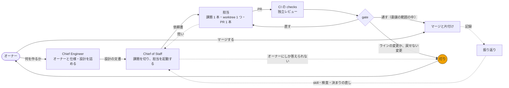

<p><picture><source media="(prefers-color-scheme: dark)" srcset="docs/assets/logo/andon-wordmark-dark.svg"></picture></p>

[English](README.md) | 日本語

# Andon

**Andon — a one-person software factory.** 一人で使うソフトウェア工場。エージェントが kanban の課題を実装・レビュー・マージまで流し、オーナーは自分にしかできない決断のときだけ呼ばれる。kanban は、プロジェクトごとの課題・問い・ルーチン・履歴を置くファイル群で、`kanban` コマンドで読み書きする。

> [!NOTE]
> Andon は、作者が学習と実験のために個人で作り、自分の仕事で使っているもの。不安定で、コマンド・形式・文書は断りなく変わり、壊れることもある。サポートと互換の約束は無く、今は PR も受け付けていない。

## どう回るか



課題 1 本は、次の順でマージまで行く。

1. オーナーが、何を作るかを Chief Engineer と対話で決める。Chief Engineer は仕様と設計を自分で調べて作り込み、文書にして Chief of Staff へ渡す。実装も課題を切ることもしない。
2. Chief of Staff は文書を課題に切り、課題ごとに依頼書を書いて担当を起動する。担当は課題 1 本につき 1 つの worktree で働き、自分の工程でテストを通して PR を出す。
3. CI の checks が PR を見る。独立レビューを入れた課題では、実装と別ブランドのモデルのレビュアーも見る。レベル B の変更を自動でマージするには、この独立レビューが要る。レビュアーは指摘を重さつきで返すだけで、直すのは担当である。
4. gate が、条件表と checks からマージしてよいかを決める。直すものがあれば担当へ戻す。レベル A はテストが通れば、レベル B は独立レビューが通れば、委譲の範囲の中で自動でマージする。レベル C（ラインそのものの変更と、戻せない変更）はオーナーがマージする。マージを打って片付けるのは、セルに常駐する dispatcher である。
5. 担当の問いは kanban を通って Chief of Staff へ行く。Chief of Staff は、オーナーにしか答えられない問いだけを灯りにしてオーナーへ回す。オーナーの答えは kanban を通って担当へ戻る。
6. 振り返りがマージの記録を読み、つまずきの元になった skill・検査・決まりを直す PR を出す。

## オーナーが呼ばれるとき

オーナーが呼ばれるのは、次の 5 種の決断のときだけである。

| 決断 | 例 | 呼ばれ方 |
|---|---|---|
| 何を作るか | 新しい機能・どのプロジェクトを足すか | オーナーが Chief Engineer と対話する |
| 利用者の挙動 | 画面でどう見え、どう動くか | 問い |
| 外との約束 | 外のトラッカー・外への送信・API の約束 | 問い |
| 戻せないリスク | push 先の変更・削除・本番・資格情報 | 操作の直前で止まって待つ |
| ラインそのものの変更 | gate の条件表・skill・設定・フック・Dockerfile | gate がレベル C にし、オーナーがマージする |

ふだんの差分のレビュー、ふだんの PR のマージ、片付け、通知の仕分けでは呼ばれない。差分のレビューはレビュアー、マージは gate と dispatcher、片付けは dispatcher、通知の仕分けは Chief of Staff が受け持つ。

誰が決断するかは、プロジェクトごとにオーナーが Chief of Staff へ任せられる。趣味のプロジェクトなら、レベル C のマージやデプロイまで任せてよい。ただし、何を作るかと、リモートの削除は、どのプロジェクトでも任せられない。

オーナーの画面の行燈は、消灯・琥珀・赤の 3 つで灯る。琥珀はオーナーが呼ばれている印で、答えるかマージすれば進む。赤は端末が失敗して止まっている印である。

## 選択的 Dark Factory と名前

設計の言葉では「選択的 Dark Factory」と呼んでいる。Dark Factory は、床に人間がいないので灯りを消して回る工場のこと。Andon はそのうち、止められるものは機械（テストと gate）、判断が要るものは LLM、決断が要るものだけをオーナーが見る。

名前はトヨタ生産方式のアンドン（ラインの異常を知らせて監督者を呼ぶ灯り）から取った。ラインは、灯りがつかない限り監督者を待たずに回る。製造業のアンドン製品ではない。

## セル

Andon は一人のソフトウェア工場を、2 つの面で言い分ける。セルは場所の面で、信頼の境界（1 つの顧客・1 つの趣味など）ごとに 1 つ立てて長く動かすコンテナである。Andon はしくみの面で、セルの中で守る規律（役・工程・gate・約束）である。

| 考え方 | 何がうれしいか |
|---|---|
| セルのルートディレクトリが、そのまま git の repo（セルの repo）になっている | 指針・skill・wiki・プロジェクトの定義が履歴に残り、別のマシンへ持ち運べ、clone から立て直せる。kanban は同じ場所の git の外に置く。 |
| イメージが境界になる | 案件のあいだで、ファイル・資格情報・ログインが混ざらない。 |
| 要る道具はイメージが持つ | どのセルでも同じ道具が同じバージョンで揃い、ホストに要るのは Docker と bash だけ。Andon を上げるのは `FROM` を上げる PR 1 本で済む。 |
| 案件の repo は、セルの中へ clone するだけ | 担当は課題ごとの worktree から PR を出す。案件の repo に kanban やセルの設定は入らない。 |

何を追跡し何を外すかは [ADR-0005](docs/adr/0005-cell-repo.md)、2 つの面の言い分けは [ADR-0029](docs/adr/0029-factory-place-and-mechanism.md) にある。

## 向いている読み手と今の状態

向いているのは、コーディングエージェントを既に端末でいくつも動かしていて、自分が離れているあいだも進めてほしいが、マージと戻せない操作の手綱は手放したくない 1 人の開発者である。まず作者自身が使うために作っている。

使うには、Linux か WSL のホストに Docker と bash が要る。セルのイメージはエージェントの CLI（Claude Code と Codex）と端末の herdr を持っているが、そのアカウントは自分のものを使う。

向かないのは、チームで使う、ホストされたサービスとして使う、互換の約束が要る、という使い方である。

今は v0.0.x のバージョンを切っていて、バージョンごとの変更と上げるときにすることは [CHANGELOG.md](CHANGELOG.md) にある。Andon は Andon のセルの中で開発していて、流れた PR は[マージ済みの PR の一覧](../../pulls?q=is%3Apr+is%3Amerged)で見られる。

なぜ作るか（モデルに置き換わっていくとしても）: Andon の部品の多く（役の分け方・引き継ぎの決まり・dispatcher）は、今のモデルとハーネスにまだできないことを補っている。モデルとハーネスが育てば、そちらへ移って要らなくなる前提で、Andon は縮むように作る。それでも作る理由は 2 つある。1 つは、この流れを自分で体験し、経験値にするため。基盤が何を肩代わりでき、どこで詰まり、何を渡してはいけないかは、自分で工場を回さないと分からない。もう 1 つは、セルの repo をホームディレクトリのように使い続けるため。セルの指針・skill・wiki・プロジェクトの定義は、セルの repo にふだんのファイルで残り、セルの上で動く仕組みが替わっても持ち越せる（[セル](#セル)）。何を外すかも、書いたものから決める。Chief of Staff の手引きは 1 本ごとに消す条件を持ち（[決定の記録](docs/decisions/2026-11-13-cos-principles-playbooks.md)）、振り返りはモデルが替わって要らなくなった指示を削る候補に挙げる。

## 始め方

セルの repo は `andon cell init <slug>` で作る。手順の本体（ホストで打つ順と、各段で見えるもの）は [docs/operate.md](docs/operate.md) にある。

```bash
andon cell init <slug> --image ghcr.io/<owner>/andon:<バージョン> --owner <email>
cd <slug>-cell && bin/bootstrap            # イメージを焼き、入口の本体と compose.yaml をイメージから取り出して起動する
bin/bootstrap host-install                  # ホストの andon-up・ssh config・herdr の設定などを置く（今あるものは上書きしない）
```

セルの repo の `bin/bootstrap` は薄い入口で、動きはイメージの中の本体が持つ。Andon のバージョンを上げると、入口の動きも一緒に新しくなる。

## 文書の地図

| パス | 何があるか |
|---|---|
| [docs/design.md](docs/design.md) | Andon とは何か・語彙・repo の構成と道具の選定（設計の本体） |
| [docs/vision.md](docs/vision.md) | ビジョン・ミッション・バリューの 1 枚と、工程・役・仕組みの図 |
| [docs/contract.md](docs/contract.md)・[schema/](schema/) | 機械向けの約束（kanban の項目・指摘・報告・問い・通知・gate・委譲）。正は `schema/` |
| [docs/operate.md](docs/operate.md) | セルを立てて課題を 1 本流す手順 |
| [docs/commands.md](docs/commands.md) | andon のコマンドの全部と、誰が打つか |
| [docs/dispatcher.md](docs/dispatcher.md)・[docs/ledger.md](docs/ledger.md)・[docs/image.md](docs/image.md) | dispatcher（常駐の係）・kanban の CLI と形式・セルのイメージ |
| [docs/process/](docs/process/README.md) | Chief of Staff の定常の仕事と、状態の移り方の定義（`process/` の YAML から作る） |
| [model/](model/README.md) | 課題の一生の形式モデルと、その検査 |
| [docs/adr/README.md](docs/adr/README.md) | ADR の読み方と一覧 |
| [docs/decisions.md](docs/decisions.md)・[docs/decisions/](docs/decisions/) | 決定の記録（2026-11-07 からは 1 件 1 ファイル） |
| [CHANGELOG.md](CHANGELOG.md) | バージョンごとの変更と、上げるときにすること |
| [AGENTS.md](AGENTS.md)・[REVIEW.md](REVIEW.md) | この repo で働く担当の指針と、レビュアーの観点 |
| `cmd/`・`internal/` | `andon` と `kanban` の CLI（Go） |
| `package/` | セルの `/opt/andon` に入るもの（skill・プロファイル・gate の条件表・settings・フック・compose・ホスト用の雛形）。中身は design.md §2.2 と image.md |
| `image/`・`init/` | ベースイメージと、`andon cell init` が写すセルの repo の雛形 |
| [tests/](tests/README.md) | PR ごとに回すシェルの検査 |

## 開発と履歴

```bash
go test ./...
tests/run --changed     # 変えたものに関係する tests/*.sh だけ。引数なしで全部
```

PR ごとに GitHub Actions が回す。`tests/public.sh` は、秘密の形と repo の外に置いた固有の値の禁止リストを全部のファイルに当てる。

文書と commit メッセージにある `Y-<数>`（`Y-123` など）は、前身の仮設の工場の kanban の番号で、この repo の課題の id（`A-0001` の形）とは別物。履歴は書き換えない。

## 貢献・脆弱性・ライセンス

1 人用の repo なので、今は PR を受け付けていない。脆弱性の知らせ方は [SECURITY.md](SECURITY.md)。ライセンスは [Apache-2.0](LICENSE)。
