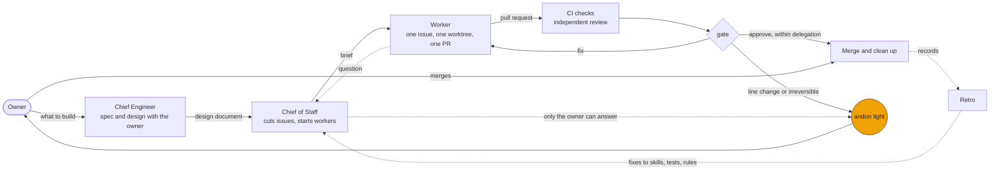

<p><picture><source media="(prefers-color-scheme: dark)" srcset="docs/assets/logo/andon-wordmark-dark.svg"></picture></p>

English | [日本語](README.ja.md)

# Andon

**Andon — a one-person software factory.** AI coding agents take issues from a kanban through implementation, review and merge. The owner is called only for the decisions that only they can make. The kanban is a set of files per project that holds issues, questions, routines and history; the `kanban` command reads and writes it.

> [!NOTE]
> Andon is a personal project. Its author builds it to learn and experiment, and uses it for their own work. It is unstable: commands, file formats and documents change without notice, and things break. There is no support and no compatibility promise, and pull requests are not accepted for now.

## How it works



One issue goes to merge in this order.

1. The owner decides what to build in a dialogue with the Chief Engineer. The Chief Engineer researches and works out the spec and design, and hands them to the Chief of Staff as a document. It neither implements nor cuts issues.
2. The Chief of Staff cuts the document into issues, writes a brief for each, and starts a worker. A worker works in one worktree per issue, passes the tests in its own step, and opens a pull request.
3. The CI checks look at the pull request. For issues that get an independent review, a reviewer running a model of a different brand from the implementer looks at it too. A tier B change needs this independent review to merge automatically. The reviewer only returns findings with a severity; the worker fixes them.
4. The gate decides from rules and the checks whether the pull request may merge. If something must be fixed, it goes back to the worker. Tier A merges automatically when the tests pass, and tier B when the independent review passes, within the delegation. Tier C (changes to the line itself and irreversible changes) is merged by the owner. The dispatcher, a program that stays running in the cell, does the merge and cleans up.
5. A worker's questions go to the Chief of Staff through the kanban. The Chief of Staff passes on to the owner, as the andon light, only the questions that only the owner can answer. The owner's answer goes back to the worker through the kanban.
6. A retrospective reads the records of merges and opens pull requests that fix the skills, tests and rules that caused trouble.

## When the owner is called

The owner is called only for these five kinds of decisions.

| Decision | Examples | How the owner is called |
|---|---|---|
| What to build | A new feature, which project to add | The owner talks with the Chief Engineer |
| How users experience it | How a screen looks and behaves | A question |
| Promises to the outside | Outside trackers, sending outside, API promises | A question |
| Irreversible risks | Changing where to push, deleting, production, credentials | The line stops right before the operation and waits |
| Changes to the line itself | Gate rules, skills, settings, hooks, Dockerfile | The gate makes it tier C, and the owner merges |

The owner is not called for reviewing ordinary diffs, merging ordinary pull requests, cleaning up, or sorting notifications. The reviewer reviews diffs, the gate and the dispatcher merge, the dispatcher cleans up, and the Chief of Staff sorts notifications.

For each project, the owner can delegate to the Chief of Staff who makes these decisions. For a hobby project, even tier C merges and deploys can be delegated. What to build, and deleting remotes, cannot be delegated in any project.

The andon light on the owner's screen has three states: off, amber and red. Amber means the owner is being called; answering or merging lets the line go on. Red means a terminal has failed and stopped.

## Selective dark factory, and the name

The design calls this a *selective dark factory*. A "dark factory" is a factory that runs with the lights off because no person is on the floor. Andon is selective: machines stop what machines can decide (tests and the gate), language models handle what needs judgment, and the owner sees only the decisions.

The name comes from the andon of the Toyota Production System, the light that signals a problem on the line and calls a supervisor. The line keeps running without waiting for the supervisor unless the light turns on. Andon is not a manufacturing-floor andon product.

## The cell

Andon describes a one-person software factory from two sides. The cell is the place: a long-lived container set up one per trust boundary (one client, one hobby, ...). Andon is the mechanism: the discipline kept inside the cell (roles, steps, the gate, contracts).

| Idea | What it gives you |
|---|---|
| The root directory of the cell is itself a git repository (the cell repo) | Instructions, skills, the wiki and project definitions are versioned, can move to another machine, and the cell can be rebuilt from a clone. The kanban sits in the same place, outside git. |
| The image draws the boundary | Files, credentials and logins do not mix between clients. |
| The image carries the tools | Every cell has the same tools at the same versions, and the host needs only Docker and bash. Upgrading Andon is one pull request that bumps `FROM`. |
| Client repositories are only cloned into the cell | Workers open pull requests from per-issue worktrees. The kanban and the cell settings never go into client repositories. |

What is tracked and what is left out is in [ADR-0005](docs/adr/0005-cell-repo.md), and the two sides are in [ADR-0029](docs/adr/0029-factory-place-and-mechanism.md) (Japanese).

## Who it is for, and status

It is for one developer who already runs several coding agents in terminals and wants them to keep working while the developer is away, without giving up control of merges and irreversible operations. It is built for its author's own use first.

You need a Linux or WSL host with Docker and bash. The cell image bundles the agent CLIs (Claude Code and Codex) and the terminal workspace herdr; you bring your own accounts for them.

It does not suit team use, use as a hosted service, or use that needs a compatibility promise.

Versions are cut as v0.0.x for now. What changed in each version, and what to do when upgrading, is in [CHANGELOG.md](CHANGELOG.md) (Japanese). Andon is developed inside an Andon cell, and the pull requests that went through are in the [list of merged pull requests](../../pulls?q=is%3Apr+is%3Amerged).

Why build it, if models will absorb it: much of Andon (the split into roles, the hand-off rules, the dispatcher) makes up for what today's models and harnesses cannot do yet, and is expected to move into them as they grow. Andon is built to shrink. It is built anyway, for two reasons. First, the author wants to live through this shift and turn it into experience: what a platform can take over, where it breaks, and what must not be handed to it are learned only by running a factory yourself. Second, the cell repo is run as a home repo, close to a home directory. The cell's instructions, skills, wiki and project definitions stay in it as plain files, so they carry over to whatever runs on top of the cell next ([The cell](#the-cell)). What to remove is decided from what is written down, too: each playbook of the Chief of Staff states the conditions under which it, or a part of it, can be deleted ([decision, Japanese](docs/decisions/2026-11-13-cos-principles-playbooks.md)), and retrospectives propose removing instructions that a newer model no longer needs.

## Getting started

A cell repo is created with `andon init <slug>`. The step-by-step procedure (the order of commands on the host, and what you see at each step) is [docs/operate.md](docs/operate.md) (Japanese).

```bash
andon init <slug> --image ghcr.io/<owner>/andon:<version> --owner <email>
cd <slug>-cell && bin/bootstrap            # build the image, take the entry's body and compose.yaml out of it, and start the cell
bin/bootstrap host-install                  # put andon-up, the ssh config, the herdr settings and more on the host (does not overwrite)
```

The cell repo's `bin/bootstrap` is a thin entry; its behavior lives in a body inside the image. Upgrading Andon updates the entry's behavior too.

## Map

Most documents are written in Japanese; English is added only where needed.

| Path | What is there |
|---|---|
| [docs/design.md](docs/design.md) | What Andon is, its vocabulary, the repo layout and tool choices (the main design document) |
| [docs/vision.md](docs/vision.md) | Vision, mission and values on one page, with a figure of the line's steps, roles and mechanisms |
| [docs/contract.md](docs/contract.md), [schema/](schema/) | Machine-readable contracts (kanban keys, findings, reports, questions, notifications, gate, delegation). `schema/` is the source of truth |
| [docs/operate.md](docs/operate.md) | How to set up a cell and run one issue |
| [docs/commands.md](docs/commands.md) | Every `andon` command, with who runs it |
| [docs/dispatcher.md](docs/dispatcher.md), [docs/ledger.md](docs/ledger.md), [docs/image.md](docs/image.md) | The dispatcher (resident program), the kanban CLI and format (English), the cell image |
| [docs/process/](docs/process/README.md) | The Chief of Staff's recurring work and the state machines, rendered from the YAML in `process/` |
| [model/](model/README.md) | The formal model of an issue's life, and its checks |
| [docs/adr/README.md](docs/adr/README.md) | How to read the architecture decision records, and their list |
| [docs/decisions.md](docs/decisions.md), [docs/decisions/](docs/decisions/) | The decision log (one file per decision from 2026-11-07) |
| [CHANGELOG.md](CHANGELOG.md) | What changed in each version, and what to do when upgrading |
| [AGENTS.md](AGENTS.md), [REVIEW.md](REVIEW.md) | Instructions for workers in this repo, and what reviewers look at |
| `cmd/`, `internal/` | The `andon` and `kanban` CLIs, in Go |
| `package/` | What is shipped into the cell at `/opt/andon` (skills, agent profiles, gate rules, settings, hooks, compose file, host templates). Details are in design.md §2.2 and image.md |
| `image/`, `init/` | The base image, and the template that `andon init` copies into a new cell repo |
| [tests/](tests/README.md) | Shell tests run on every pull request |

## Development and history

```bash
go test ./...
tests/run --changed     # only the tests/*.sh related to what you changed; no argument runs all
```

GitHub Actions runs them on every pull request. `tests/public.sh` checks every file for the shapes of secrets and for a denylist of personal values kept outside the repo.

`Y-<number>` (such as `Y-123`) in documents and commit messages is an issue number from the kanban of the interim factory that came before Andon, not an issue id of this repo (shaped like `A-0001`). The history is not rewritten.

## Contributing, security and license

This is a one-person project and does not take pull requests for now. To report a vulnerability, see [SECURITY.md](SECURITY.md). The license is [Apache-2.0](LICENSE).
