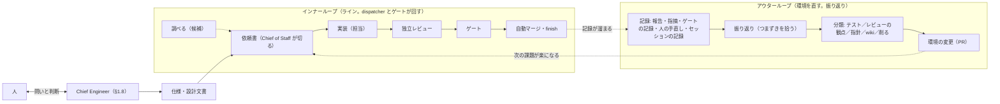
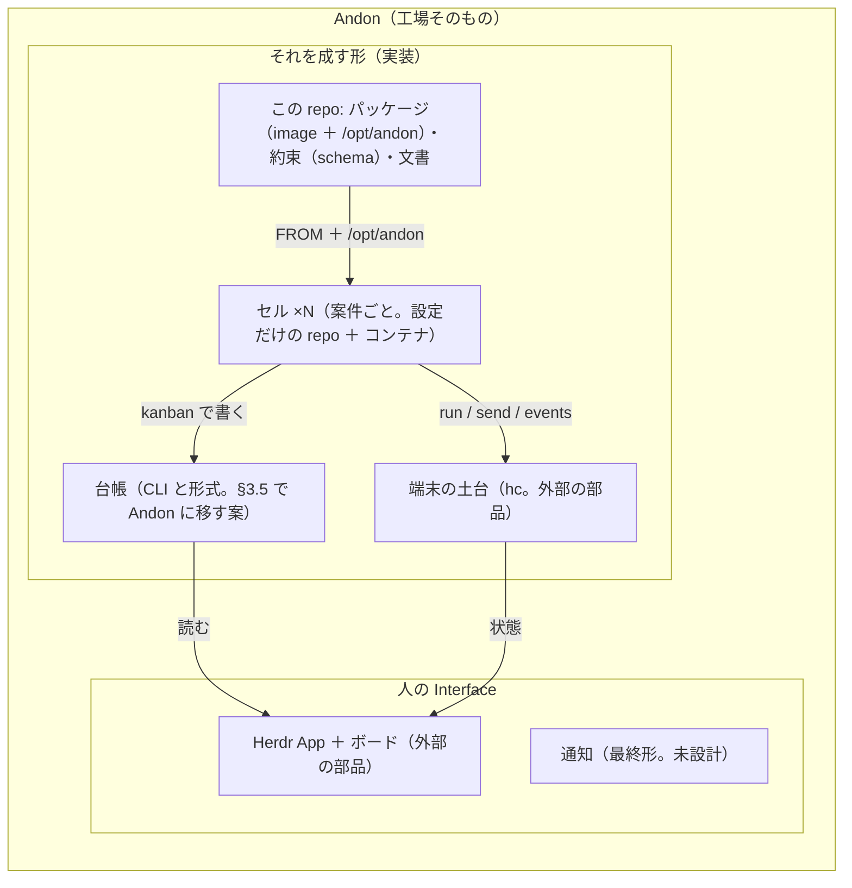
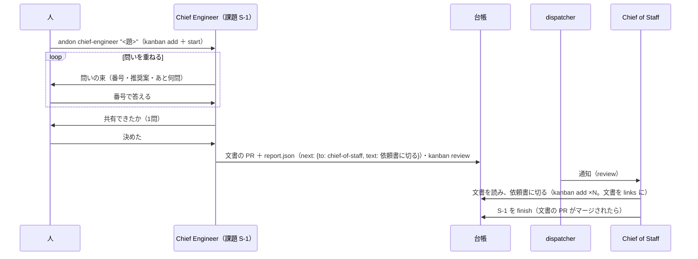

# Andon の設計（最初の版）

- 状態: **設計の提案**（2026-11-04 起草、2026-11-05 書き直し）。実装はしない。読んだ人がどこから建てるかを決める。
- **読み手の前提**（人、2026-11-05）: この文書は **Andon の repo だけを読む人**のために書く。今動いている工場（以下「仮設の工場」。§3 で棚卸しする）を知らなくても読める。仮設の道具の名前（yard・deck・flightdeck）は §3 と §5 にだけ出し、本文の役と部品は Andon の名前で呼ぶ（§0.1）。語彙はリーン開発（Lean Software Development・Kanban Method）の英語を先に置き、トヨタ生産方式（TPS）を出典として添える（§1.7）。
- 人の決定（日付つき）:
  - 2026-11-04: 自分のソフトウェアファクトリーに **Andon** と名前を付けて育てる。Andon は**工場そのもの（構造）の名前**で、今の実装（仮設の工場）はそれを成す形の1つ。Andon はこの repo `<owner>/andon` に一から建て、一定できあがったら Andon 専用のセルを用意し、Andon の上で Andon を開発する（セルフホスト）。理由: 今は道具が散らばっていて管理しにくい。
  - 2026-11-04: **最終的に public にする**つもりで開発する（今は private。§2.6）。
  - 2026-11-04: 台帳の CLI と形式は、Andon に合わせた名前で Andon のモノレポに入れてよい（§3.5。段取りは持ち主と決める）。
  - 2026-11-04: 部品と役の名前は TPS の語彙を調べて当てる。ソフトウェアに移された系譜（リーン開発・Kanban Method）も同じ表に（§1.7）。
  - 2026-11-04: **仕様・設計を人と対話する役（Chief Engineer）を、ラインを回す役（Chief of Staff）と分ける**（§1.8）。
  - 2026-11-04: Warp の software factory（Zach Lloyd の講演）を読み、取り入れるものと違えるものを書く（§1.9）。
  - 2026-11-05: 読み手は Andon の repo だけを読む人。ラインを回す役の名前は **Chief of Staff**。語彙はリーン開発を意識する。
  - 2026-11-05: **道具の選定もこの時点である程度しておく**（base image・CLI の言語など。§2.7）。
  - 2026-11-05: **§6 の 27 問すべてに人の答えが出た**（§6 の右の列。推奨と違ったのは 2〈係は `dispatcher`〉・10〈セルの自動 push は捨てる〉・11〈日本語から始め、必要になったら英語〉・26〈`hobby` は全部任せる〉）。決定は P1 で `docs/decisions.md` に写す。
  - 2026-11-05: **オーナー（人）と Chief of Staff の間の委譲の状態をファイルで持つ**（何をどこまで任せたか。範囲・付与した人・日付・期限・取り消し・根拠つき。§1.10）。委譲の広さは案件ごとに違う——「趣味の開発ならマージやデプロイは勝手にしてくれてもいい」——ので、既定の型から足し引きする形に。
- 入力（正）: 仮設の工場の設計文書（決定 1〜15 と残る問い）と、人との議論の記録（2026-11-04。ハーネスは薄く・人用／AI 用／機械用の記述を分ける・開発体験を損なわない・ダブルループ構造・名前 Andon・新しく建てる・セルフホスト）。どちらも private の記録なので、決定は Andon の `docs/decisions.md` に日付と出典つきで写す（§5.2 の P1）。この文書は決まったことを**前提として使い、繰り返さない**。主題は「その配線を新しい repo にどう置くか」。
- 書き手: Andon を設計する担当エージェント（最上位のモデル）。読んだ版は付録。

---

## 0. 一言で

**Andon は「選択的 Dark Factory」。止められるものは機械、判断が要るものは LLM、残りだけ人。ラインは回り続け（AND ON）、人を呼ぶときだけ灯りがつく（アンドン）。**

この repo に建てるのは、その工場の**パッケージ**（セルの base image と `/opt/andon`）と**約束**（機械が読む形）と**文書**（人用・AI 用）で、**案件のデータは持たない**。セルは Andon のパッケージを `FROM` で指す設定だけの repo になり、更新は版上げの PR 1本になる。

**最初の commit から public に耐える形で建てる**（§2.6）: 秘密と、案件や個人に固有の値は repo に入れず、利用者側の設定に出す。履歴に残ると消せないので、PR ごとにテストする。

最初の到達点（§5.1）: **Andon のセルを1つ立て、その中で Andon 自身の PR が1本、人がレベル C と不可逆な操作以外に触らずに流れる。** そこまでを §5.2 の手に切った。

### 0.1 語彙（この文書の語と英語）

役と部品は Andon の名前で呼ぶ。括弧は識別子（CLI・ファイル・ラベル）に使う英語。出典と選んだ理由は §1.7。

| 語 | 英語 | 意味 |
|---|---|---|
| **Andon** | andon | 工場そのもの。構造の名前。この repo はそれを成す形の1つ |
| **セル** | cell | 案件（信頼境界）ごとに1つ立てる長寿命のコンテナと、その設定 repo（`<slug>-cell`）。手元にもクラウドにも立つ。出典はリーンのセル生産（§1.7）。前の語は §2.4 |
| **パッケージ** | package | この repo からセルに配るもの一式: base image と `/opt/andon/`（command・skill・プロファイル・フック・ゲートの条件表・環境メモ・ホスト用） |
| **ライン** | line | 課題が依頼書からマージまで流れる工程の列（＝インナーループ）。「ラインそのものの変更」はゲートの条件表・skill・設定・フックの変更 |
| **灯り** | andon light | 人の判断待ち。灯りがつく条件は §1.3 の5種だけ |
| **台帳** | ledger | セルのプロジェクトごとに1つ。課題・問い・ルーチン・履歴を持つファイル群。書くのは台帳の CLI（`kanban`。§3.5）だけ |
| **課題** | issue | 台帳のカード1枚。何が困っていて、何が出れば解けたか（解決すべき問題）と完了条件を持つ。かんばん（§1.7）。台帳に乗る |
| **作業** | task | 担当が計画で課題を分けた単位。1つの課題に1つ以上。担当の報告の `## 計画` に1行ずつ置き、終了条件を持つ。台帳に乗らない（[ADR-0008](adr/0008-issue-naming.md)） |
| **依頼書** | brief | 課題の文書（背景・完了条件・守ること・Settings）。人と AI が読む |
| **報告** | report | 担当が課題ごとに書く結果。人用の Markdown と機械用の JSON（§4） |
| **問い** | question | 人の判断を求める1通。判断の種類・事実・理由・選択肢・推奨案・あと何問 |
| **通知** | notification | dispatcher が Chief of Staff へ届ける機械の合図（報告が書かれた・レビューに入った・ゲートが判定した…）。人は呼ばない |
| **Chief Engineer（主査）** | chief-engineer | 人と仕様・設計を対話し、文書にしてラインへ渡す役。実装も課題切りもしない（§1.8） |
| **Chief of Staff（CoS）** | chief-of-staff | ラインを回す役。文書を依頼書に切り、担当を起こし、検収し、振り返りをする。人と設計の対話はしない（§1.8） |
| **担当** | worker | 1つの課題のために起きるエージェント。自分の worktree の中だけで働き、報告を書いて終わる |
| **レビュアー** | reviewer | 実装と別ブランドのモデルで、書いていない目で commit を読み、指摘を重さつきで返す。直さない |
| **dispatcher** | dispatcher | セルに1つ常駐するプログラム（仕事の出典は TPS の水すまし〈water spider〉。名前はソフトウェアで聞き馴染みのある英語の dispatcher にした〈人、2026-11-06〉。§1.7。`runner` は CI の runner と紛れるので使わない）。台帳と端末を周期で回り、通知を届け、レビュアーを起こし、ゲートを回し、片付ける。判断はしない。設計は [dispatcher.md](dispatcher.md) |
| **ゲート** | gate | PR をマージしてよいかの決定式。条件表（JSON）と PR の head の GitHub の checks を読み、`approve`／`fix`／`needs_human` を返す（checks が揃うまでは `wait`）。レベル A・B・C（下） |
| **レベル A／B／C** | tier | ゲートが変更ごとに決める段階。A＝テストが通れば自動マージ、B＝独立レビューつきで自動マージ、C＝人がマージ（ラインそのものの変更・不可逆なもの） |
| **振り返り** | retro | アウターループのルーチン。記録を読んでつまずきを拾い、環境を直す PR を出す |
| **トリアージ** | triage | 報告の「次にやること」を集めて、課題に切る・捨てる・寝かせるを決める手 |
| **プロファイル** | profile | エージェントの起こし方（CLI・モデル・effort）の名前。端末の土台の template が中身を持つ |
| **ルーチン** | routine | 台帳にある定期の仕事（振り返り・トリアージ・見回り） |
| **委譲** | delegation | オーナーが Chief of Staff（と dispatcher・担当）に任せた範囲。プロジェクトごとのファイルで持ち、人だけが書く（§1.10） |
| **指揮側／作業側** | control／work | セルの中の2段。指揮側＝人・Chief of Staff・dispatcher・ゲート・台帳・wiki。作業側＝担当・レビュアー（別のマシンでもよい） |
| **インナーループ／アウターループ** | inner／outer loop | 内側＝ライン。外側＝振り返り。合わせて**ダブルループ** |
| **仮設の工場** | interim factory | 今動いている工場。Andon を建てる間だけ使い、保守は運用を止めない程度（§3・§5） |
| **セルフホスト** | self-hosting | Andon のセルの中で Andon を開発する状態 |
| **外部の部品** | — | Andon が使うが持たないもの。端末の土台 **hc**（herdr-core。エージェント用の永続する端末。Apache-2.0）、人の Interface **Herdr App** と**ボード**（herdr-flightdeck。全セルの自分待ちを1画面で見る Web ボードと画面の mod。別プロジェクトの持ち物） |

---

## 1. Andon とは何か

### 1.1 名前

- **アンドン（行灯）**: トヨタ生産方式の「アンドン」は、ラインの異常を知らせるランプ。作業者が紐を引いて灯りをつけ、人（監督者）を呼ぶ。ラインは、灯りがつかないかぎり人を待たずに回る。これは Andon の像そのもの——**人に灯りをつけるのは判断が要るときだけ**（§1.3）で、それ以外は機械と LLM が回す。
- **And ON**: 「そして、続く」。ラインは止まらずに回り続ける。マージは自動、片付けも自動、人が見ていない夜も回る（クラウド常駐）。
- **モチーフは未決**（人）。案:

| モチーフ | 何を表すか | 合うところ | 合わないところ |
|---|---|---|---|
| **三色ランプ**（トヨタ式のアンドン） | 緑＝流れている・黄＝人の判断待ち・赤＝止まった | エージェントの状態（working・blocked・finished）とボードの列（Working・Needs you・Done）に**そのまま写る**。「灯りがつく＝人を呼ぶ」の意味が通じる | 工場の絵が強く、趣味の工房の雰囲気からは遠い |
| **行燈**（紙の灯り） | 人の手元を照らす、柔らかい1つの灯り | 「And ON」と日本語の両方に掛かる。Herdr App の画面（暗い背景に1つの灯り）に合う | 「止める・呼ぶ」の意味は無い。状態の色分けには使いにくい |

推奨: **意味は三色ランプから、絵は行燈から**取る。文書と画面の語彙は「灯りがつく＝人の判断待ち」「緑・黄・赤」で揃え、ロゴや README の絵柄は行燈でよい。最終決定は人（§6 の問い1）。

### 1.2 選択的 Dark Factory と、リーンの原則

**選択的 Dark Factory**（出典: freee の講演「freee における規模の実践」。付録）: 人が全工程を見る工場（速くならない）でも、人を排除した工場（誰にも理解されない成果物が溜まる）でもなく、**判断が要るところだけ人が見る**工場。KPI は人の介在率で、「見なくていい」範囲を広げ続ける。freee のハーネスの原則「ガイドで渡し、センサーで止め、二重レビューで確かめ、誤りは上流から直す」は、Andon では 依頼書（ガイド）・テストとゲート（センサー）・独立レビューとレベル C（二重レビュー）・振り返り（上流から直す）に当たる。

これをリーン開発の語で言い直すと、Andon が守る原則は4つ:

1. **流れ（flow）を止めない。** 課題は pull で流れ（担当は依頼書を引き取り、dispatcher が次の工程を起こす）、人の判断待ちは流れを止めずに脇に置く（§1.3）。
2. **仕掛り（WIP）を制限する。** 同時に走る担当の数・1プロジェクトに1題の設計・レビューの往復の上限（§1.7）。
3. **品質を作り込む（build quality in）。** テストで見つけるのではなく工程で作り込む: 担当は自分の工程でテストを通してから渡し、ゲートは異常なら止める（§1.3・§4）。
4. **全体を見て直す（see the whole）。** 部分ではなく流れ全体を測り（§5.1 の指標）、振り返りが環境を直す（§1.4）。

### 1.3 人に灯りをつける判断は5種

| # | 判断 | Andon での口 |
|---|---|---|
| 1 | 事業判断（何を作るか・どのプロジェクトを迎えるか） | 人が **Chief Engineer** と対話して決め、仕様・設計文書にして Chief of Staff へ（§1.8） |
| 2 | 利用者の挙動 | 問い（`kind: users`） |
| 3 | 外との契約や制約（外部トラッカー・外向きの送信・API の約束） | 問い（`kind: promise`）。他のプロジェクトから委譲された依頼は人の承認とみなさない |
| 4 | 不可逆なリスク（push 先の変更・削除・本番系・資格情報） | 問い（`kind: irreversible`） |
| 5 | **ラインそのものの変更**（ゲートの条件表・skill・設定・フック・Dockerfile） | ゲートの**レベル C**（人がマージする） |

**範囲の判断**（担当が見つけたもののどれを直すか）は Chief of Staff が持ち、灯りはつかない（候補が上の 1〜5 に当たる分だけ人へ。[ADR-0006](adr/0006-survey-fix-decide.md) 決めたこと 5）。これ以外に灯りはつかない。ゲートが通したものは自動でマージし、人はレベル C と不可逆な操作だけ見る。**判断の種類はどの案件でも同じ**だが、2〜5 の「誰が判断するか」は案件ごとの委譲（§1.10）で変わる: 趣味の案件ならレベル C のマージやデプロイも Chief of Staff に任せられる。1（何を作るか）だけは委譲できない。**問いは「1通で答えられる形」**（何の判断か・事実・理由・選択肢・推奨案・あと何問）に揃える（形は [contract.md](contract.md) §5）。理由: 返す口は最終的に通知になるので、文脈なしで読めて1通で答えられる形を今から揃える。

### 1.4 ダブルループ



- ラインの入口は **Chief Engineer**（§1.8）: 人と仕様・設計を対話し、文書にして Chief of Staff へ渡す。Chief of Staff はそれを依頼書に切る。
- 担当の工程の背骨は **理解 → 計画 → 作業 → 確認 → 完成 → 振り返り**（[ADR-0006](adr/0006-survey-fix-decide.md) 決めたこと 9〜11）。担当が主体で、依頼書（課題と完了条件）を自分で理解して作業に分け、作業ごとに終了条件を置く。**横展開**（同じ種類のものをほかにも探す）は既定で、範囲の中は直し、外は残し、範囲を決めないと作業が切れないときだけ止まる（候補の一覧 `candidates.json` と `scope` の問いで止まり、答えるのは Chief of Staff）。
- 依頼の完了条件が「分かる・候補が出る」なら、インナーループの入口に**調べる課題**が入る（`deliverable: candidates`）。担当は直さず候補の一覧と報告を返し、Chief of Staff が候補から直す課題を切る。調べる課題にゲートと独立レビューは無い（[ADR-0006](adr/0006-survey-fix-decide.md) 決めたこと 1・7）。
- インナーループは**dispatcher が回す**（レビュアーの起動・ゲート・マージ・片付け）。Chief of Staff はラインを回す判断だけ（依頼書に切る・`needs_human` の検収・問いの中継）。仕様・設計の会話は Chief of Staff の仕事ではない。
- アウターループの改善を入れる判断は**ラインを2つに分ける**: 案件 repo のテスト・レビューの観点・指針（`AGENTS.md`）は Chief of Staff の判断で無灯、Andon 自身のライン（ゲート・skill・規約・設定）の変更だけ人（§1.3 の 5）。
- 振り返りの入力は自己申告だけでなく、機械が残す記録（指摘・ゲートの記録・報告の機械向けの部分・人の手直し）と、セッションの記録。**記録を機械向けの形で残す**（§4）のは、このループのため。

### 1.5 人は判断だけ。手元とクラウド。作業側は別のマシンでもよい

- 人は判断だけする。実装・レビュー・ゲート・片付け・通知の仕分けは人の仕事ではない。
- セルは増え、散らばる。手元（WSL）にも、クラウド常駐（PC を閉じても回る）にもある。どちらも**同じセルの repo・同じパッケージ・同じ bootstrap**。
- セルの中の2段（指揮側／作業側）は、**マシンの境**にもできる。指揮側（人・Chief of Staff・dispatcher・ゲート・台帳・wiki）は1つのマシン、作業側（担当・レビュアー）は同じマシンでも別のマシンでもよい。台帳は指揮側に1つ。作業側からの入口は `andon issue …` の command に閉じ、別のマシンなら command が端末の土台（hc）越しに写す。人の Herdr App の画面でもこの2段で分ける（指揮側の Space と課題ごとの Space。[ADR-0002](adr/0002-herdr-spaces.md)・[ADR-0003](adr/0003-task-spaces.md)）。
- **常駐・定期の処理は、指揮側のマシンで 1 者だけが走らせる**。どの処理を誰が・二重に走ったら何が起きるか・今の守りと無い所は [dispatcher.md](dispatcher.md) §7 の表。作業側を別のマシンに出す前の前提を確かめるのに使う。
- 返す口は、まずは各セルの Chief of Staff の端末、最終的には通知。だから問いの形を今から揃える。
- 騙す担当への備えは今は持たない（履歴は固定のプログラムが作り、照合は後から足せる形にだけ）。理由（人）: 偽ろうとするならもっと簡単に偽れるので、そこを塞いでも割に合わない。

### 1.6 Andon と、それを成す形と、Interface



Andon が**持つ**のは パッケージ・約束・文書と、セルの形。端末の土台（hc）と Interface（Herdr App・ボード）は**外部の部品**で、Andon は約束（§4）を通してそれらを使う。台帳（CLI と形式）は今は外部の部品で、Andon に移す案が §3.5。

### 1.7 語彙の系譜: リーン開発・Kanban Method と、トヨタ生産方式（TPS）

人（2026-11-04・05）: 命名は TPS の語彙を調べて当て、ソフトウェアに移された系譜（リーン開発・Kanban Method・バリューストリームマッピング）も意識する。public の読み手の多くはソフトウェアの人で、系譜の語はそのまま英語で通じる。だから**系譜の語を先に、TPS の語を出典として**並べる。出典は付録（Poppendieck 夫妻の2冊・Anderson の著書・Rother と Shook『Learning to See』の序文・Toyota UK の用語集・lean.org の Lexicon ほか。原典の本は読んでいない）。

**ソフトウェアの系譜**:

| 系譜 | 語（英語） | 元の意味 | Andon での当て |
|---|---|---|---|
| **Lean Software Development**（Mary & Tom Poppendieck『Lean Software Development: An Agile Toolkit』2003。2006 の『Implementing Lean Software Development』で一部の原則が改名された） | 1 ムダをなくす（eliminate waste） | 製造の7つのムダをソフトに写す: 仕掛り＝部分的にできた仕事、作りすぎ＝余分な機能、待ち、手戻り、引き継ぎ… | **人の待ち**（判断待ちで止まった担当）・**手戻り**（レビューの fix・ゲートの差し戻し）・**余分な機能**（依頼書の範囲外）。振り返りが数える対象（§4 の記録から） |
| | 2 学習を強める（amplify learning） | 短い反復と試作で学ぶ | アウターループ（振り返り → 環境の変更）・Chief Engineer の試作（§1.8 の 4） |
| | 3 決定を遅らせる（decide as late as possible） | 不可逆な決定は情報が揃うまで遅らせ、選択肢を残す | **人の判断待ちの扱い**: 判断が要る問いはラインを止めず、決まるまで決めない（問いを開いたまま他の枝を進める。Chief Engineer の未決の問い・dispatcher の「待つ」）。不可逆なもの（§1.3 の 4）だけ先に人へ |
| | 4 速く届ける（deliver as fast as possible） | 小さく速く届けるほど学べる | インナーループの自動マージ・小さい PR（レベル A／B）・「1本流れる」の時間を測る（§5.1） |
| | 5 チームに権限を（empower the team。2006 版では respect people） | 決める人は現場に | 担当の自工程完結（下）・Chief of Staff が課題の範囲内の許可を出す・案件側の改善は Chief of Staff の判断で無灯・**委譲のファイル**（任せた範囲を明示し、その中は聞かずに進める。§1.10） |
| | 6 品質を作り込む（build quality in。build integrity in とも） | 検査で見つけるのではなく工程で作り込む | テスト・ゲート・独立レビュー（TPS の自働化・自工程完結と同じ当て。英語ではこちらが通じる） |
| | 7 全体を見る（see the whole） | 部分最適でなく流れ全体を見る | アウターループ・セルを横断する wiki・俯瞰（台帳と端末の一覧）・バリューストリーム（下） |
| **Kanban Method**（David J. Anderson『Kanban: Successful Evolutionary Change for Your Technology Business』2010。2005 年に名付けた） | 見える化（visualize） | 仕事の流れを板に出す | 台帳とボード（大部屋。下） |
| | WIP 制限（limit work in progress） | 工程ごとの仕掛りに上限を置き、pull で流す | **同時に走る担当の数**（セルの設定）・Chief Engineer は1プロジェクト1題・レビューの往復の上限（`review_rounds`） |
| | 流れの管理（manage flow） | 流れを測り、滞りを減らす | dispatcher の周期・平準化（下）・`stalled` の通知 |
| | 方針の明示（make policies explicit） | いつ動かしてよいかを明文化する | ゲートの条件表・設定・依頼書の Settings・委譲のファイル（**機械が読む形**にする。§4・§1.10） |
| | フィードバックの輪（implement feedback loops） | 定期の振り返りと測定 | 通知・振り返りのルーチン |
| | 協働の改善（improve collaboratively, evolve experimentally） | 科学的に小さく変える | 改善の PR（テストで確かめてから入れる） |
| **Value Stream Mapping**（Mike Rother & John Shook『Learning to See』1999。Toyota では Material and Information Flow Mapping） | バリューストリーム（value stream） | 材料と情報の流れを1枚に描き、ムダを見つけ、将来の姿を描く | §1.4 の図がその「現状」。振り返りの最初の手は流れを描くこと: 課題が依頼書からマージまで通る時間と、人が触った回数を台帳の履歴から数える（§5.1） |

**TPS の語と、Andon の部品・役の当て**（web で読んだ。出典は付録。トヨタ本体の公式の定義が見つからなかった語は lean の解説の定義。依頼の当てを確かめ、**意味が食い違うものは直した**）:

| TPS の語 | 元の意味（出典の要約） | Andon での当て | 当ての確かめ | ローマ字／英名（英語圏での通じ方） |
|---|---|---|---|---|
| **アンドン**（andon） | 「合図・信号」。異常を知らせるランプ。作業者が紐を引くとまずチームリーダーが駆けつけ、決まった位置までに直らなければラインが止まる。紐は引き金の1つで、自動の設備も自分で止まって灯りをつける | **人への灯り＝判断点**（問い・レベル C・Needs you）。依頼の当て「判断待ちの灯り・通知」のうち、**通知はアンドンではない**: 通知は dispatcher→Chief of Staff の合図で、人を呼ばない。「紐を引くとまずチームリーダー」は、Andon では「担当が止まったらまず Chief of Staff が範囲内だけ答え、範囲外を人へ」そのもの | 直した。工場そのものの名前なので、**部品の名前には使わない**（衝突する） | `andon`／英名は無い（signal・visual alert と説明される）。ローマ字がそのまま英語 |
| **自働化**（jidoka。ニンベンの付いた自動化） | 異常が起きたら設備が自分で止まり、注意を呼ぶように設計すること。TPS の2本柱の1つ | **ゲート**（異常なら止めて人を呼ぶ決定式）と、**担当の Stop フック**（報告無しで止まれない） | 合う。ゲートは正常なら通す（マージ）ので、「止まる装置」より「自働化の原則を持つ装置」 | `jidoka`／**autonomation**（automation with a human touch とも）。英名のほうが通じる |
| **ポカヨケ**（poka-yoke） | 間違い（poka）を避ける（yokeru）仕掛け。作業者が間違えようとしても間違えられない作りにする | **managed settings の deny**（`gh pr merge` を打てない）・`andon issue ready` の照合（HEAD と PR の head が違えばレビューに出せない）・`tests/public.sh`（固有の値を commit できない） | 合う。ゲートと違い「判断しない。できなくする」側の名前 | `poka-yoke`／**mistake-proofing**（error-proofing）。両方通じる。ローマ字は英語の借用語 |
| **かんばん**（kanban） | 後工程が前工程から引き取るときに使う**カード**。TPS を pull で回す道具 | **課題**（台帳のカード。依頼書＝引き取りの指示）と、それを動かす **CLI**（§3.5 の名前の推奨） | 合う（カード＝課題）。台帳全体（履歴・問い・ルーチン）は「かんばんの箱」で、かんばんそのものではない。ソフトウェアの「Kanban」（ボードの手法）と重なるが、意味は近く通じやすい | `kanban`／英名は無い（card・signboard）。ローマ字がそのまま英語で、最も通じる |
| **自工程完結**（ji kotei kanketsu） | 自分の工程で良品条件を満たし、不良を後工程に渡さない。検査に頼らず工程で品質を作り込む。事務の仕事にも広げられ、「意思決定の連鎖」で自分の仕事の良否を自分で分かるように | **担当の工程**: テストを通してから commit・`ready` の照合・レビューの指摘を自分で振り分ける。担当の skill の方針の語 | 合う。部品の名前ではなく、skill の文の語 | `ji kotei kanketsu`／**built-in quality**（quality at the source）。ローマ字は英語圏で稀。英名で |
| **反省**（hansei）・**カイゼン**（kaizen） | 反省＝節目と終わりに問題を見つけて共有し、同じ誤りを繰り返さない集まり（PDCA の check に当たる）。カイゼン＝継続的な改善 | **振り返り＝反省**（アウターループの入口。記録を読み、候補を出す）。**改善の PR＝カイゼン**（出口） | 合う | `hansei`／**reflection**、`kaizen`／**continuous improvement**。kaizen はローマ字が英語。hansei は lean の語で、ソフトでは **retro**（retrospective）のほうが通じる |
| **横展**（yokoten） | 「横に展開する」。1つの場所の学びを組織の全体へ広げる | **パッケージの版上げで全セルへ広がること**と、セルをまたぐ wiki。依頼の当て「案件の学びを1か所へ集約」は**向きが逆**: 集約は横展の前段（拾い上げ）で、横展は広がる側 | 直した | `yokoten`／**horizontal deployment**（lateral deployment）。英名で |
| **標準作業**（standardized work） | 今いちばん良いと分かっている手順を文書にし、それを守り、改善で更新する | **skill・command・依頼書の雛形・プロファイル**（決まった手順）。wiki は標準作業ではなく「歴史」（日付つきの決定） | 直した（依頼の当ては wiki・skill。wiki を外した） | 英名 **standardized work** だけ（ローマ字は使われない） |
| **大部屋**（obeya） | 「大きな部屋」。プロジェクトの関係者と情報を1つの部屋に集めて速く決める。Prius の開発で内山田が作った | **人の Interface**（Herdr App ＋ ボード＝全セルの自分待ちを1画面） | 合う（見る面として）。ただし外部の部品なので Andon が名付けない | `obeya`／**big room**（war room とも）。両方通じる |
| **セル生産**（cell production。cellular manufacturing） | 必要な設備と人を1か所に集め、1つの製品（の族）を始めから終わりまで流す小さな単位。ラインを長くつながず、単位ごとに独立して回る | **セル**＝案件（信頼境界）ごとに1つ立てる、必要なもの（パッケージ・台帳・端末・wiki）を全部中に持ち独立して回る単位（ADR-0005 前提 3。人の決定 2026-11-06）。持ち主は1人・互いに独立・同じ形・持ち運べる | 合う。前の語（§2.4）は建物の語で、独立して回る単位の意味が無かった。Andon＝工場、セル＝案件ごとの単位、ライン＝セルの中の工程、大部屋＝全セルを見る面 | **cell**（cellular manufacturing）。英名がそのまま通じる |
| **現地現物**（genchi genbutsu） | 「実際の場所、実際の物」。現場に行って自分の目で確かめる | **振り返りが記録そのもの（セッションの記録・指摘・ゲートの記録）を読む**こと。Chief of Staff の検収「言われた結果を信じず実物を読む」 | 合う。方針の語 | `genchi genbutsu`／**go and see**。両方通じる |
| **平準化**（heijunka） | 生産量と種類をならして、山と谷を作らない | **並行の上限**（セルの設定）とルーチンの開き方（溜めない） | 合う。方針の語 | `heijunka`／**production leveling**（level scheduling）。英名のほうが通じる |
| **主査**（shusa。今は「チーフエンジニア」） | 製品1つの構想・仕様・事業の成否に全責任を持つ役。1953 年に制度ができた（flier の要約が豊田英二の「主査は製品の社長、社長は主査の助っ人」を紹介。原典は未確認）。開発者への正式な権限はほとんど無く、機能部門に属す人を構想の力で束ねる。生産技術・販売との調整も持つ（lean.org の Lexicon: "program manager with total responsibility for a product line, previously known as shusa"） | **Chief Engineer**＝人と仕様・設計を対話する役（§1.8）。案件（製品）の構想と仕様を持ち、ラインに指示しない（課題を切るのは Chief of Staff） | 合う（権限なし・構想を持つ・現場の監督と別、が重なる）。Toyota の主査が持つ「開発工程の管理・生産技術との調整」は Andon では Chief of Staff。**「仕様と設計の持ち主」の意味だけ取る** | `shusa`／**chief engineer**（Toyota の公式英名。lean では定着。一般の英語では「上級技師」とも読まれるので README に1行の説明）。英名で |
| **生産技術／生産準備**（seisan gijutsu。production engineering／production preparation） | 製品の設計段階から量産の立ち上げまで、工程・設備・治具・品質の作り込みを設計する部門。製品の設計とも現場（製造）とも別（出典: トヨタ系の求人票の職務の記述。トヨタの 2026-05 の組織発表は Production Engineering Group を「engineering・production・manufacturing engineering の統合」と説明） | **Andon 自身のラインの仕様・設計**（この文書・§5.2 の立ち上げ・ラインの変更＝§1.3 の 5）。セルフホストでは **Andon のセルの Chief Engineer が生産技術**（製品＝Andon のライン） | 合う。役を2つ作らない: Chief Engineer が1つで、対象が製品か工場かの違い。識別子には使わず方針の語（「ラインの変更は生産技術の仕事＝人の判断」） | `seisan gijutsu`（通じない）／**production engineering**（manufacturing engineering とも）。英名で、文書の語だけ |
| **水すまし**（mizusumashi。water spider） | 決まった経路を決まった周期で回り、各工程に部品を届け、できたものを引き取る専任の運び手。工程を知っていて、通るたびに異常に気づく。単なる運搬係ではなく手順が標準化されている | **dispatcher**（周期で台帳と端末を回り、通知を届け、レビュアーを起こし、ゲートを回し、片付ける。止まった担当に気づく） | 合う（依頼の当てには無かった語。足した）。**dispatcher の仕事の出典**（名前は英語の一般語の dispatcher） | `mizusumashi`／**water spider**（**runner** とも）。英名のほうが通じる |
| **チームリーダー**（team leader）・**工長**（group leader） | アンドンの紐が引かれたら最初に駆けつけ、現場で直し、直らなければラインを止めて上に上げる役。製品の構想は持たない | **Chief of Staff**（担当が止まったら範囲内だけ答え、範囲外を人へ。ラインを回す） | 合う（主査と現場の監督が別、の「現場」の側）。名前は TPS の語ではなく mattpocock の chief-of-staff から取る（人の決定。§1.8） | **team leader**／**group leader**。英名で、説明の語だけ |

**命名の方針**:

1. **ソフトウェアの系譜の英語を先に**（人、2026-11-05）: 識別子（CLI・ファイル・ラベル）と方針の語の英語は、TPS の語と系譜の語が競えば**系譜の語**（`retro` を `hansei` より、`wip` を「仕掛り」より、build quality in を jidoka より、`dispatcher` を `mizusumashi` より）。`kanban` は両方で同じ語なので変わらない。
2. **TPS の語で名付けるのは意味がぴったり重なる部品だけ**（かんばん＝課題の CLI、水すまし＝dispatcher、主査＝Chief Engineer）。ゲート・issue・triage・publish・boot は英語のまま。自働化・ポカヨケ・自工程完結・横展・現地現物・平準化は**方針の語**として docs と skill の文で使い、括弧に英名を添える。「アンドン」は工場の名前に取ってあるので部品には使わない。
3. **ローマ字か英名か**（人、2026-11-04。public にするので英名の通じやすさを比べる）。**ローマ字が英語の借用語になっている語だけローマ字**（`kanban`・`andon`・`kaizen`・`poka-yoke`）、それ以外は英名か、ソフトで通じる英語。理由: 識別子は public の README と `--help` に出る。`mizusumashi` や `hansei` は lean を知る人には強いが、知らない人には読めない。代案: 全部ローマ字（Andon の個性は出るが、`--help` が読めない）。
4. **日本語の文では一般の語**（人、2026-11-05）: 作った訳語（決定の木・フロンティア・道しるべ・来歴）は使わず、ふだん口にする言い方（決定の一覧・未決の問い・指針・履歴）か、もともとある日本語にする。役の名前は英語のまま（Chief Engineer・Chief of Staff・dispatcher）か一般のカタカナ（レビュアー）。TPS の日本語（反省・自働化）は出典として括弧に添える。
5. 具体の案は §3.5（CLI の名前）と §6 問い2・17・18。

### 1.8 役の分け方: Chief Engineer（仕様・設計を人と対話する役）と Chief of Staff（ラインを回す役）

人（2026-11-04）: 「Dark Factory にするには仕様や設計の検討は Chief of Staff とではなく、別のプロファイルとやるのがよさそう」「それこそ grill-me のような SKILL や Pstack にもあるようななにかを主としてやるエージェントになるべき」。根拠は仮設の工場での経験そのもの: 設計の議論をラインを回す役が人と行い、文脈が太った（本来は別の役の仕事だった、という反省）。

**なぜ分けるか**: ラインを回す役が人と設計を詰めると文脈が太り（1つの議論で数十の判断）、ラインを回す判断（依頼書・検収・振り返り）と混ざる。人の介在率を測る面でも、人との会話が1つの役に集まるほうが「見なくていい範囲」を広げやすい。TPS でも、製品の構想と仕様を持つ役（主査）と現場を回す役（チームリーダー・工長）は別（§1.7）。

**役の並び**（最初の版）:

| 役 | 本業 | 人との会話 | 持つ判断 | 起こし方・寿命 | プロファイル |
|---|---|---|---|---|---|
| **Chief Engineer** | 人に問いを重ねて仕様・設計を詰め、文書にして渡す。**実装も課題切りもしない** | **する**（本業。人が直接話す） | 無い（決めるのは人。Chief Engineer は推奨案を出す） | 人がプロジェクトの場所で `andon chief-engineer "<題>"`。1題＝1課題。文書を渡したら finish | `chief-engineer`（下の「プロファイル」） |
| **Chief of Staff** | ラインを回す: 文書を依頼書に切る・担当を起こす・検収・振り返り・wiki | `needs_human` の問いの中継と受付だけ | 課題の範囲内の許可・範囲（候補のどれを直すか。委譲と判断の4種の中で）・案件側のアウターループ | 人が `andon chief-of-staff`。常駐 | `chief-of-staff` |
| dispatcher | 通知・レビュアーの起動・ゲート・片付け | しない | しない | セルに1つ常駐 | — |
| 担当・レビュアー | 1課題・1レビュー | 問いは台帳経由 | 自工程の品質 | Chief of Staff（dispatcher）が起こす | `claude`・`codex`・`*-review` |

mattpocock の chief-of-staff は「spec を書く（to-spec）・tickets に切る（to-tickets）・実装を回す・retro」を1つの役に持たせる。Andon はそれを **Chief Engineer（問いと spec）／Chief of Staff（tickets と回すことと振り返り）**に割る。割る線は「人と話すか」。名前は mattpocock の語をそのまま取る（人の決定 2026-11-05。TPS の対応は §1.7 のチームリーダー）。

#### Chief Engineer の SKILL の骨格（`package/skills/chief-engineer/SKILL.md`。短く書く。決まった手順は command へ）

参考にしたもの（出典は付録。**本文は複製しない**。要点だけ取り、Andon の語で書き直す）: mattpocock/skills の `grilling`（決定を木の形で持つ・今出せる問いだけ出す・一度に出す問いの束・事実と判断の分離・終わりの確認）・`grill-me`（何を・いつ）・`to-spec`（決めたことだけ書く・テストの継ぎ目を先に）・`to-tickets`（縦に薄く切る・依存を書く）・`handoff`。pstack（poteto 作。Claude Code の plugin `cursor/pstack`）の `in-your-own-words`（目的の言い直し）・`sharpen`（深く、大きくではなく）・`architect`（構造の違う案を2つ以上）・`interrogate`（反論は走らせて証明したものだけ）・`show-me-your-work`（決定の履歴）。gstack の `office-hours`（前提への反論・代案 A/B/C・設計書の形）・`plan-ceo-review`（範囲の4モード: 広げる・選んで広げる・保つ・減らす）・`plan-eng-review`（構造・端・テスト表。これは担当とレビュアーの側で使う）。

1. **読む（事実は Chief Engineer の仕事）。** 人に聞く前に自分で調べる: 案件のマスタ（用語・合意事項）・repo の docs・セルの wiki の index・台帳（進行中の課題と開いている問い）・決定の記録。環境にある事実は副エージェント（新しい文脈）に取りに行かせ、待つ間も別の枝を進める。**人に事実を聞かない。人に聞くのは判断だけ。**
2. **言い直す。** 人の目的と困りごとを自分の言葉で1段落に書き、人が直す（pstack `in-your-own-words`）。ここで題の大きさを見る: 1セッションに収まらない題は先に割る（grill-me の「問いが200になったら範囲が大きすぎる」）。
3. **前提を並べる。** 「本当にこの問題か」「何もしないとどうなるか」「既にあるもので済む部分」「配り方（新しい部品なら利用者にどう届くか）」を**同意する／しない**の文で並べ、人が1つずつ返す（office-hours Phase 3）。同じ前提で2度失敗していたら前提を疑う（pstack attack-the-premise）。
4. **問いを重ねる（本体）。** 設計を**決定の一覧**として持ち（前提 → それに依る決定 → さらに依る決定、の順。木の形）、前提が済んで**今出せる問い**だけを出す。問いの形は台帳の問い（[contract.md](contract.md) §5）と同じ: **何の判断か・事実・理由・選択肢・推奨案・あと何問**。「はい」で推奨案が通る文にする。一度に出すのは互いに依らない問いの全部（番号つき）、人は番号で答える。答えが返るたびに一覧を組み直す。**推奨案は出すが決めない**: 自分で答えて進んだら骨格の違反（grilling の「事実は skill の仕事、判断は人の仕事」）。
   - 既定は「互いに依らない問いをまとめて出す」（人が端末で向き合っている前提）。人が1問ずつを好むならセルの設定（`andon.toml`）の1行で切り替える（台帳経由の問い〈離席中〉は常に1問ずつ。§6 問い19）。
   - **話しても決まらない問い**（見た目・手触り）は話し続けない。試作を1つ、捨てる前提の小さい課題（レベル A・`review: off`）として Chief of Staff へ渡し、返るまで別の枝を進める（grill-me の prototype・pstack exhaust-the-design-space）。Chief Engineer 自身は書かない。
5. **代案を2つ以上。** 構造の違う案を2〜3（最小・理想・横から。office-hours Phase 4、pstack architect の「design it twice」）。各案に大きさ・リスク・再利用するもの・捨てるもの。推奨案を1行の理由と一緒に。人が選ぶ。範囲の問いは plan-ceo-review の4モード（広げる・選んで広げる・保つ・減らす）で聞く。
6. **反論を走らせる（任意。外向きの面・不可逆な設計のとき）。** 別の文脈の副エージェント（できれば別ブランド）に「この設計を壊せ。証明できたものだけ返せ」を出す（pstack `interrogate`、gstack の second opinion）。返った指摘は人に見せて判断を取る。
7. **終わり方。** 出せる問いが無くなったら（どの枝も訪ねた・暗黙の前提が残っていない）、**「共有できたか」を人に1問で確かめる**（終わりの確認。弱いモデルはここを飛ばす）。人が「決めた」と言うまで文書を確定しない。人が離席したら、残った問いを文書の「開いている問い」に書き、台帳の問い（`kanban ask`）にして待つ。**待つことが Chief Engineer の本業**で、pstack の「人を待たない」は当てはめない（事業判断はその場で人のもの）。
8. **文書にして渡す。** 下の形で書く（to-spec: **決めたことだけ**。文書が人の言っていないことを言っていたら欠陥。捨てた案と「やらないこと」が一番役に立つ行）。文書は対話の途中から書き足す（決定が1つ済むごとに「決めたこと」に日付つきで1行。文脈が切れても文書が状態）。渡し方は下。

**成果物の形**（人用の Markdown。1題1文書。機械は読まない）:

```
# <題>（仕様・設計。日付・Chief Engineer の課題 id）
## 問題（人の言葉で。言い直しの段落）
## 前提（同意済み。番号）
## 決めたこと（番号・日付・理由・捨てた案。あとから覆したら上書きせず下に足す）
## やらないこと（範囲の外。理由）
## 受け入れ条件（テストできる形。どの継ぎ目でテストするか＝seams を先に。TDD と独立レビューがここを見る）
## 依頼書に切る案（縦に薄く・依存だけ。切るのは Chief of Staff）
## 開いている問い（残った問い。判断の種類つき）
## 出典（読んだもの・捨てた案の出所）
```

置き場: 案件の repo の `docs/` に PR（案件のマスタ〈用語・合意事項〉があれば「合意事項」としてマスタへ。用語の増減は案件の用語集へ。§6 問い21）。**Andon 自身の設計は ADR** `docs/adr/NNNN-<題の英字>.md`（4桁の通し番号。先頭の状態行は `提案`／`決定（日付）`／`覆された → ADR-NNNN`。中身の形は上のとおりで、受け入れ条件と切る案が ADR の「結果」に当たる。構造が変わる覆しは新しい ADR、小さな改めは同じ ADR の「決めたこと」に下から足す。人の決定 2026-11-05。最初の ADR は [adr/0001-skills-distribution.md](adr/0001-skills-distribution.md)）。[decisions.md](decisions.md) には ADR 1本につき1行（要点と番号）を足し、各決定を写し直さない。受け入れ条件の継ぎ目は to-spec の「seams before prose」のとおり: 既存の継ぎ目を優先し、できるだけ高く、できるだけ少なく。

**Chief of Staff への渡し方**（台帳経由。約束は [contract.md](contract.md) §4・§8。新しい約束は足さない）:



- Chief Engineer は**台帳の課題**として回る（`andon chief-engineer` が `kanban add` → 案件の repo に worktree を切る → `hc run` → `kanban start` する。repo は台帳の repos が1つならそれ、2つ以上なら `andon chief-engineer --repo <host/owner/repo> "<題>"` で選ぶ。依頼書は人の1行の題。端末のラベル `role=chief-engineer`）。だから worktree・報告・PR・finish・「太らせて寝かせない」が担当と同じ道具で済み、新しい約束が要らない（§6 問い20）。Chief of Staff は Chief Engineer の課題を**検収しない**（検収は人が対話の中でした）。文書の PR のマージは案件のゲートの規則どおり（docs がレベル A／B なら自動。Andon 自身の `docs/design.md` はレベル C で人）。
- 渡すものは**文書だけ**（文脈のポインタ。chief-of-staff の「context pointers」）。会話の記録は渡さない。Chief of Staff が切った依頼書は文書の節を `links` で指す。
- Chief Engineer が同時に2人いない（1プロジェクト1題。WIP 制限）。前の題が終わらないまま新しい題を始めたいときは、前の題を「開いている問い」つきで一度渡す。

**プロファイルと人の呼び出し方**（案。推奨つき）:

| 案 | プロファイル | 呼び出し | 推奨 |
|---|---|---|---|
| **A**（推奨） | 専用のプロファイル `chief-engineer`（モデルは最上位。effort 高。SKILL `chief-engineer` を最初の3行で読む。書けるのは docs と自分の課題だけ。実装の command は deny） | プロジェクトの場所で `andon chief-engineer "<題>"`。動いていればその端末に乗る。将来はボードの「Needs you」から | 問いを重ねる仕事は「モデルの知識で系が壊れる所を当てる」仕事で、モデルの差が一番出る（mattpocock の docs）。Chief of Staff と同じ形（command 1つ・プロファイル 1つ）で開発体験が変わらない |
| B | 既存の最上位のプロファイルを流用（プロファイルを足さない） | Chief of Staff が `kanban add` して `andon issue start`（この文書を書いた課題と同じ） | 仮設の間はこれ（§5.3 の 9）。ただし「人と直接話す」が依頼書の文に頼る |
| C | `chief-of-staff` のプロファイルに SKILL を足し、Chief of Staff が「設計モード」に入る | `andon chief-of-staff` の中で `/grill` | 分けない案。文脈が太る（人の指摘そのもの）。採らない |

Andon が自分を設計するとき（セルフホスト、Andon のセルの台帳）は、そのセルの Chief Engineer が TPS でいう**生産技術**（§1.7）: 製品＝Andon のライン。ラインの変更は人の判断（§1.3 の 5）なので、その文書は必ず人がマージする。

**「Pstack」について**（人の答え 2026-11-05。§6 問い19）: Pstack＝**poteto（Lauren Tan）作の pstack**。Claude Code の plugin として `cursor/pstack` で公開されている（MIT。Codex 向けの移植が painhardcore/pstack）。`interrogate`・`architect`・`sharpen`・`in-your-own-words`・`show-me-your-work` が設計の対話に当たる。gstack（Garry Tan。MIT）は pstack の一部を取り込んでいる（`licenses/MIT-pstack.txt`）。上の骨格は pstack と gstack の**両方から取った**。

**取らないもの**: gstack の telemetry・brain・勧誘の段（public の repo に不要）、office-hours の「6つの問い」の起業向けの部分（事業の診断は人の仕事）、pstack の「人を待たない」（Chief Engineer は待つ）、Chief Engineer が試作や実装に入ること（担当の仕事）、会話の記録を文書に写すこと（文書は決定だけ）。

**ライセンス**: 参考3つは全部 MIT（mattpocock/skills・cursor/pstack〈移植 painhardcore/pstack〉・garrytan/gstack）。Andon の SKILL は**本文を写さず**、Andon の語で書き直し、出典を `docs/` に記す（MIT の表示義務は複製したときだけ生じる。写すなら `LICENSES/` に原文を置く）。

### 1.9 Warp の software factory（Zach Lloyd）から取り入れるもの・違えるもの

人（2026-11-04）: 講演「Software Engineering Is Becoming Factory Engineering — Zach Lloyd, Warp」（AI Engineer World's Fair 2026、20分）を読んで反映する。**読めた範囲**: 動画の字幕は取れなかった（YouTube の timedtext は空で返り、字幕を取る道具は手元に無く、入れない決まり）。代わりに、Latent Space の講演後インタビュー（2026-07-01）と当日の dispatch、同じ主張の別講演「Self-Improving software factories: The new open source model」の要約（構成図の説明つき）、講演を引いた2本のブログ（paddo.dev・Jory Pestorious）、ai.engineer の講演ページ、Warp の Oz の発表（2026-02-10）と Warp Factories の発表（2026-08-18）、Lenny's Newsletter の回（2026-09-21。章立てだけ）を読んだ（出典は付録）。そのあと人が NotebookLM で出した講演の要約（二次資料）が届き、ループの段（検証と監視・スキルループ）の確かめに使った。**読めなかった範囲**: 講演の本文そのもの（言い回し・図の細部・質疑）。主張は複数の二次資料で一致した部分だけ取った。

**Lloyd の主張と Andon**（取り入れる／違える。理由つき）:

| # | Lloyd の主張（出典の要約） | Andon では | 取り入れる／違える・理由 |
|---|---|---|---|
| 1 | **「製品ではなく、製品を作るものを作る」**。ソフトウェア工学は factory engineering になり、CI/CD と同じく、まともな規模のプロジェクトは全部 factory を持つようになる。engineer は meta-engineer になる | 工場（Andon）を建てる人＝人と Andon のセルの Chief Engineer（§1.8）。TPS の語では**生産技術**（§1.7）。「選択的 Dark Factory」（§1.2）と同じ像 | **取り入れる**（像は同じ）。Andon の語では factory engineer ＝ 生産技術。役の名前には使わない（英語の文で説明に使う） |
| 2 | **ループの段**: 入力（トラッカー・Slack・端末・監視）→ 振り分け（簡単なものは直接実装、複雑なものは spec へ）→ **spec agent が product spec と tech spec を書く**→ 人の spec review → 実装（クラウドの agent）→ agent のレビュー ＋ 人のレビュー → 検証（UI は computer-use で screenshot・動画）→ CI/CD → 監視 agent が入口に戻す | Chief Engineer（§1.8）→ Chief of Staff が依頼書に切る → 担当 → 独立レビュー → ゲート → マージ（§1.4）。監視の入口は無い | **半分取り入れる**。spec の2本立て（product＝何を・tech＝どう）は Chief Engineer の文書の「問題・決めたこと」と「受け入れ条件・依頼書に切る案」に写す。**違える**: Warp の spec は agent が書いて人が review するが、Andon の spec は**人と Chief Engineer の対話で決める**（事業判断は人のもの。§1.8）。監視からの入口は最初の版に無く、入口は人と振り返りだけ（下の (a)）。UI の検証は人の skill（ユースケースを実行して動画と実行の跡を証拠にする手）が既にあり、担当のテストの1種として後で入れる |
| 3 | **人の接点（spec review・code review・product review）が「factory の中で詰まる所」**。どこに人を入れるかはチームが選ぶ。review を全部 agent にする所もあれば、高リスクの変更だけ人が見る所もある | 判断5種（§1.3）とレベル A／B／C（ゲート）。人はレベル C と不可逆だけ | **取り入れる**（同じ考え）。**違える**: Warp は段（spec・code・product の review）に人を置くが、Andon は**変更ごと**にゲートがレベルを決める（ライン自身の変更＝レベル C）。固定の接点より「灯りがつく条件」で持つほうが、人の介在率を下げる方向に動かしやすい |
| 4 | **測る**: 自動でマージされた PR の割合（20% → 60% へ上げる）、PR あたりの人の介在回数、PR あたりのコスト（モデル構成ごと。コストと品質の Pareto）、効率。run ごとに LLM-as-judge で採点し、失敗した run から自己改善の workflow を作る。実課題を replay してモデルを比べる | §5.1 の確かめ方3（履歴に人の `by` が無い）。freee の KPI「人の介在率」 | **取り入れる（指標だけ）**: §5.1 に **自動マージ率・PR あたりの人の介在回数・PR あたりの token コスト・依頼書からマージまでの時間** を足し、台帳の履歴と `report.json` から数えられる形にする（振り返りの入力。§1.7 の value stream）。**違える**: judge による run の採点・replay・Pareto は**最初の版に入れない**（薄いハーネス。記録の形 §4 を先に揃え、必要になったら記録から作る）。paddo.dev の警告も取る: 弱いゲートで throughput を上げると「速くバグを出す工場」になる——指標は自動マージ率だけでなく、ゲートの差し戻し率と一緒に見る |
| 5 | **構成**: control plane（仕事を配る）・クラウドの sandbox（どのハーネスでも動く）・agent とモデルの選択・data plane（記憶。小さく作るのは易しいが大きくするのは難しい）・**observer agent**（他の agent の仕事を見て skill を直す＝self-improving の仕組み。例: 上級者が review agent の指摘を直すと、observer がそれを見て次の run の agent を直す） | 指揮側／作業側（§1.5）: 指揮側＝dispatcher・台帳・ゲート、作業側＝担当（worktree か別マシン）。プロファイルがモデルの選択。記憶＝台帳の履歴・記録（§4）・wiki。observer ＝ 振り返り（アウターループ） | **取り入れる（配線）**: 指揮側／作業側の2段と「どのハーネスでも」は同じ（Claude Code・Codex の両方を担当に）。**違える（2つ）**: (a) data plane は**ファイル**（台帳の形式が約束。DB・MCP は将来 §4）で、ホストされた記憶を持たない。(b) observer は **skill を直接書き換えない**。振り返りの出口は PR で、案件側のテスト・観点・指針は Chief of Staff の判断、Andon 自身のライン（skill・ゲート・設定）は人（§1.3 の 5）。理由: skill の自己書き換えは「ラインそのものの変更」で、人が灯りを見る側に置いた決定。self-improving は **PR 経由の self-improving** にする |
| 6 | **factory は版管理されたコード**。自分のインフラでも Warp のでも動く。どのモデル・どのハーネスでも（open-weight・Claude Code・Codex） | パッケージ（image ＋ `/opt/andon`）とセルの repo（§2）。セルフホスト（§5） | **取り入れる**（既にそう）。Andon は「factory を定義するコード」を public にする側（§2.6） |
| 7 | **段階的に**: リスクの低い repo や特定の issue の種類から始め、自動マージの割合を上げていく。最初の bottleneck は review か「agent が何を変えたか見えないこと」 | ゲートのレベル A／B／C・独立レビュー・指摘の JSON | **取り入れる**（既にそう）。「見えない」の対策は Andon では**記録の形**（§4: 指摘・ゲートの記録・報告の機械向けの部分）と大部屋（ボード） |
| 8 | **open source のモデル**: 製品が安く作れる時代の堀は配布・エコシステム・ブランド・データ・資本。自動化が OSS の負担（雑な issue・雑な PR・review の重さ）を吸収する。**公開の protofactory**（build.warp.dev）で issue・状態・agent・貢献者を見せる | public にする（§2.6）。台帳と大部屋はセルの中（private） | **半分取り入れる**: 道具（Andon）は public、**工場の現場（台帳・通知・問い）は public にしない**（案件のデータ。§2.6 の「固有の値はセルへ」と同じ線）。Andon は1人の工場で外からの issue・PR を受ける入口が無い。公開の現場が要るならボードの持ち主と相談（§3.2 の追加。今は出さない） |
| 9 | **検証**（Jory の整理）: engineering excellence ＝ verification（自動化できる判断）＋ context ＋ taste。「spec が eval になった。走らせられる spec」。factory は spec どおりかは証明できるが、spec を書く価値があったかは分からない | Chief Engineer の受け入れ条件（テストできる形。継ぎ目を先に。§1.8）・ゲート・独立レビュー | **取り入れる**: 受け入れ条件は**できるだけ走らせられる形**（テスト・振る舞いテスト・ユースケースの実行）で書き、依頼書の完了条件がそれを指す。「spec を書く価値」は人の判断（事業判断）で、Chief Engineer の前提の問い（§1.8 の 3）がそこを受け持つ |

**Warp Factories／Oz との違い**（製品との線引き。出典は Warp の発表と二次資料。閉じた beta なので中身は発表の範囲）:

| 観点 | Oz（2026-02）／Warp Factories（2026-08、closed beta） | Andon |
|---|---|---|
| 何か | Oz: クラウドで coding agent を走らせ・管理・編成する基盤（Docker の sandbox、run ごとの共有リンクと監査の跡、CLI と API、enterprise は self-host、2026-05 から Claude Code・Codex・Warp Agent を1つの control plane で）。Factories: その上の「cloud software factory」（版管理された定義・SDLC の自動化・multi-model／harness・指標と記憶つきの self-improvement・custom agent／skill／automation・Slack／Teams／Linear／Jira／GitHub／GitLab の入口・factory app の画面・$10,000 分の利用枠） | 1人のためのソフトウェアファクトリーの**道具と約束と文書**（§0）。製品ではなく public の repo。セルは自前（WSL・クラウド常駐）。価格は無い |
| ハーネス | どのモデル・どのハーネスでも（実装役を Claude Code や Codex に替えられる） | 同じ（プロファイル＝端末の土台の template。実装とレビューは別ブランド） |
| 作業の場 | headless の sandbox。人は共有リンクで跡を見る | **永続する端末**（hc の PTY）。人が担当の端末に入れる（規約で入らないが、入れる）。別マシンへは hc 越し |
| 記憶・指標 | hosted の data plane（会話・評価・記憶）。cost・throughput・quality の自動の指標。judge で run を採点 | **ファイル**（台帳・記録・wiki。形式が約束）。指標は履歴から数える（§5.1）。judge は入れない（上の 4） |
| 人の接点 | 段に固定（spec・code・product review）。「いつでも入れる」 | **変更ごとにゲートがレベルを決める**。灯りがつく条件（判断5種） |
| 自己改善 | observer agent が skill を直す | **振り返り → PR**（人か Chief of Staff の判断を通る。上の 5） |
| 入口 | トラッカー・chat・監視・端末 | 人と Chief Engineer の対話と振り返り。外からの issue は無い |
| 公開性 | 製品は閉じた beta。Warp の端末は OSS、factory の現場（build.warp.dev）は公開 | 道具は public（予定）、現場は private |

Andon が**後で借りてよいもの**: factory app の「pending items」（＝ボードの Needs you。もう在る）、PR あたりの人の介在回数とコストの表（§5.1 に指標として入れた）、実課題の replay によるプロファイルの比較（記録 §4 が揃ってから。§6 問い22）。

**Andon に薄い2つ**（人の NotebookLM の要約〈付録〉の「検証と監視」「スキルループ」から。トリアージ→仕様→実装→レビュー→人の判断は Andon と重なる。薄いのは「検証と監視」と「人が直したことから学ぶスキルループ」）:

**(a) 検証と監視。** Lloyd のループでは、検証（UI やコードが正しく動くか）はマージの前、監視はデプロイの後で、**監視のデータは次のサイクルの入力としてループの先頭に戻る**。Andon は検証を「担当のテスト・独立レビュー・ゲート」に分けて持っているが、「受け入れ条件を走らせた」という段が無く、監視の入口も無い。

| 段 | Warp | Andon の今 | Andon での扱い（推奨） |
|---|---|---|---|
| 検証（マージ前） | computer-use agent が UI の screenshot・動画を作り、agent と人が見る | 担当のテスト（`tests/`）・独立レビュー（指摘）・ゲート | **Chief Engineer の受け入れ条件（§1.8。番号つき・できるだけ走らせられる形）を、担当が1つずつ「通した・通せない・人が見る」で報告する**。`report.json` に任意キー `acceptance[]`（`{id, result: pass \| fail \| manual, evidence}`。[contract.md](contract.md) §4。版は上げない）。ゲートは `fail` があれば `fix`、`manual` があればレベルを1つ上げる（A → B）。UI の検証はユースケースの実行（動画 ＋ 実行の跡 ＋ 独立の副エージェントが敵対的に確かめる）を**担当のテストの1種**として `acceptance` の `evidence` に指す。検証そのものを新しい役にしない（dispatcher・ゲートは判断しない。記録を読むだけ） |
| 監視（デプロイ後） | 監視 agent が出荷後の信号（エラー・ログ・利用）を読み、ループの先頭（トリアージ）へ戻す | 無い。入口は人（Chief Engineer・受付）と振り返り（記録）だけ。デプロイは案件の CI の仕事で、Andon は持たない | **「信号」の入口を1つ足す**（最初の版の後。§5.1 の「その先」）: dispatcher が外の信号——案件 repo の main の CI の失敗・依存の更新・issue・エラー監視の webhook——を通知 `kind: signal`（[contract.md](contract.md) §6）として Chief of Staff へ届け、**トリアージの候補**にする。そこから先は Lloyd の振り分けと同じ: 完了条件がテストで書けるほど明確なら **Chief of Staff が依頼書に切る**（レベル A／B）、何を作るかの判断が要るなら **Chief Engineer へ**（事業判断）。順: まず main の CI の失敗（外部の部品が要らず、信号の形が決まっている）、次に案件ごとのエラー監視（Sentry 等。案件側の設定。Andon は webhook の受け口の形だけ持つ）。利用の統計は入れない（「利用者の挙動」は人が見る側に置いた） |

**違える理由**: Warp は検証と監視に agent（computer-use・監視 agent）を置くが、Andon は**記録と入口の形**だけ持ち、判断は今の役（担当・ゲート・Chief of Staff・Chief Engineer）に流す。薄いハーネスの方針で、「検証 agent」「監視 agent」という役を足さない。出荷後の監視そのもの（何を計るか）は案件の設計で、Chief Engineer の文書の「受け入れ条件」に「出荷後に見る信号」を1行書く所までが Andon の約束。

**(b) スキルループ（人が直したことから学ぶ）。** Lloyd: 人が agent の仕事を直したら、そのフィードバックから学んで次のプロセスを直す（observer agent が skill を書き換える）。Andon の振り返りは記録（報告・指摘・ゲートの記録・セッションの記録）を読むが、**人の手直しを機械的に拾う口が無い**——人が何を直したかは、今は会話と PR の中に散っている。

Andon で「人の手直し」が起きる所は5つしか無い。全部、既にある記録か、dispatcher が finish のときに `gh` で取れるものに写せる:

| # | 人が直す所 | 今どこに残るか | 拾う口（dispatcher が `andon issue finish` のときに `library/corrections.json` に集める） |
|---|---|---|---|
| 1 | **問いの答えが推奨案と違った**（担当・ゲート・Chief Engineer の問い） | `questions.yaml` の答え ＋ `library/questions/<n>.json` の `options[].pick` | `{"kind": "answer", "question": n, "decision_kind": "...", "recommended": "...", "picked": "..."}`。推奨案が外れた率を判断の種類ごとに数えられる |
| 2 | **PR の上で人が直した**（レビューのコメント・担当のブランチへの人の commit・マージ前の手直し） | GitHub（PR のコメント・commits の author） | `{"kind": "pr", "comments": [...], "human_commits": [{"sha", "files"}]}`。`gh pr view --json comments,commits` から |
| 3 | **指摘を人が覆した**（`must_fix` を waive してマージ・レベル C で fix を押し切った） | ゲートの記録（`by` が人の行）・`report.json` の `waived` | `{"kind": "override", "finding": {...}, "reason": "..."}`（`waived` のうち人が書いたもの、ゲートの `needs_human` への答え） |
| 4 | **人が担当に直しを指示した**（端末へ送った文） | 端末の記録 | 最初の版では拾わない（文の解析になる＝厚くなる。仮設の経験: Markdown や画面の文を正規表現で読むと端が尽きない）。代わりに担当が報告の `next[{to: issue}]`・`remember[]` に書く（自己申告。今と同じ） |
| 5 | **Chief Engineer の推奨案を人が覆した**（対話の中） | 文書「決めたこと」の「捨てた案」 | 文書に残る（人用）。機械では拾わない。Chief Engineer の問いを台帳の問いにした分だけ 1 に入る |

振り返り（ルーチン。アウターループ）は `corrections.json` を**記録の1つとして読み**、つまずきを テスト（機械的に止められる）／レビュアーの観点（`REVIEW.md`）／指針（`AGENTS.md`）／skill・ゲート（Andon のライン）に振り分けて PR にする（§1.4）。**Warp と違える所**: observer が skill をその場で書き換えるのではなく、**まとめて・PR で・判断を通して**直す（案件側は Chief of Staff、Andon のラインは人。§6 問い22）。理由は上の 5 と同じで、skill の自己書き換えは「ラインそのものの変更」。速さは落ちるが、履歴が PR に残り、同じ手直しが2度起きたときだけ直す（1度の手直しを規則にすると規則が太る）。

この2つを足しても、新しい役は増えない。増えるのは**記録2つ**（`acceptance[]`・`corrections.json`）と**通知1種**（`signal`）だけで、どれも「機械が読む形」（§4）の上に乗る。

**判断と決断の置き場**（[ADR-0006](adr/0006-survey-fix-decide.md) 決めたこと 14）: 決断（情報が無い中で決める）は人か、委譲（§1.10）の中の Chief of Staff。判断（情報があれば理屈で出る）は標準にして下ろし、標準は **機械が確かめる形（schema・command の照合・ゲートの条件表・テスト）→ 文（skill・依頼書の雛形・`AGENTS.md`）→ 人のレビュー** の順に置く。文に置いた標準が守られないときは、文を増やす前に機械の段へ下ろせないかを見る。

### 1.10 委譲: オーナーが Chief of Staff に何をどこまで任せるか

人（2026-11-05）: 「オーナー（人）と CoS の間の委譲の状態をファイルで管理しておくとよさそう」「そもそも趣味開発だとマージやデプロイは勝手にしてくれてもいいと思っていることもあるから、そのあたりが制御されるとよい」。

**なぜファイルか**: 今は委譲が skill の規約の文と人の発言（会話）に散っている。Chief of Staff が起きるたびに「これは聞くべきか」を文脈から推すと、太る・ぶれる。委譲を**機械が読む形**で持てば、Chief of Staff は範囲内を聞かずに進め、範囲外は問い（§4）を出す。判断の種類（§1.3）は変わらず、**誰が判断するか**だけが変わる。リーンの語では「チームに権限を」と「方針の明示」（§1.7）の交点で、TPS では作業者にラインを止める権限を与えるアンドンの紐が原型（TPS は止める権限、Andon は進める権限）。「権限委譲」の TPS の固有語は見つからなかったので、識別子は英語の一般語 `delegation`。

**置き場**（2026-11-06 に `projects/<slug>/project.json` の `delegation` に決まった。[ADR-0004](adr/0004-project-layout.md)・[contract.md](contract.md) §11。以下の `delegation.json`・`delegation.md` は決める前の名前で、案の比べ方の記録として残す）（推奨: セルの repo の `projects/<slug>/delegation.json`。人用はそこに生成する `delegation.md` と `andon delegate show` の表）:

| 案 | 置き場 | 利点 | 難点 |
|---|---|---|---|
| **A**（推奨） | セルの repo `projects/<slug>/delegation.json`（機械）＋ `delegation.md`（人用。command が生成） | **書き手は人だけ**が自然に守れる: セルの repo は人のもので、担当と Chief of Staff は案件 repo の worktree で働き、セルの repo には書けない（managed deny）。履歴＝git の log（author・日付・commit message に根拠）。取り消し＝commit。プロジェクトごと、という粒度が `projects/<slug>/` にそのまま合う | 台帳と置き場が分かれる（台帳は git の外）。ボードからは見えない（§3.2 に相談を足せる） |
| B | 台帳 `.flightdeck/delegation.json` | 台帳と一緒に見える。`log.jsonl` の `by` で照合できる | 台帳の CLI が知らないファイルになる（形式の相談がもう1つ増える）。台帳は git の外なので履歴が CLI 頼み |
| C | ゲートの条件表 `gate.local.json` の中 | 置き場が1つ減る | 軸が違う: 条件表は「変更が何か（レベル）」でセルごと、委譲は「誰が判断するか」でプロジェクトごと。人が読む一覧にもならない |

**形**（機械用。正は [contract.md](contract.md) §11）: 既定の型（`preset`）を1つ選び、`grants[]` で足し引きする。

```json
{"version": 1, "project": "sample-site", "preset": "hobby",
 "grants": [
   {"id": "d1", "scope": "publish", "value": "public",
    "by": "owner", "at": "2026-11-05", "until": null,
    "evidence": "2026-11-05 の対話「サイトは勝手に出してよい」（projects/sample-site/master/decisions.md #12）",
    "revoked": null},
   {"id": "d2", "scope": "deploy", "value": "none",
    "by": "owner", "at": "2026-11-05", "until": "2026-12-31",
    "evidence": "移行中はデプロイを人が見る",
    "revoked": null}]}
```

**範囲（`scope`）**。足すのは意味が重なるものだけにし、最初の版はこの8つ:

| `scope` | 値 | 任せると何が変わるか | 任せても残るもの |
|---|---|---|---|
| `merge` | `none` / `A` / `B` / `C` | dispatcher がマージしてよい**最大のレベル**。`C` ならラインそのものの変更も自動マージ | Andon 自身のライン（Andon のセルの `andon` プロジェクト）は常に `B` まで（型 `andon` で固定。§1.3 の 5） |
| `deploy` | `none` / `preview` / `production` | 担当・dispatcher が案件のデプロイ（CI の workflow の起動など）を打ってよい段階 | 条件: 戻す command が1つで、受け入れ条件に書いてある（無ければ `none` と同じ） |
| `publish` | `none` / `internal` / `public` | 外への公開（パッケージの release・サイト・投稿）。`internal` は自分のセルの中（`andon publish`）まで | `public` は取り消せない。型 `work`・`andon` は `none`。`hobby` は `public` まで任せる（人の決定 2026-11-05。戻せないことを承知の上） |
| `irreversible` | 許す操作の一覧（`delete-branch` / `force-push` / `rewrite-history` / `delete-remote` …） | 一覧にある操作だけ、問いを出さずに打てる | 既定は空。`delete-remote` は型でも足せない（人だけ） |
| `external-requests` | `true` / `false` | 他のプロジェクトから委譲の印つきで来た依頼を、承認とみなして進めてよいか | 不可逆な操作の go は人（上の `irreversible` が効く） |
| `profile` | `true` / `false` | プロファイル（モデル・effort）の選び方を Chief of Staff に任せるか | 新しいプロファイルを作る・変えるのは人（ラインの変更） |
| `package-update` | `true` / `false` | パッケージの版上げ（セルの `FROM`）の PR を Chief of Staff が受けてよいか | マージは `merge` のレベルに従う（`Dockerfile` はレベル C） |
| `line-change` | `none` / `project` / `plant` | アウターループの改善をどこまで無灯で入れるか: `project`＝案件 repo のテスト・レビューの観点・指針まで、`plant`＝セルの設定（`gate.local.json`・`AGENTS.local.md`）まで | Andon のパッケージ（skill・ゲートの条件表の既定・設定の既定）は常に人 |

**既定の型（`preset`）**（案件はここから `grants[]` で足し引きする）:

| 型 | `merge` | `deploy` | `publish` | `irreversible` | `external-requests` | `profile` | `package-update` | `line-change` | 向き |
|---|---|---|---|---|---|---|---|---|---|
| **`hobby`** | `C` | `production` | `public` | `delete-branch` / `force-push` | `true` | `true` | `true` | `plant` | 趣味の開発。**全部任せる**（人の決定 2026-11-05。マージ・デプロイ・戻せない公開も）。リモートの削除と履歴の書き換えだけ人 |
| **`work`** | `B` | `none` | `none` | （空） | `false` | `true` | `true` | `project` | 仕事。レベル C・デプロイ・外向き・不可逆は人 |
| **`andon`** | `B` | `none` | `none` | （空） | `false` | `true` | `true` | `none` | Andon 自身（セルフホストのセル）。ラインの変更は人 |

仮設の規約は `work` に近い（レベル C と不可逆は人・委譲印つきは承認にしない・プロファイルは Chief of Staff）。最初の版の既定（`preset` が無いとき）は **`work`**（安全側）。

**判断5種との関係**: 種類は同じ（§1.3）。1（何を作るか）は型でも grant でも**委譲できない**（オーナーの目的そのもの。Chief Engineer との対話で決める）。2〜4 は型で「誰が判断するか」が変わる（例: `hobby` では 2〜4 は全部 Chief of Staff。4 不可逆のうちリモートの削除と履歴の書き換えだけ人）。5（ラインの変更）は案件側（`line-change`）とセル（`plant`）まで委譲でき、Andon のパッケージは常に人。

**誰が読むか・いつ**:

- **Chief of Staff**: 起きるたび。`UserPromptSubmit` のフックが `andon delegate show --json` を文脈に添える（§4 のフックと同じ口）。判断が範囲内なら聞かずに進め、範囲外なら問いの JSON を出す（`kind` は判断の種類。`facts` に「委譲 `merge: B` の外」と書く）。
- **ゲート**: 判定のたび。判定のレベルが `merge` の値を超えていれば、approve でも `needs_human`（理由に `delegation: merge=B < tier C`）。
- **dispatcher・担当の command**: デプロイ・公開・不可逆な操作の**前**に読み、無ければ command が止まって理由を1行出す（ポカヨケ。判断しない。できなくする）。
- 読む側はセルの repo の **HEAD** の `delegation.json` だけを読む（worktree や作業側の写しは読まない）。

**ゲートの条件表・依頼書の Settings との関係**（3つは別の置き場。優先は 委譲 → 条件表 → 課題）:

| 何 | 決めること | 粒度 | 書き手 |
|---|---|---|---|
| ゲートの条件表（`gate.json` ＋ `gate.local.json`） | **変更が何か**（レベル A／B／C） | セル（repo ごとの上書きあり） | 人（レベル C） |
| 委譲（`delegation.json`） | **誰が判断するか**（そのレベルを通してよいか・デプロイ・公開・不可逆） | プロジェクト | 人 |
| 依頼書の Settings（`issue.yaml` の `merge`・`review` …） | **この課題で狭めるか** | 課題 | Chief of Staff |

課題の `merge: auto` は委譲の範囲の中でだけ効き、`merge: person` は委譲があっても人に戻す（**狭める方向にだけ効く**）。委譲が無い課題の `auto` はゲートが `needs_human` にする。条件表と委譲を1つにしない理由は上の案 C。

**書き手の照合**: 委譲の正はセルの repo の HEAD。command は、そのファイルを最後に変えた commit の author がセルの `andon.toml` の `owner` と一致するときだけ信じ、一致しなければ**無委譲（全部人）**として読む（安全側。履歴は固定のプログラム〈git〉が作り、読む側が照合する——台帳の `log.jsonl` の `by` と同じ考え）。Chief of Staff・担当・dispatcher は人のファイルを書き換えられない（managed settings の deny `Edit(//workspace/…)` が Claude Code の道具と Bash の `sed -i`・`tee`・リダイレクトを拒む。ファイルを自分で開く子プロセスと Codex は拒めず、照合が受け持つ。ADR-0005 決めたこと 6）・`andon delegate` は役の端末で打てない（端末のラベル）。将来は signed commit で強くできる（今は備えない。§1.5）。委譲を足す・狭める・取り消すのは `andon delegate grant|narrow|revoke`（人がセルの repo で打つ。JSON と `delegation.md` を書き、根拠を commit message に残す）。

**任せた場合でも残す安全網**:

1. **記録**: 自動でマージ・デプロイしたものは、ゲートの記録・`report.json`・PR に残る（§4）。人が後から読める。
2. **取り消せる**: `revoke` の commit は次の判定から効く（読む側は判定ごとに HEAD を読む。常駐の Chief of Staff はフックで毎 turn 読む）。期限（`until`）を過ぎた grant は無いものと同じ。
3. **戻し方**: マージ → revert の PR（Chief of Staff が切る。レベル A）。デプロイ → 任せる条件そのもの（戻す command が受け入れ条件にある）。公開 → 戻せない。`hobby` では承知の上で任せ（人の決定）、`work`・`andon` では人。
4. **壊れたら灯る**: 自動マージ後の main の CI の失敗は外の信号（§1.9 の `signal`）で Chief of Staff へ戻り、直しの課題になる。それでも直らなければ問い。

**仮設の工場で先に小さく試すなら**: 仮設のセルの repo に `projects/yard/delegation.json`（型 `work` に `merge: B`・`profile`・`package-update`・`external-requests: true` を足した1枚）を置き、Chief of Staff（仮設のコーディネーター）の設定ファイルに「起きたら読み、範囲内は聞かない」の1行を足す。ゲートは読まない（マージは人のまま）ので、効くのは「聞かずに進める範囲」だけ——プロファイルの選び方・雛形の更新の取り込み・委譲印つきの依頼・レベル B までのマージの判断を人に聞かなくなる。1〜2週で、人への問いの数が減ったか・範囲外を聞き損ねたか（`corrections.json` の前身として、人が直した回数）を数える。`andon delegate` の command と schema は P2・P5 で建てる（§5.2）。

**問い**: §6 の 25〜27。

---

## 2. repo の構成

### 2.1 1つの repo・3つの読み手

人（2026-11-04）: 「人間用の記述と AI 用の記述は分けて考えたほうがよい」「開発体験を損なわない設計にしておくべき」。これを**置き場**で表す。読み手は3つ:

| 読み手 | 置き場 | 形 | 決まり |
|---|---|---|---|
| **人** | `README.md`・`docs/` | Markdown（図は Mermaid）。判断点・理由・決定の記録 | 機械が読まない。文の形に約束を持たせない |
| **AI**（Chief of Staff・Chief Engineer・担当・レビュアー） | `package/skills/*/SKILL.md`・`package/environment.md`・`package/templates/*.md`（プロファイルの本文）・repo ルートの `AGENTS.md`・`REVIEW.md` | Markdown。省略しない | 機械が読まない。手順のうち決まったものは command に移し、文には「いつ・何を打つか」だけ残す |
| **機械**（command・dispatcher・ゲート・フック・ボード） | `schema/`・`package/gate.json`・`package/settings.json`・`package/hooks/`・台帳の項目・`library/*.json` | JSON Schema・JSON・YAML のキー | Markdown を読まない。無い・読めない・知らない値は安全側に倒す（[contract.md](contract.md)） |

3つの決まり:

1. **1ファイル1読み手。** 人用の文書に機械が読む行を埋めない（仮設の経験: 依頼書の `## Settings` を正規表現で読む形は端が尽きなかった）。AI 用の文書に人向けの経緯を書かない（毎セッション読まれて文脈を食う）。
2. **正は機械用、説明は人用。** 約束の正は `schema/`。`docs/contract.md` はそれを人が読めるように説明したもので、食い違えば schema が正。テスト（`tests/`）が両者の食い違いを見つける。
3. **AI 用は短く、command に寄せる。** skill の行数が増える方向の変更は、まず「command にできないか」を問う。

### 2.2 ディレクトリ構成

```
andon/
  README.md                  人用。一言・入口（セルの立て方）・文書の地図
  AGENTS.md                  AI 用。この repo で働く担当の指針（短い。テストの回し方・触ってよい場所）
  REVIEW.md                  AI 用。この repo のレビュアーの観点
  docs/                      人用
    design.md                この文書
    contract.md              機械向けの約束の説明（正は schema/）
    dispatcher.md               dispatcher の設計（何を拾い、誰にいつどう届け、どこまで動かすか）
    decisions.md             決定の記録（日付・出典。仮設の設計文書の決定を写す。ADR は1本1行）
    operate.md               セルの立て方・更新・引っ越し（人の手順）
    adr/NNNN-<題>.md         Chief Engineer の題ごとの ADR（§1.8。番号と状態つき）。部品の生きた設計（dispatcher.md・image.md・ledger.md）は直下のまま
    assets/logo/             Andon と dispatcher の記号・ワードマーク（SVG。明るい背景用と -dark。窓の色の意味は置き場の README）
  schema/                    機械用（約束の正。JSON Schema）
    ledger/                  台帳の形式（台帳の CLI を移したら。§3.5）
    issue-keys.schema.json    台帳の項目のうち Andon の予約キー（review・must_fix・…）
    findings.schema.json     レビュアーの指摘
    report.schema.json       報告の機械向けの部分
    question.schema.json     問いの形
    notification.schema.json 通知
    gate.schema.json         ゲートの条件表と記録
    project.schema.json      プロジェクトの事実と委譲（§1.10。contract.md §11）
    candidates.schema.json   候補の一覧（調べる課題の成果。contract.md §12。ADR-0006）
  package/                   セルに配るもの（image に COPY され /opt/andon になる）
    bin/andon                入口の CLI（Go の1バイナリ。cmd/andon から焼く）
    lib/andon/               command が読む資材（中身のソースは internal/<sub>）。sub-command: issue・chief-of-staff・chief-engineer・dispatcher・gate・triage・publish・delegate・boot・init（言語は §2.7）
    skills/<name>/SKILL.md   AI 用: chief-of-staff・chief-engineer（§1.8 の骨格）・worker・independent-review・ask-one-by-one・triage・glossary
    environment.md           AI 用: セルの環境メモ（エージェントの設定ファイルが @ で読む）
    templates/<profile>.md   プロファイル（端末の土台の template。chief-of-staff・chief-engineer・claude・sonnet・fable・codex・codex-review・claude-review）
    hooks/                   ハーネスのフック（Stop・UserPromptSubmit。dispatcher と command を呼ぶだけ）
    gate.json                ゲートの条件表の既定
    settings.json            managed settings の既定（deny・allow・hooks）
    codex.rules              Codex の execpolicy の rules（settings.json の deny の頭の線。直接の形とよくある wrapper）
    compose.yaml             セルの compose（bootstrap がイメージから取り出す）
    host/                    ホスト用（WSL の andon-up・ssh config の雛形・herdr の config・cloud-init の雛形・Windows の ps1）と、Herdr App の mod（andon・inbox・kanban-board・context-header・files-plus）・レイアウト layouts/andon.json
  image/                     base image
    Dockerfile               備品・Claude Code・Codex・hc・台帳の CLI・package/ の COPY
    aqua/                    備品の宣言（aqua.yaml・registry・checksums・policy）
  init/                      セルの repo の雛形（andon init が写す。生成後は追従しない）
    andon.toml  Dockerfile  bin/bootstrap  .aqua/local.yaml  local/setup.sh
    compose.override.yaml  AGENTS.local.md  gate.local.json  templates.local/  .ssh/  wiki/
    projects/<slug>/project.json     プロジェクトの事実と委譲の例（`delegation` は型 work。§1.10。ADR-0004）
  cmd/andon/  internal/      andon の Go のソース（cmd/andon が入口、internal/<sub> が中身。go.mod は repo の根）
  cmd/kanban/                台帳の CLI（Go。移したら。名前は §3.5）
  tests/                     テスト（bash。偽の hc・試しの台帳・schema の検証・image のビルド。Go は go test）
  .github/workflows/         image を焼いて検査する・tests（ghcr へは v* の tag だけ）
```

- **`package/` はセルに効くもの、それ以外は Andon を建てる人と担当のためのもの。** `/opt/andon` の中身は `package/` と同じ構成（`/opt/andon/bin/andon` …）。
- 仮設の command 6本と入口・起動・bootstrap・ラッパーは、`package/lib/andon/` と `init/` に名前を変えて移る（§3）。
- `wiki/` は**セルの repo** に置く（Andon 本体の repo ではない）。セルフホストのセル（Andon 自身の）の wiki は、そのセルの repo にある。

### 2.3 パッケージがどこに効くか（symlink の網を生成に替える）

| パッケージ | 効く場所 | 写し方（`andon boot` が毎起動） |
|---|---|---|
| `/opt/andon/bin/andon`・`lib/` | PATH | イメージの `/usr/local/bin/andon` → `/opt/andon/bin/andon`（焼く。volume に触らない） |
| `/opt/andon/skills/*`（＋ `/opt/andon/.claude-plugin/plugin.json`） | Claude Code は plugin `andon`（`/andon:<name>`）。Codex など `.agents/skills` を読むハーネスは `~/.agents/skills/andon-<name>` | Claude Code 系のプロファイルの command が `--plugin-dir /opt/andon` でその場で読む（symlink は張らない）。Codex 向けは `~/.agents/skills/andon-<name>` → `/opt/andon/skills/<name>` の symlink を boot が張る。利用者の自作 skill には触らない。設計は [ADR-0001](adr/0001-skills-distribution.md) |
| `/opt/andon/templates/*.md` ＋ セルの `templates.local/` | `~/.config/herdr-core/templates/` | boot が**生成**（パッケージにセルの上書きを重ねる。本文の `/opt/andon` は `ANDON_HOME` に置き換える）。Claude Code 系の command に `--plugin-dir /opt/andon` と `--append-system-prompt-file /opt/andon/skills/<役>/SKILL.md`（役の skill を system prompt に足す。[ADR-0001](adr/0001-skills-distribution.md)）。Chief of Staff の template に `--add-dir`（wiki・projects）とフックが入る |
| `/opt/andon/environment.md` ＋ セルの `AGENTS.local.md` | `~/.claude/CLAUDE.md`・Codex の `~/.codex/AGENTS.md` | boot が書く**2行**（`@/opt/andon/environment.md`・`@/workspace/AGENTS.local.md`）。Codex 向けは連結して生成（要実測） |
| `/opt/andon/settings.json`（deny・allow・hooks）＋ `andon.toml` | `/etc/claude-code/managed-settings.json` | boot が生成して置く（root）。managed は最優先でセッションから書き換えられない。設定ファイルを HOME に symlink する仮設の形は**やめる** |
| `/opt/andon/hooks/*` | managed settings の `hooks` | 上と同じ |
| `/opt/andon/codex.rules` | `~/.codex/rules/andon.rules`（＋ `~/.codex/config.toml` の承認・sandbox の既定） | boot が生成する。config.toml は無いキーだけを足す（[image.md](image.md) の「Codex の承認と sandbox」） |
| `/opt/andon/gate.json` ＋ セルの `gate.local.json` | `andon gate` | command が起動時に重ねて読む（ファイルは生成しない） |
| `/opt/andon/compose.yaml` | ホストの `docker compose` | `bin/bootstrap` がイメージから取り出し `.andon/compose.yaml`（gitignore）に置く |
| `/opt/andon/host/*` | WSL の `~/.local/bin`・クラウドの VM・人の Herdr App の設定フォルダ（`mods/`・`layouts/`） | `bin/bootstrap host-install` で写す（今あるものは上書きしない） |

セルの repo にパッケージのファイルは**1つも無い**。だから雛形の更新の取り込み（3方向マージ）が要らず、更新は `Dockerfile` の `FROM` の版を上げる PR（Renovate が出せる）と `bootstrap rebuild` だけ。Andon を直してセルで試すときは、`bootstrap rebuild --from <andon の checkout>` がその checkout から base image を焼いて `FROM` を差し替える（GHCR を通さない。配る版は `vX.Y.Z` の tag だけ）。

### 2.4 仮設の名前との対応

仮設の工場の文書や台帳を読むときのための対応表。Andon の本文では左の語を使わない。

| 仮設の語 | Andon の語（識別子） | 扱い | 理由 |
|---|---|---|---|
| **yard**（案件ごとのコンテナと repo） | **セル**（`andon`。CLI・`andon.toml`・`/opt/andon`）。セルの repo の名前は `<slug>-cell` | 語を替える | 人「yard という名前も忘れてよいかも」。2026-11-05 に決めた語と repo の名前（§6 問い3）を 2026-11-06 に改めた（次の行） |
| **建屋**（plant。2026-11-05〜06 の Andon の語） | **セル**（`cell`）。repo は `<slug>-cell`（前の形 `andon-<slug>` のセルはそのまま動く。operate.md §2） | 語を替える（人の決定 2026-11-06。ADR-0005 前提 3） | 建物の語で、独立して回る単位の意味が無かった（§1.7 のセル生産）。識別子に残る `plant`（委譲の `line-change` の値・dispatcher の Space の id `andon-<x>-plant`・`ANDON_PLANTS`・`internal/plantinit`）は、読むファイルと動いているセルに効くので、この語の改めでは変えない |
| `yard <sub>`（CLI） | `andon <sub>` | 替える | 入口は1つ。古い名前の別名は作らない（仮設と Andon は同居しないので要らない） |
| コーディネーター | **Chief of Staff**（`chief-of-staff`。略して CoS） | 替える（人の決定 2026-11-05） | 人「コーディネーターという名前がダブルループに合わない」。mattpocock の chief-of-staff から |
| 担当エージェント | **担当**（`worker`） | 日本語はそのまま、識別子を英語に | 「task agent」より役が伝わる |
| yard news（通知の係） | **dispatcher**（`dispatcher`。出典は水すまし。§1.7。人の決定 2026-11-05） | 育てる | 通知だけでなくレビュアーの起動・ゲート・片付けを持つので、「news」では狭い。設計の正は [dispatcher.md](dispatcher.md) |
| 知らせ | **通知** | 替える | 一般の語で |
| 段 A／B／C | **レベル A／B／C**（`tier`） | 替える | 一般の語で |
| 来歴・道しるべ・推し | 履歴・指針・推奨案 | 替える | 一般の語で（§1.7 の方針4） |
| **deck**（台帳の CLI と形式） | **`kanban`**（推奨。§3.5） | Andon に移す案（人の方向。段取りは持ち主と） | 移すまでは外部の部品のまま。形式は変えず、Andon は「任意のキー」の上に予約キーを置く（§4） |
| **flightdeck**（Web ボード・画面の mod） | **ボード**。「人の Interface」（大部屋） | 外部の部品 | 別プロジェクト（herdr-flightdeck）の持ち物。台帳のファイルを直接読む（CLI を呼ばない）ので、CLI を移しても形式が同じなら動く |
| **hc**（herdr-core） | そのまま **hc**。「端末の土台」 | 外部の部品 | Andon が土台に求めるのは5つ（永続 PTY・状態・起こす・ラベル・別のマシンに届く）＋ `hc events` |
| **Herdr App** | そのまま。「人の Interface」 | 外部の部品 | 画面の mod はボードの持ち物 |
| （無い。コーディネーターが兼ねていた） | **Chief Engineer**（`chief-engineer`。出典は主査） | 新しい役 | 人と仕様・設計を対話する役（§1.8）。名前は §6 問い18 |
| プロジェクト・台帳・課題・依頼書・報告・問い・プロファイル・ルーチン・レビュアー・ゲート | そのまま | 変えない | 一般の語 |

用語集（`package/skills/glossary`）は Andon の最初の版で新しく書く: §0.1 の語を正にし、上の対応表を「仮設の語（2026-11 以前）」として末尾に置く。

### 2.5 開発体験を損なわない

Andon を建てる担当（仮設の工場の担当も、セルフホストの担当も）が困らないように:

- **セルの外でも動く**: `tests/*.sh` は偽の hc・試しの台帳・一時 HOME で回り、台帳の CLI と `hc` があれば（aqua）どの checkout でも通る。
- **checkout の command をそのまま試せる**: `ANDON_HOME=<checkout>/package` で `bin/andon` が `/opt/andon` の代わりに checkout の `lib`・`skills`・`gate.json` を見る。セルフホストの担当が、自分の worktree の command を自分のセルで試せる（dispatcher・ゲートは `--dry-run` で）。
- **image はローカルでも焼ける**: `docker build -f image/Dockerfile .` で同じものができる。CI は同じ手順を回すだけ。
- **AGENTS.md は指針だけ**: この repo の `AGENTS.md` は「テストは `bash tests/*.sh`」「`package/` の変更はセルで実測」「schema を変えたら contract.md と tests」の数行。

### 2.6 最初の commit から public に耐える形

人（2026-11-04）: Andon は最終的に public にする。git の履歴に残ったものは消せない（消すには履歴の書き換えが要り、public にしたあとは事実上できない）。だから**最初の commit から**、public に出せないものを repo に入れない。

**入れないもの**と、その**行き先**:

| 入れないもの | 例 | 行き先（利用者側の設定） |
|---|---|---|
| 秘密 | token・鍵・`.env` の値・`gh` の資格情報・Claude／Codex のログイン | セルの volume と `.env`（gitignore）。「秘密をファイルに書かない」 |
| 個人の環境に固有の値 | セル名・ホスト名・ポート番号・メールアドレス・GitHub のユーザー名・ホームのパス | セルの `andon.toml`・`.env`・`AGENTS.local.md`・`compose.override.yaml`・`host/` の雛形は値を空か例（`example.com`・`<owner>`）で |
| 案件に固有のもの | 案件名・社名・プロジェクトの一覧・案件の repo 名・顧客の用語 | セルの `projects/`・`AGENTS.local.md`・セルの wiki。Andon の docs の例は架空の名前で（この文書の仮設のセル名・案件名は、P1 で架空の名前 `example-yard`・`sample-site` 等に置き換え済み） |
| 公開できない依存への参照 | private な repo の release・private な文書への URL | §3.4。public にするまでに取り込む・公開してもらう・差し替える |
| 仮設から写すときに付いてくるもの | 雛形の変数（ユーザー名）・README の例・`.ssh/authorized_keys`・端末の土台の machine の名前 | 写すときに剥がす（§5.3 の 7） |

**テスト**（PR ごと。P1 で入れる）:

1. `tests/public.sh`: 秘密の形（token・鍵・`password=` 等。仮設のゲートの条件表にある正規表現から始める）と、**固有の値の禁止リスト**（ユーザー名・メールアドレス・セル名・ホスト名・ポート番号・案件名。1行1つ。人が足す。**リストは repo の外に置く**＝名前を履歴に残さないため。置き場と書き方は `tests/README.md`）を、追加行と全ファイルに当てる。当たれば落ちる。例として要るものは架空の名前に。
2. CI（Actions）で同じテストを全 PR に回す（この repo のテストは台帳の CLI と hc が要らないので、CI に載せられる。仮設のゲートが無くても止まる）。
3. 秘密のテストは既製の道具（gitleaks 等。aqua で入る）を**足してよい**（新しい道具の導入は人の go。推奨は gitleaks）。固有の値の禁止リストは自前の grep で足りる。
4. ゲートのレベル C に `.github/workflows/**` を入れる（テストそのものを弱める変更は人が見る）。
5. **それでも漏れたら**: public にする前なら履歴を書き換えて消す（`git filter-repo`。不可逆なので人の go）。public にしたあとは消せないので、秘密なら失効させる（token の revoke）。だから public にする直前に履歴全体をもう一度 1 でテストする（§5.3 の 8）。

### 2.7 道具の選定

人（2026-11-05）: 「道具の選定もこの時点である程度しておきたい（イメージや CLI の作成言語など）」。決めが要るものを並べ、推奨と理由を書く。仮設の工場が使っていて困っていないものは変えない。

| 何 | 推奨 | 理由 | 代案（採らない理由） |
|---|---|---|---|
| **base image** | `ubuntu:24.04`（LTS）を直接 `FROM` し、利用者・sudo・git・ssh・locale を自前で入れる。Go のバイナリは multi-stage の builder（`golang:<版>`）で焼く | 仮設は devcontainers の base image に乗っているが、devcontainer への依存は捨てる（§3.1）。Ubuntu は Playwright のブラウザ・Claude Code・Codex の動作確認が揃っている。LTS で5年 | Debian slim（小さいが Playwright の依存を自分で揃える）／devcontainers の base（VS Code から入りやすいが、捨てた依存に戻る） |
| **`andon`（command）の言語** | **Go**（人の決定 2026-11-05。§6 問い24）。`kanban`（台帳の CLI）と同じ module・同じビルド。`andon` 1バイナリに issue・dispatcher・gate・delegate・boot …を sub-command で持つ | (1) dispatcher は常駐して状態を持つ——bash では辛い（仮設の経験: 画面や Markdown を正規表現で読む形は端が尽きない）。(2) ゲートと委譲は**決定式**で、`go test` で表にして確かめたい。(3) YAML・JSON・TOML・JSON Schema を標準的に扱える。(4) 配布が1バイナリ（image に COPY するだけ。jq・gh への依存が減る）。(5) 台帳の CLI が Go で来る（§3.5）ので、repo の言語が1つになる。(6) public の読み手に読める | bash 継続（仮設の 1,466 行を写すだけで速い。だが常駐と状態・テストが弱く、jq/gh/yq に依る。二度書くことになる）／Python・TypeScript（ランタイムを image に足す。Go なら要らない）。**§6 問い24** |
| **bash が残る所** | `Dockerfile` の `RUN`・ホストの `bootstrap`・`host/` のスクリプト（ホストは docker と bash だけ）・結合テストの駆動（`tests/*.sh`） | ホストと image の組み立ては shell が自然。`shellcheck` で検査 | — |
| **Go の版と依存** | 版は `mise.toml` で固定（仮設の deck と同じ 1.27 系）。依存は最小: `gopkg.in/yaml.v3`（台帳。deck と同じ）・`github.com/BurntSushi/toml`（`andon.toml`）・JSON Schema の検証ライブラリ1つ。CLI の枠組み（cobra 等）は入れず標準の `flag` | deck が依存2つで済んでいる薄さを保つ | — |
| **設定と記録の形式** | 人が書く設定＝**TOML**（`andon.toml`）。台帳＝**YAML**（形式 v2 のまま）。機械の記録・条件表・委譲＝**JSON**。約束の正＝**JSON Schema**（2020-12。`$id` に版） | 人が書くものは TOML が読みやすく、機械が書くものは JSON が扱いやすい。台帳は形式を変えない（§4） | 全部 YAML（人が書く設定には楽だが、機械の記録には曖昧） |
| **テスト** | 単体＝`go test`（決定式・schema・command の出力）。結合＝bash（偽の hc・試しの台帳・一時 HOME。仮設の tests と同じ型）。`tests/public.sh`（§2.6）・`gitleaks`・`shellcheck` | 決定式は表で、配線は実物で | — |
| **備品の入れ方** | CLI＝**aqua**（宣言と checksum。仮設と同じ）。言語＝**mise**。npm のグローバル（Claude Code・Codex・portless）＝固定の prefix | 仮設で困っていない。`apt` は最後の手段 | — |
| **コンテナ** | **docker compose**（ホストは docker と bash だけ。クラウドも同じ compose） | 仮設と同じ | Kubernetes 等（1人の工場には重い） |
| **CI と配布** | **GitHub Actions**。PR とマージごとに tests（image を焼いて検査するだけ）、tag で image を `ghcr.io/<owner>/andon:vX.Y.Z` と Go のバイナリ（4 target。deck の workflow と同じ形）。マージごとの `:<sha>` の push はやめた（2026-11-06。GHCR のストレージ枠。日々の試しはセルで checkout から焼く。decisions.md §18）。release の道具（goreleaser 等）は入れない | 仮設と deck の形をそのまま使える | — |
| **版上げ** | **Renovate**（aqua・`FROM`・Go の依存） | 仮設と同じ | — |
| **エージェントのハーネス** | **Claude Code**（既定。フックと managed settings）と **Codex CLI**（担当・レビュアー）。最初の版の Chief of Staff・フックは Claude Code だけ（§6 問い12） | 仮設と同じ | — |
| **文書** | Markdown ＋ Mermaid。schema の `description` と識別子は英語（§6 問い11） | GitHub でそのまま読める | — |

決めないもの（今は要らない）: DB・MCP（台帳の形式が約束なので後ろだけ替えられる。§3.2 F7）、通知の口（最終形。クラウド常駐の後）、Web の画面（ボードは外部の部品）。

---
## 3. 散らばっているツールの棚卸しと、まとめ方

**仮設の工場**は4つの持ち物でできている。この節だけ、それぞれの名前で呼ぶ:

- **template-yard**: セルの雛形の repo（cookiecutter。派生したセルは cruft で更新を取り込む）。command・skill・設定・Dockerfile・ホスト用のスクリプトの正。
- **example-yard**: 今動いているセル1つ（`/workspace`）。雛形から降りたものと、案件のデータ。
- **herdr-flightdeck**: 別プロジェクトの持ち物。台帳の CLI **deck** と形式（ledger-format v2）、人の Interface（Web ボード・画面の mod）。
- **hc**（herdr-core）と **Herdr App**: 端末の土台と人の Interface。外部の部品。

扱いは3つ: **取り込む**（Andon の repo に移し、Andon が持つ）／**外部の部品**（Andon が使うが持たない。約束で繋ぐ）／**捨てる**（Andon では要らない）。herdr-flightdeck は別プロジェクトの持ち物なので、取り込みたいものは §3.2 に「相談したいこと」として並べ、ここでは決めない。

### 3.1 棚卸し

**template-yard**（`6d45fa7`）:

| 今 | 行数 | 扱い | Andon での置き場・理由 |
|---|---|---|---|
| `cookiecutter.json`・`hooks/post_gen_project.py`・`tests/cookiecutter-render.sh`・`.cruft.json`（派生側） | — | **捨てる** | 配布はイメージのタグ。セルの雛形は `init/`（生成後に追従しないので道具は何でもよい） |
| `{{slug}}-yard/Dockerfile` | 150 | 取り込む | `image/Dockerfile`（上段: 備品・Claude Code・Codex・hc・台帳の CLI・`package/` の COPY）と `init/Dockerfile`（下段: `FROM ghcr.io/<owner>/andon:<版>` ＋ `local/setup.sh` の2段）に分ける |
| `compose.yaml` | 60 | 取り込む | `package/compose.yaml`。`bootstrap` がイメージから取り出す。volume の一覧はそのまま（廃止した前の仕組みの volume 2つは捨てる） |
| `.aqua/*`（aqua.yaml・registry・checksums・policy・local.yaml の雛形） | — | 取り込む | `image/aqua/`。`local.yaml` の雛形は `init/.aqua/local.yaml` |
| `.devcontainer/scripts/post-create.sh`・`post-start.sh`（246 行）・`initialize.sh`、`bin/yard-boot`（162 行） | 400 超 | 取り込む（畳む） | `package/lib/andon/boot` 1本。symlink の自己修復を**生成**に替える（§2.3）。残るのは portless・sshd・dispatcher の起動・Claude Code の起動リンク・設定の救出 |
| `.devcontainer/devcontainer.json` | — | **捨てる** | devcontainer CLI に依存しない方針（今も便宜だけ）。VS Code から入る必要が出たら `init/` に薄い雛形を足す |
| `.devcontainer/sshd_config` | — | 取り込む | `image/`（焼く） |
| `.devcontainer/herdr/config.toml`・`file-viewer.toml` | — | 取り込む | `package/host/herdr/`（セルの中の herdr の設定の雛形。boot が volume へ写す。セルの repo が実体を持つ今の形はやめる） |
| `.devcontainer/herdr-core/templates/*.md`（7つ） | — | 取り込む | `package/templates/`。boot がセルの `templates.local/` を重ねて `~/.config/herdr-core/templates/` に生成 |
| `.devcontainer/herdr-auto-title/`（python のフック） | — | **捨てる** | 使わない。tab 名は Andon 同梱の App の mod が付ける（[ADR-0002](adr/0002-herdr-spaces.md)）。image に焼かず、managed settings のフックにも付けない |
| `.claude/settings.json`（permissions・plugins・env・statusLine） | — | 取り込む（形を変える） | `package/settings.json`（managed settings の既定）。boot が生成（§2.3）。plugins の有効化はセルの `andon.toml` から |
| `.claude/statusline.sh` | — | 取り込む | `package/lib/andon/statusline` |
| `.claude/skills/yard-coordinator`（274 行）・`yard-task-agent`（135）・`independent-review`（103）・`ask-one-by-one`（80）・`yard-triage`（144）・`yard-glossary`（212） | 948 | 取り込む（名前を替え、短くする） | `package/skills/{chief-of-staff,worker,independent-review,ask-one-by-one,triage,glossary}`。手順のうち決まったもの（一致の確認・レビュアーの起動・ゲート・片付け）は command と dispatcher へ移し、文を減らす |
| `.claude/skills/yard-setup`（SKILL 142 行・CHANGELOG・`assets/formation-section.md`） | — | **捨てる** | 版は git の tag。環境メモは生成（`environment.md` ＋ `AGENTS.local.md`）。規約の追記は要らない |
| `AGENTS.md`（環境メモ ＋ 編成の規約） | — | 取り込む（分ける） | 環境の節 → `package/environment.md`。編成の規約（規約1〜10・受付と俯瞰）→ `package/skills/chief-of-staff` と `docs/operate.md`。案件の部分（projects の一覧・直接フォワード）→ セルの `AGENTS.local.md` |
| `bin/yard`（80 行）・`lib/yard/task`（234）・`coordinator`（99）・`news`（464）・`gate`（322）・`triage`（239）・`publish`（28） | 1,466 | 取り込む（育てる） | `package/bin/andon`・`package/lib/andon/*`。`andon issue` に作業側の command（`show`・`report`・`review`・`ask`・`ready`・`review-request`。§4）、`news` を**dispatcher**（`dispatcher`）に育てる（レビュアーの起動・ゲート・finish・フックの口）。`gate` は「台帳の項目と指摘の JSON を読む」形（仮設で進行中）を出発点に |
| `bin/yard-coordinator`・`yard-deck-tick`・`yard-merge-gate`・`yard-publish`・`yard-task`・`yard-triage`（古い名前の別名） | 24 | **捨てる** | Andon に古い名前は無い |
| `bin/bootstrap`（89 行。ホストで動く入口） | 89 | 取り込む | `init/bin/bootstrap`（セルの repo に1本）。イメージから `compose.yaml` と自分の更新版を取り出す。`host-install` を足す |
| `bin/yard-autopush`（78 行。セルの repo の post-commit） | 78 | **捨てる** | 人の決定（2026-11-05。§6 問い10）: commit と push は Chief of Staff や Chief Engineer が意識して行うことで、仕組みは要らない |
| `bin/yard-agent-wrapper` | 13 | 取り込む | `image/`（焼く。portless をセル固定の node で） |
| `merge-gate.json` | — | 取り込む | `package/gate.json`（既定）。セルごとの上書きは `init/gate.local.json`。repo ごとのレベルの上書き（§6 問い7）を足す |
| `README.md`・`docs/design.md`・`orchestration.md`・`merge-gate.md`・`triage.md`・`shepherdr-gap.md`・`redesign.md`・`customize.md`・`wsl-host.md`・`windows-host.md` | — | **捨てる**（写さない） | 仮設の記録として template-yard に残す。Andon の `docs/` は新しく書き、決定だけ `docs/decisions.md` に日付と出典つきで写す。`redesign.md` はこの文書の入力で、指すだけ |
| `docs/wsl/yards-up`（366 行）・`yard-cruft`・`herdr-config.toml`、`docs/windows/wezterm.lua`・`yard-artifacts-tunnels.ps1` | — | 取り込む（`yard-cruft` は捨てる） | `package/host/{wsl,windows,cloud}/`。`yards-up` → `andon-up`（雛形の更新の pull を外し、セルの repo の ff-only pull とイメージの版の表示だけに）。`host-install` で写す。docs のコピーをやめる |
| `tests/*.sh`（9本・1,587 行） | 1,587 | 取り込む | `tests/`。名前を替え、`cookiecutter-render.sh` を捨て、`image.sh`（ビルドが通る）と `schema.sh`（schema と contract.md・例の食い違い）を足す |
| `renovate.json` | — | 取り込む | Andon の repo（aqua の版上げ）と `init/renovate.json`（セルの `FROM` の版上げ） |
| `.github/workflows/` | 無い | 足す | image を焼く（PR とマージは検査だけ、tag で `:vX.Y.Z`）・tests |

**example-yard**（仮設のセル。`/workspace`）:

| 今 | 扱い | 理由 |
|---|---|---|
| 雛形から降りたもの全部（`bin/`・`lib/`・`.claude/`・`.devcontainer/`・`Dockerfile`・`compose.yaml`・`.aqua/aqua.yaml` …） | **仮設のまま**（Andon には写さない） | 正は template-yard。example は Andon ができるまで仮設として動かし続ける |
| `AGENTS.md` の案件の部分（projects の一覧・直接フォワード・pin の注記） | セルの `AGENTS.local.md` の形 | 引っ越しのとき（§5.4）に写す |
| `memory/`（index.md だけ・空） | セルの `wiki/` の種 | Andon のセルの repo に `wiki/index.md` を置く |
| `projects/<slug>/`（仮設では symlink と実ディレクトリ。Andon では実ディレクトリだけ）・`projects/*/.flightdeck/`（台帳。git の外） | 案件データ。**移し方は後**（§5.4 に線だけ） | セルの repo の形は同じ（`projects/`）。台帳はディレクトリごと写す |
| `local/setup.sh`・`.aqua/local.yaml`・`compose.override.yaml`・`.ssh/authorized_keys`・`.env`・`merge-gate.json`（描画済み） | セルの repo の形（`init/` と同じ名前） | 今の「派生側が触る場所」がそのままセルの repo の中身になる。`merge-gate.json` は `gate.local.json`（上書きだけ） |
| `.cruft.json` | 捨てる | — |
| `files/`（納品物。追跡する。ADR-0005）・`.ghq/`・`.codex/` | セルの中の置き場。`files/` 以外は gitignore | — |

**ホスト（WSL・Windows）**: 上の `docs/wsl/*`・`docs/windows/*` のとおり `package/host/` に取り込む。「ホストには docker と bash だけ」の原則に、「それ以外に置くものはパッケージの `host/` から `host-install` で写す」を足す。

**herdr-flightdeck**（別プロジェクトの持ち物。`3691923`）:

| 今 | 扱い | Andon との関係 |
|---|---|---|
| `deck`（Go の CLI。台帳を書く唯一の道具） | **外部の部品** | Andon の command（`andon issue …`・dispatcher・ゲート）は台帳の CLI を呼ぶ。配布は aqua の private release（CI の token で image に焼く。§6 問い5） |
| `docs/ledger-format.md` ＋ `docs/schema/*.v2.schema.json`（形式 v2） | **外部の約束** | Andon の予約キー（§4）は「Any other key is allowed and kept」の上に置く。形式そのものは変えない。変えたいものは §3.2 |
| `docs/concept.md`・`docs/yard-news.md`・`handoff-*.md` | 外部の記録 | Andon の `docs/decisions.md` から指す。写さない |
| `herdr-app/mods/`（focus-queue・work-board・files-plus・context-header）・`layouts/flightdeck.json` | 外部の部品（人の Interface）。**2026-11-06 に取り込んだ**（`package/host/` の inbox・kanban-board〈work-board を改名〉・context-header・files-plus・`layouts/andon.json`。`host-install` で人の App に置く。[decisions.md](decisions.md)） | 約束は端末のラベル（`project`・`issue`・`title`・`role`・`news.replied`）と台帳の形式だけ |
| `cmd/flightdeck`（Web ボード。全セルの自分待ち） | 外部の部品 | 将来の「通知から返す口」の候補の1つ。Andon の問いの形（§4）を読めるように、§3.2 で相談 |

**hc（herdr-core 0.1.17）・Herdr App**: 外部の部品。Andon が hc に求めるのは、永続 PTY・エージェントの状態（OSC 7501）・起こす（template・label・`--on`）・`hc send`／`keys`・別のマシン（`machine`・`exec --on`・`file --on`・`put`）・`hc events`（dispatcher が見回りの代わりに使う）。Herdr App は人の Interface で、Andon は触らない。

### 3.2 herdr-flightdeck に相談したいこと（決めない。持ち主へ）

| # | 相談 | 理由 | 無くても動くか |
|---|---|---|---|
| F1 | `deck events --follow`（`log.jsonl` の続きを cursor 付きで読む） | dispatcher の「バイト位置を自前で控える」をやめる。hc の `events` と同じ形にそろう | 動く（今の形のまま） |
| F2 | 問いの形を `questions.yaml` の任意キーとして受ける: `options[]`（推奨案を先頭）・`facts`・`reason`・`remaining`・`from` | 通知から1通で答える前提。ボードの返事欄が選択肢を出せる | 動く（Andon は `library/questions/<n>.json` に別に置く。§4） |
| F3 | `kind` に5つ目 `line`（ラインそのものの変更） | 今の enum は4種。レベル C の問いに種類が付かない | 動く（`kind` を省き、JSON の側に書く） |
| F4 | `issue.yaml` の `agent` に `<machine>/t7` を許す（か `machine` キーを足す） | ledger-format は「the ledger's own machine（`t3`, not `vps/t3`）」。作業側を別のマシンに出すと食い違う | 動かない部分がある（ボードが作業側の状態を引けない） |
| F5 | `by` に代筆の印（dispatcher が作業側の outbox を引いて報告を書くとき `terminal:<dispatcher> for <machine>/t7`） | 履歴の真正。ゲートが「誰が書いたか」で照合する | 動く（dispatcher の控えで補う） |
| F6 | Andon の予約キー（`review`・`must_fix`・`reviewer`・`review_rounds`・`merge`・`machine`）を ledger-format に「Andon が使うキー」として注記する | 他の読み手が同じ名前を別の意味で使わないため | 動く（任意キーのまま） |
| F7 | 台帳の入れ物を将来 DB・MCP にするとき、台帳の CLI が server になるか、Andon が持つか | 今は決めない。入口が `andon issue …` に閉じていれば後ろだけ替えられる | 動く |
| F8 | dispatcher（旧 yard news）の設計の所在 | dispatcher は Andon が育てる。flightdeck 側は記録として残し、設計の正を Andon の `docs/` に移してよいか | 動く。**回答: 移してよい**（2026-11-05。[decisions.md](decisions.md) §7）。正は [dispatcher.md](dispatcher.md) |
| F9 | 台帳の CLI の配布経路（aqua の private release → Andon の image に CI で焼く） | ビルドに token が要る。GHCR に Go のバイナリを同梱するか、flightdeck の release のままか | 動く（起動時に token で入れる） |

### 3.3 捨てるものと、その理由（まとめ）

cookiecutter・cruft・`yard-setup`（版と CHANGELOG を全 PR が触る形）・symlink の自己修復・古い名前の別名・devcontainer.json・`yard-cruft`・廃止した前の仕組みの名残（volume 2つ・用語の対応表の節）。どれも「その形である限り何度でも出る」痛みの元で、Andon は一から建てるので最初から持たない。**捨てるのは形だけで、決定と記録は捨てない**（`docs/decisions.md` に写し、原文は仮設の repo に残す）。

### 3.4 依存の公開性（public にするとき何が要るか）

Andon が使う部品のうち public でないものを洗い出した（`gh repo view` で 2026-11-04 に確かめた）。扱いは「取り込む／公開してもらう／差し替える」。herdr-flightdeck と <owner> の他の repo は Andon の持ち物ではないので決めず、§3.2 の相談に足す（F10〜F12）。

| 部品 | 今の公開性・ライセンス | Andon との関係 | public にするとき |
|---|---|---|---|
| `deck`（herdr-flightdeck の release） | **private**（ライセンス無し）。aqua の `tags: [private]`、取得に token | command・dispatcher・ゲートが呼ぶ。image に焼く（F9） | 公開してもらう（release だけ public にする・別 repo に出す）か、Andon の image に同梱して配る（再配布の許可が要る）か、差し替える（Andon が台帳の CLI を持つ。§6 問い6 と同じ判断）。**相談 F10** |
| ledger-format v2・schema・concept.md（herdr-flightdeck の docs） | private | Andon の約束（contract.md）の土台。この文書と contract.md から指している | public の読み手に届かない。公開してもらう（docs だけでも）か、許可を得て `docs/` に写す（出典と版を添えて）。**相談 F11** |
| flightdeck の mod・Web ボード | private | 人の Interface。Andon は触らない | Andon の動作には要らない（台帳の CLI があれば回る）。README に「あれば使える」と書くだけ。**相談 F12**（公開の予定があるか） |
| `hc`（herdrdev/herdr-core）・herdr-app・herdr | **public**（Apache-2.0） | 端末の土台・人の Interface | そのまま |
| herdr-auto-title（sh1ma。MIT。仮設が vendoring） | public（MIT） | 使わない | ADR-0002 の mod が tab 名を付ける。image に焼かない |
| cc-shiori（<owner>。plugin の marketplace） | **public**（MIT） | セルの settings の `extraKnownMarketplaces` | そのまま。ただしセルの `andon.toml` から足す形（Andon の既定には入れない） |
| <owner>/skills（自作 skill） | private | 仮設では `~/.claude/skills` の symlink | Andon の依存にしない。セルの設定（`andon.toml` の `skills_repo`）で指す |
| template-yard・example-yard | private | 仮設。この文書が入力として指す | public の読み手に届かない。決定は `docs/decisions.md` に写す（P1）ので、設計の正はそこ。仮設への参照は「仮設の記録（private）」と印を付けて残す |
| base image（`ghcr.io/<owner>/andon`） | private の予定（§6 問い5） | パッケージ | public にするときは image も public に（中に private の部品が無いことが条件＝上の deck の行） |
| aqua・Claude Code・Codex・portless・Playwright・mise・uv | public | 備品 | そのまま |

相談に足すもの（§3.2 の続き）:

| # | 相談 | 理由 | 無くても動くか |
|---|---|---|---|
| F10 | `deck` を public の読み手が取れる形にできるか（release だけ public・別 repo・Andon の image への同梱の許可） | Andon を public にしたとき、利用者が台帳の CLI を取れないとセルが立たない | 動かない（public の利用者には） |
| F11 | ledger-format v2・schema・concept.md を public の読み手が読める形にできるか（docs の公開か、Andon の `docs/` への写しの許可） | contract.md の土台。約束の文書が読めないと Andon の約束も読めない | 動く（Andon だけなら） |
| F12 | flightdeck の mod・Web ボードを公開する予定があるか | Andon の README に「人の Interface」として書けるか | 動く |

### 3.5 案: 台帳の CLI と形式（deck）を Andon のモノレポへ

人の方向（2026-11-04）: deck は Andon に合わせた名前で Andon のモノレポに入れてもよい。**案として書く**。ただし deck は herdr-flightdeck プロジェクトが保守しているので、移す段取りは「持ち主と決めること」（下）に並べ、ここでは決めない。

**今の deck**（`3691923` で確かめた）: `cmd/deck/` の Go（約 4,500 行。うちテスト5本）。依存は `yaml/v3` と `x/sys` だけ。テストは `go test ./cmd/deck/...` と `herdr-app/cli/test-deck.mjs`（node の振る舞いテスト）。release は tag `deck-v*` で4つの OS・arch のバイナリと `SHA256SUMS`。形式の正は `docs/ledger-format.md` と `docs/schema/*.v2.schema.json`。**ボードの mod と Web ボードは deck を呼ばず、台帳のファイルを直接読む**——依存は CLI ではなく**形式**にある。

**repo の構成**（§2.2 に足す）:

```
andon/
  go.mod                      module github.com/<owner>/andon（Go は mise で固定）
  cmd/kanban/                 今の cmd/deck（名前は下の案）。テストも一緒に
  schema/ledger/              {config,issue,routine,questions}.v3.schema.json（形式の正。もとは herdr-flightdeck の docs/schema/*.v2。ADR-0008）
  docs/ledger.md              今の docs/ledger-format.md（形式の説明。Andon の契約の一部に）
  tests/kanban.sh             今の test-deck.mjs を bash に（node に依らない。中身は同じ振る舞い）
  image/Dockerfile            CI が焼いたバイナリを COPY（aqua の private release が要らなくなる＝F9・F10 が消える）
  .github/workflows/          go test ＋ 4 target のビルド。release は Andon の tag で一緒に
```

- 1つの repo に bash（command）と Go（台帳の CLI）が同居する。境は明確: **台帳を書くのは Go の CLI だけ**（今と同じ）、command はそれを呼ぶ。
- Andon の予約キー（§4）と台帳の形式が同じ repo に来るので、「任意のキーの上に置く」は「形式の版で変える」に変えられる（契約が1か所になる）。
- Andon が public になれば（§2.6）台帳の CLI と形式も public になる。F10・F11 が要らなくなる。

**名前の案**（Andon の語彙＝灯り・ライン・ループ、と §1.7 の語彙から。推奨つき）:

| 案 | CLI | 台帳のフォルダ | 理由 | 難点 |
|---|---|---|---|---|
| **かんばん**（推奨） | `kanban`（`kanban add`・`kanban start`・`kanban ask` …） | `.flightdeck/` のまま（形式 v2 を変えない）。形式 v3 のときに `.kanban/` へ | TPS で課題のカードそのもの。Kanban Method と同じ語で、英語圏で最も通じる。「かんばんを切る・動かす」が今の `deck add`・`deck start` にそのまま重なる | `kanban` は一般名詞なので GitHub 上に同名のツールが多い |
| ライン | `line`（`line add` …） | `.line/` | Andon の語彙（ラインの状態＝台帳）。短い | 英語の一般語すぎて検索できない。`line` は端末で別の意味（行）に読まれる。TPS の意味（生産ライン）は台帳ではなく工程の列 |
| 灯り | `lamp`／`lantern` | `.lamp/` | Andon の語彙。人の案に Lantern があった | 台帳は灯りではない（灯りは判断点）。意味が食い違うので採らない |

推奨: **`kanban`**（ローマ字が英語の借用語で、系譜の語でもある。方針1・3）。日本語の呼び名は「台帳」のまま（かんばんは課題のカードの語）。CLI だけ `kanban`。`deck` の名前は、仮設が止まるまで alias（1版だけ）。この文書と contract.md では台帳の CLI を `kanban` と書く。

**ほかの部品も同じ語彙で揃えるか**（§1.7 の方針のとおり、意味が重なるものだけ）:

| 部品 | 今 | 案 | 推奨 |
|---|---|---|---|
| dispatcher | `yard news` | `runner`（lean で water spider の別名）／`mizusumashi`（ローマ字）／`keeper` | **dispatcher**（人の決定 2026-11-05、名前は 2026-11-06 に改めた。`runner` は CI の runner と紛れる。日本語の文でも「dispatcher」、§1.7 に「水すまし（water spider）」） |
| 振り返りのルーチン | 無い | `retro`（ソフトで通じる英語）／`hansei`（ローマ字）／`reflection`（英名） | **retro**（方針1）。日本語の文では「振り返り（反省 hansei）」。`reflection` は一般語すぎる |
| ゲート | `gate` | `jidoka`／`gate` | **gate**（自働化は原則の語。ゲートは通す側もある） |
| フック・deny・照合 | `hooks/` | `pokayoke/`／`hooks/` | **hooks**（ポカヨケは説明の語。Claude Code の語「hooks」と揃える） |
| 仕様・設計の役 | 無い | `chief-engineer`（英名）／`architect`（ソフトの語）／`shusa`（ローマ字） | **chief-engineer**（Toyota の公式英名。`architect` は構想と仕様を持つ意味が無く狭い。`shusa` は通じない。§6 問い18） |
| ラインを回す役 | `coordinator` | `chief-of-staff`／`cos`／`coordinator` | **chief-of-staff**（人の決定 2026-11-05。`cos` は短いが `--help` で読めない） |
| issue・triage・publish・boot・init | 英語 | 変えない（command の名前は `task` だったが `issue` に改めた。[ADR-0008](adr/0008-issue-naming.md)） | TPS に重なる語が無い |

**持ち主（herdr-flightdeck）と決めること**（段取り。Andon は決めない）:

| # | 決めること | Andon の案 |
|---|---|---|
| K1 | 移すか・いつか | Andon の P5（約束を command に）のあと、P7（1本流す）の前。それまで Andon は release の `deck` を使う（F9） |
| K2 | 形式の正の所在 | `ledger-format.md` と schema を Andon へ移し、flightdeck は「読む側」として Andon の `docs/ledger.md` を指す。形式の変更は Andon の PR で、flightdeck へ知らせる（今の「versioned and announced」の相手が入れ替わる） |
| K3 | あちらの mod・Web ボードが依る所 | 形式だけ（ファイルを直接読む）。CLI の移動では壊れない。`herdr-app/cli/`（deck の README・`test-deck.mjs`）は Andon を指す案内に |
| K4 | 版と release | 最初の Andon の release は `deck-v0.3.0` と**同じ振る舞い**（flightdeck の `test-deck.mjs` を通す）。tag は Andon の版に揃える。aqua の registry の entry を Andon に向ける。仮設のセルは `deck-v0.3.0` のまま（止まるまで） |
| K5 | 移す間の互換 | 名前を替えても `deck` の alias を1版だけ残す。形式は v2 のまま（`.flightdeck/` のフォルダ名も）。フォルダの改名は v3（K6） |
| K6 | 形式 v3 の内容（任意） | フォルダ名 `.kanban/`・Andon の予約キーを正式の項目に・問いの形（F2・F3）・`agent` の machine（F4）・`by` の代筆の印（F5）。1回でまとめて上げる |
| K7 | 保守の持ち主 | 移したあとは Andon（Andon のセルの台帳）。flightdeck 側からの要望は委譲の印で Andon の Chief of Staff へ |
| K8 | 移す前に flightdeck で済ませたい変更があるか | 持ち主が決める。Andon は待つ |

---

## 4. 機械向けの約束（要点。正は [contract.md](contract.md)）

ハーネスを薄くする要。機械（command・dispatcher・ゲート・フック・ボード）が読むものは、全部ここに並ぶ形で持ち、**Markdown は読まない**。

| 約束 | 置き場 | 書き手 | 読み手 | 出発点 |
|---|---|---|---|---|
| 台帳の項目（依頼書の Settings の正） | `issue.yaml` の予約キー `review`・`must_fix`・`reviewer`・`review_rounds`・`merge`・`machine`・`deliverable`（`pr`／`candidates`。調べる課題の印） | Chief of Staff（`kanban set`。履歴は `log.jsonl` の `by` で照合） | ゲート・dispatcher・担当 | 仮設で進行中の「ゲートが台帳の項目を読む」形 |
| 候補 | `issues/<id>/library/candidates.json`（`commit`・`candidates[]` の `id`・`text`・`file`・`line`・`in_scope`） | 担当（`andon issue candidates`） | Chief of Staff（切る・範囲の問いに答える）・人・トリアージ・振り返り。ゲートと dispatcher は判定に読まない | ADR-0006。contract.md §12 |
| 指摘 | `issues/<レビュアーの id>/library/findings.json` | レビュアー | ゲート・担当（振り分け）・振り返り | 同上（形そのまま） |
| 報告の機械向けの部分 | `issues/<id>/library/report.json`（`commit`・`pr`・`review_request`・`waived`・`next`・`remember`・`agents_md`） | 担当 | dispatcher（レビュアーの起動・ready の一致）・ゲート（`pr`）・トリアージ・振り返り | 仮設の報告の `PR:` 行・`## レビュー依頼`・`## Next`（宛先の印を足す） |
| 問い | `questions.yaml`（台帳の CLI。人向けの `text`）＋ `issues/<id>/library/questions/<n>.json`（判断の種類・事実・理由・選択肢・推奨案・あと何問） | 担当・dispatcher（ゲートの `needs_human`）・Chief of Staff | Chief of Staff・通知の口・ボード | 「1通で答えられる形」・1問ずつの作法 |
| 通知 | dispatcher の中の JSON（`kind`・`project`・`issue`・`at`・`detail`）。届けるときだけ `<news>` の文に描く | dispatcher | Chief of Staff（フック経由）・ボード（`news.replied`） | 仮設の通知の種類。外の信号 `signal` は最初の版の後（§1.9） |
| 受け入れ条件の検証 | `report.json` の `acceptance[]`（Chief Engineer の受け入れ条件の番号・`pass`／`fail`／`manual`・証拠） | 担当 | ゲート・振り返り | §1.9 の (a)。任意キー（版は上げない） |
| 人の手直し | `issues/<id>/library/corrections.json`（問いの答えが推奨案と違った・PR の上の人の直し・指摘の覆し） | dispatcher（finish のときに集める） | 振り返り | §1.9 の (b)。Warp のスキルループを「記録＋PR」で |
| ゲートの条件表と記録 | `package/gate.json` ＋ `gate.local.json`。記録は `issues/<id>/library/gate/<sha>.json` ＋ PR のコメントと status。PR の head の GitHub の checks（CI）も事実に入る（private の repo ではブランチ保護が効かないので、ゲートが CI の結果を見る） | 人（条件表）・ゲート（記録） | ゲート・dispatcher（マージの直前に head と checks を読み直す）・振り返り・人 | 仮設のゲートの条件表と出力・仮設で Chief of Staff が `statusCheckRollup` を目で見てからマージしていた所 |
| 端末の土台との約束 | 端末の名前 `<slug>-<id>`・ラベル `role`・`project`・`issue`・`title`・`news.replied`・template の名前＝プロファイル | command・dispatcher | ボード・dispatcher | 今のまま |
| フック | managed settings の `hooks`。Chief of Staff の `Stop`・`UserPromptSubmit`（dispatcher が通知を渡す）、担当の `Stop`（報告か問いが無ければ止まれない） | boot が生成 | Claude Code | 要実測 |
| 委譲 | セルの repo の `projects/<slug>/delegation.json`（型 ＋ `grants[]`: 範囲・値・付与した人・日付・期限・根拠・取り消し） | 人（`andon delegate`。照合は commit の author） | Chief of Staff（起きるたび）・ゲート（`merge` の最大レベル）・dispatcher と command（デプロイ・公開・不可逆の前） | §1.10。[contract.md](contract.md) §11 |
| 仕様・設計の受け渡し | Chief Engineer の課題の `report.json`（`pr`＝文書の PR・`next[{to: chief-of-staff}]`）と端末のラベル `role=chief-engineer`。**新しい約束は足さない** | Chief Engineer | dispatcher（通知）・Chief of Staff（文書を読んで依頼書に切る） | §1.8 |

原則は6つ（contract.md §0）: 無い・読めない・知らない値は安全側／読み手は知らないキーを無視し、書き手は保つ（ledger-format と同じ）／1つの約束に1人の書き手／形式の正は `schema/`、版は schema の `$id`／台帳の形式は変えない（任意キーの上に置く）／Markdown は人と AI のもので、機械は読まない。

---
## 5. 仮設からの引っ越しとセルフホストの線

### 5.1 何ができたら「一定できあがった」か

推奨（人の案のとおり）: **Andon のセルを1つ立て、その中で Andon 自身の PR が1本、人がレベル C と不可逆な操作以外に触らずに流れる。** 確かめ方を機械が数えられる形にしておく:

| # | 確かめること | どう確かめるか |
|---|---|---|
| 1 | セルがパッケージから立つ | `andon init <slug>` → `bootstrap` でセルが立ち、セルの repo にパッケージのファイルが無い（`Dockerfile` は `FROM` ＋ 2行）。`gh auth login`・`claude login` はセルの中で済ませる |
| 2 | 1本流れる | そのセルのプロジェクト `andon` の台帳で、課題1件が 依頼書（`review: on`・`merge: auto`）→ `andon issue start` → 担当の PR → `review-request` → dispatcher がレビュアーを起こす → `ready` → dispatcher がゲート → approve → dispatcher がマージ → finish まで通る |
| 3 | 人が触っていない | `log.jsonl` の `by` に Chief of Staff と dispatcher と担当とレビュアー以外が無い。Chief of Staff の turn は「依頼を受ける」と「結果を見る」の2つだけ |
| 4 | 流れたのは Andon 自身の変更 | PR の repo が `<owner>/andon`。レベル A か B（レベル C は定義上、人が見る） |
| 5 | 自分をテストできる | セルの中で `bash tests/*.sh` が green |
| 6 | 仮設は止まっていない | 仮設のセルの台帳と端末に異常なし。仮設のプロジェクトは Andon のセルができるまで Andon の仕事を持つ |

**数える指標**（Warp に倣う。§1.9 の 4。振り返りの入力。台帳の履歴 `log.jsonl` と `report.json`・ゲートの記録から数えられる形にする）: 自動マージ率（人の `by` 無しでマージされた PR ／ 全 PR）・PR あたりの人の介在回数（`by` が人の行の数）・PR あたりの token コスト（端末の土台か担当の報告から。最初の版は無くてよい）・依頼書からマージまでの時間・ゲートの差し戻し率（`fix`＋`needs_human` ／ 全判定。自動マージ率と一緒に見る）。最初の版では「1本流れる」で1回数えるだけでよい。

ここまでが「一定できあがった」。クラウド常駐・通知の口・振り返り・作業側を別のマシンに出す・外の信号の入口と人の手直しの記録（§1.9 の (a)・(b)）は**その先**で、Andon のセルの上で Andon の課題として建てる。

### 5.2 そこまでの最小の手（課題に切れる粒度）

全部 `<owner>/andon` への PR。依頼書の Settings は右の列。順は上から。並行できるものは「依存」に書く。

| # | 手 | 大きさ | 完了条件（要点） | プロファイル・Settings | 依存 |
|---|---|---|---|---|---|
| P1 | **骨組み**: §2.2 の構成（空のディレクトリは `.gitkeep`）・`README.md` の地図・`docs/decisions.md`（仮設の設計文書の決定・ゲートとトリアージの決定を日付と出典つきで写す）・`AGENTS.md`・`REVIEW.md`・`tests/` の型（1本の偽テスト）・**`tests/public.sh` と禁止リスト（§2.6）**・`LICENSE`（§6 問い13）・CI（tests だけ） | 小 | `bash tests/*.sh` が green。decisions.md の各行に日付と出典。この PR の文書の固有の値（仮設のセル名・ポート番号）が架空の名前に置き換わる | `sonnet`・Review off | この PR のマージ |
| P2 | **約束を schema とテストに**: `schema/` 7本（contract.md §2〜§7・§11）・`tests/schema.sh`（例が schema を通る・command の出力が schema を通る）・contract.md を schema に合わせて直す | 中 | contract.md の例が全部 schema を通る。知らないキー・無いキーの例が落ちる | `claude`・Review on（機械向けの正） | P1 |
| P3a | **base image と CI**: `image/Dockerfile`（仮設の Dockerfile の上段。`package/` を `/opt/andon` に COPY）・`image/aqua/`・Actions で `ghcr.io/<owner>/andon:<sha>` と `:vX.Y.Z` を焼く・台帳の CLI の焼き込み（相談 F9） | 大 | PR のマージで image が焼け、`docker run … andon help` が出る。`tests/image.sh` がローカルのビルドを確かめる | `codex`（新しい独立した module）・Review on（`claude-review`） | P1（`package/` は空でよい） |
| P3b | **パッケージの移植**: 仮設の command 6本と入口を **Go の `andon` に書き直す**（§2.7。bash は参照。最初は sub-command の骨と `boot`・`publish`・`triage` まで）・skill 6つ（＋新しい `chief-engineer`。§1.8 の骨格。短い）・プロファイル 7つ（＋`chief-engineer`）・`andon chief-engineer`（`kanban add`＋`start`＋`hc run` するだけ）・ゲートの条件表・`settings.json`・`statusline` を `package/` に名前を替えて移す。`yard` → `andon`、`coordinator` → `chief-of-staff`、`news` → `dispatcher`（中身はまだ通知だけ）。`boot`（仮設の起動スクリプト3本を1本に。symlink を生成に）。tests を移す | 大（分けてよい: 3b-1 command と tests／3b-2 skill とプロファイル／3b-3 boot） | 移した tests が green。skill の中の `yard …` が `andon …` に。boot が managed settings・プロファイル・`CLAUDE.md` の2行を生成する（偽の HOME で） | `claude`・Review on | P1 |
| P3c | **台帳の CLI を Andon へ移す**（§3.5。持ち主と K1〜K8 を決めてから）: `cmd/kanban/`・`schema/ledger/`・`docs/ledger.md`・`tests/kanban.sh`・CI のビルド・image への COPY・alias `deck` | 中（コードは写すだけ。テストと CI が主） | `test-deck.mjs` 相当の振る舞いテストが green。`kanban --help` が `deck --help` と同じ。image の中に `kanban` と `deck`（alias） | `claude`・Review on（別ブランド `codex-review`） | P3a・K1〜K8 の合意 |
| P4 | **セルの雛形と入口**: `init/`（`andon.toml`・`Dockerfile` 2行・`bootstrap`・`local/`・`gate.local.json`・`AGENTS.local.md`・`wiki/index.md`・`projects/`）・`andon init <slug>`・`bootstrap` がイメージから `compose.yaml` を取り出す・`host/` と `host-install`（`andon-up`・ssh config・herdr config・cloud-init の雛形） | 中 | 偽のイメージで `andon init x` → `bootstrap --dry-run` が通る。実機でセルが1つ立つ（P7 で確かめる） | `claude`・Review on（`bin`） | P3a・P3b |
| P5 | **約束を command に**: `andon issue show/report/review-request/ready/ask`・`report.json`・問いの JSON・`andon gate` が `issue.yaml` の予約キーと `report.json` の `pr` と `findings.json` と**委譲**を読む・ゲートの記録・`andon delegate grant/narrow/revoke/show`（§1.10）・`tests/` | 中〜大 | `tests/andon-issue.sh` に ready の正負（HEAD 不一致・レビュー stale・`report.json` の形）、`tests/andon-gate.sh` に記録の形。担当の skill から一致の確認の文が消える | `claude`・Review on | P2・P3b |
| P6a | **dispatcher にインナーループを持たせる**: `review_request` を拾ってレビュアーを起こす（`kanban add --parent` ＋ detached worktree ＋ `hc run`）・`review` に入ったら `andon gate` を回す・approve ＋ `merge: auto` でマージ → finish・fix は担当へ `hc send`・`needs_human` は問い（`from: gate`） | 大 | 試しの台帳と偽の hc で、Chief of Staff が1ターンも使わずに review-request → レビュー → gate → マージ → finish が通る。Chief of Staff の skill のレビューとゲートの節が「`needs_human` のとき」だけになる | `claude`・Review on | P5 |
| P6b | **フックで届ける・止める**: Chief of Staff の `Stop`・`UserPromptSubmit`（`andon dispatcher drain`）、担当の `Stop`（`stop-check`）、離席時だけ `hc send`（仮設の離席の判定を移す）。`package/hooks/`・`settings.json` | 中 | `tests/andon-dispatcher.sh` に「turn 中の通知が Stop で届く」「送信時に添えられる」「離席時だけ hc send」「doing で報告無しの Stop が block」。**要実測**（本物の Claude Code で1日） | `claude`・Review on | P6a |
| P7 | **セルを立てて1本流す**（人の手 ＋ 直しの課題）: `andon init home` → `bootstrap` → 中でログイン → `ghq get <owner>/andon` → `projects/andon` の台帳 → `andon chief-of-staff` → 小さい PR（レベル A か B）を1本。[operate.md](operate.md) にその手順 | 中 | §5.1 の 1〜6 が全部 ✓。落ちたところは直しの課題に切る | 人 ＋ `sonnet`（operate.md）・直しは `claude` | P4・P6b |
| P8 | **セルフホストに移る**: Andon の仕事を仮設のプロジェクトの台帳から `home` の台帳へ。仮設の Chief of Staff の設定に「Andon の仕事は home へ渡す」。template-yard に tag を打って凍結 | 小 | 以後の Andon の PR が home の台帳から出る。仮設の台帳に Andon の todo が無い | 人 ＋ Chief of Staff（課題にしない） | P7 |

- 全部で PR 10 本前後。P3a と P3b、P4 と P5 は並行できる。
- dispatcher が P3b・P6a・P6b でそれぞれ何を持つかは [dispatcher.md](dispatcher.md) §5。
- レビュアーは、Claude が書いたものは `codex-review`、Codex が書いたもの（P3a）は `claude-review`。`must_fix: major`・`review_rounds: 2` は既定のまま。
- **仮設のゲートで Andon の PR をマージする**には、仮設のセルのゲートの条件表の `repos` に `github.com/<owner>/andon` を足す（レベル C。人が入れる）。それまでは人がマージする（この PR と同じ）。

### 5.3 仮設の工場で建てる間の決まり

1. **仮設に入れるのは「運用を止めない直し」と「Andon の PR を流すのに要るもの」だけ。** 要るもの: ゲートが台帳の項目と指摘の JSON を読む形（仕上げてマージ）・離席の判定（実装は P6b で Andon に移す）・Chief of Staff がゲートでマージする経路（Andon の PR を仮設で人無しに通せる）・仮設のセルのゲートの条件表に `<owner>/andon`（レベル C・人）。仮設の台帳では Y-20・Y-53・Y-21。
2. **仮設で打たない手**: 仮設の設計文書に並ぶ残りの手（版を tag に・フック・ready の照合・dispatcher・managed settings・振り返り・wiki・問いの形・パッケージ化・クラウド・通知・作業側の分離）。全部 Andon で建てる。乾いた走り5本（仮設の台帳の Y-22）は Andon の PR 5本で兼ねる（推奨。§6 問い4）。ほかの保守課題は凍結（トリアージの `keep`）。
3. **雛形の更新の取り込みは、上の1が仮設のセルに降りるまで。** それ以後 template-yard の master を動かさず、tag を打って凍結する（P8）。新しいセルを雛形で立てない。新しい案件は Andon のセルができるまで待つか、仮設のセルに迎える。
4. **Andon を建てる担当は、仮設のプロジェクトの台帳で回す**（この文書と同じ。repo は `<owner>/andon`）。プロファイルと Settings は §5.2 の列。
5. **仮設の記録は消さない。** template-yard の docs・仮設の台帳・議論の記録はそのまま。Andon の docs は指す（写さない）。仮設で出た学びのうち Andon に効くものは、トリアージの流れで `docs/decisions.md` かセルの wiki の種へ。
6. **仮設の通知・ゲートが壊れたら直す**（運用を止めない程度）。壊れていないものは磨かない。
7. **仮設から Andon へ写すときは固有の値を剥がす**（§2.6）: 雛形の変数（ユーザー名）・セル名・ポート番号・`authorized_keys`・端末の土台の machine 名・案件名。写す前に `tests/public.sh` を通す。
8. **public にする直前に、履歴全体をもう一度テストする**（§2.6 の 5）。漏れがあれば履歴を書き換える（人の go）。時期は §6 問い16。
9. **仮設での Chief Engineer は最上位のプロファイルの担当課題**（§1.8 の案 B。この文書を書いた課題がその形）。依頼書に「人と直接対話する（Chief of Staff は中継しない）。問いは端末で、離席中は台帳の問い」と書き、成果は文書の PR と報告の「依頼書に切る」。`andon chief-engineer` の command とプロファイルは P3b で建てる。
10. **委譲を仮設で先に試してよい**（§1.10 の最後の段落。セルの repo に1枚と設定の1行。ゲートは読まない）。

### 5.4 仮設のセルの案件の移し方（線だけ。後で決める）

- 順: **Andon のセル（home）で1本流れてから**（P7）。仮設のセルは案件データが一番大きいので最後。ほかのセルも同じ手順。
- 手: `andon init <slug>` でセルの repo（`<slug>-cell`）を作り、仮設のセルから案件データだけ写す——`projects/`（symlink は実ディレクトリにする。理由は [operate.md](operate.md) の「セルの置き方」）・`AGENTS.md` の案件の部分 → `AGENTS.local.md`・`.aqua/local.yaml`・`local/setup.sh`・`compose.override.yaml`・`.ssh/authorized_keys`・ゲートの条件表の上書き分 → `gate.local.json`・`memory/` → `wiki/`。台帳（`projects/*/.flightdeck/`。git の外）はディレクトリごと写し、台帳の CLI の lint で確かめる。
- 中で取り直すもの（核）: `gh auth login`・`claude login`・Codex のログイン。ghq の repo は GitHub から clone し直す（volume を持ち越さない。worktree は未マージの PR の branch から戻る）。端末の土台の設定とプロファイルは boot が生成する。ホストの ssh config・`yards-up` は `host-install` で置き換える。
- 旧 `example-yard` の repo は archive（削除しない。不可逆）。
- 決めるのは後: セルの repo を新しく作るか作り替えるか、portless の番号と直接フォワードの引き継ぎ、動いている担当（worktree）の引っ越し中の扱い。

---

## 6. 決めきれなかった点と人の答え（2026-11-05 に 27 問すべて決定）

仮設の設計文書に残っている問いは `docs/decisions.md` に写すので、ここには Andon を建てるときに**先に決めが要るもの**と、Andon で新しく出たものだけを並べる。人の答えは右の列（1問ずつ出し、2026-11-05 に全部そろった）。推奨と違ったのは 2・10・11・26 で、本文はそれに合わせて直してある。決定は P1 で `docs/decisions.md` に日付つきで写す。

| # | 問い | 推奨 | 代案・理由 | 人の答え（2026-11-05） |
|---|---|---|---|---|
| 1 | **モチーフ**: 行燈か三色ランプか（§1.1） | 意味は三色ランプ（緑・黄・赤＝流れている・人の判断待ち・止まった）、絵は行燈 | どちらか1つに寄せる。意味と絵を分ければ両方取れるので、分ける | 推奨どおり |
| 2 | **役の識別子**: `chief-of-staff`・`chief-engineer`・`dispatcher`・`worker` でよいか | このまま（§0.1。`--help` でそのまま読める英語） | `cos`・`ce`（短いが読めない）／dispatcher は `mizusumashi`（lean を知る人には強い）・`keeper` | `chief-of-staff`・`chief-engineer`・`worker` はこのまま。**係は `dispatcher`**（`runner` は CI の runner と紛れる。日本語の説明は水すまし。名前は 2026-11-06 に改めた） |
| 3 | **セルの英語名と repo の名前**: 「yard」を残すか。セルの repo は `andon-<slug>` か `<slug>-yard` のままか。セルフホストのセルの slug | 「yard」は仮設の語として対応表へ。セルの repo は `andon-<slug>`。セルフホストのセルは `home`（repo `andon-home`）（→ 2026-11-06 に repo の名前は `<slug>-cell`。§2.4） | `<slug>-yard` を残すと今のホストの道具がそのまま使えるが、名前が2つになる | 推奨どおり |
| 4 | **仮設でやる範囲**: Chief of Staff がゲートでマージする経路（仮設の台帳の Y-21）を仮設でやるか。乾いた走り5本（Y-22）を Andon の PR で兼ねるか | 経路はやる（Andon の PR を人無しで通す経路になる）。乾いた走りは Andon の PR 5本で兼ねる。ほかは凍結 | 経路もやめて人がマージし続ける（Andon の PR 10本の間だけなので、それでも回る） | 推奨どおり（仮設の保守課題の整理は Chief of Staff） |
| 5 | **base image の置き場と台帳の CLI の焼き込み** | `ghcr.io/<owner>/andon`（private）。台帳の CLI は flightdeck の release から CI の token で（相談 F9） | image に焼かず、boot が token で入れる（初回起動に token が要る） | 推奨どおり。台帳の CLI は image に焼く（P5 までは CI の token で release から。移した後は同じ repo で作る） |
| 6 | **台帳の持ち方**: 台帳の CLI と形式を Andon のモノレポに移すか（人の方向。§3.5） | 移す。名前は `kanban`、形式 v2 はそのまま、段取り K1〜K8 は持ち主と。時期は P5 のあと | 外部の部品のまま使い続ける（F9〜F11 の相談が残る。public にするとき台帳の CLI が取れない） | 推奨どおり |
| 7 | **案件 repo の `AGENTS.md`・`REVIEW.md` をレベル B に下げるか**（`gate.json` の repo ごとの上書き） | 下げる（独立レビュー付き）。Andon の repo とセルの repo はレベル C のまま | レベル C のまま（アウターループの改善が人で律速） | 推奨どおり |
| 8 | **ダブルループの構造の名前**（人: 「変則スター」はもう少し適切な名前があるかも） | 名前を付けない。「インナーループ／アウターループ」と §1.4 の図で足りる。「変則スター」の語は使わない | 付けるなら、見立て（厨房・鉄道）ではなく形の語で | 推奨どおり |
| 9 | **旧文書の扱い**: 仮設の docs を Andon に移すか | 移さず指す。決定だけ `docs/decisions.md` に写す | 全部移す（量が多く、仮設の語で書かれている） | 推奨どおり |
| 10 | **セルの repo の自動 push** を残すか | 残す（`init/` に置き、`andon.toml` で切れる）。wiki の取り込みに効く | 捨てる（セルの repo の commit は稀） | **捨てる**（commit と push は Chief of Staff や Chief Engineer が意識して行うことで、仕組みは要らない） |
| 11 | **文書の言語**（public にするとき）: 人用・AI 用の文書は日本語のままか、英語を併記するか。schema の `description` は英語か | 人用・AI 用は日本語のまま（書き手も読み手も人は1人。英語を併記すると二重の保守になる）。`README.md` だけ英語の要約を上に置く。schema の `description` と識別子は英語 | 全部英語（読み手が増えるが、skill の質が落ちる）／全部日本語 | **日本語から始め、必要になったら英語を足す**（README の英語の要約・schema の `description` と識別子は英語） |
| 12 | **Codex の Chief of Staff とフックの同等物** | 最初の版は Claude Code だけ | — | 推奨どおり |
| 13 | **ライセンス** | Apache-2.0（hc・herdr-app と揃う。特許の条項がある。vendoring する MIT のものと併存できる）。P1 で `LICENSE` を置く（最初の commit からの意思表示） | MIT（cc-shiori と揃う。短い）。公開まで置かない（履歴に「ライセンス無しの期間」が残るだけで害は無いが、後から選ぶ理由も無い） | 推奨どおり |
| 14 | **名前の衝突**: 「Andon」は製造業の一般名詞で、同名のソフトが多い（web で軽く見た: Aveva「Andon」・Famic「Andon Studio」・「AndonCloud」・OSS の eAndon。USPTO に Andon Electronics の商標があるが電子部品で、ソフトの「ANDON」の登録は見つからなかった。一般名詞なので強い商標は立ちにくい） | 名前はこのまま。GitHub の `<owner>/andon` は取ってある。商標は取らない。README の1行目に「ソフトウェアファクトリー」と書いて製造業のアンドン製品と区別する | 固有名に寄せる（`andon-factory` 等）。web の確認は軽いものなので、public にする前に人が USPTO・J-PlatPat をもう一度引く | 推奨どおり |
| 15 | **public にするまでに相談 F10〜F12 が要る**（台帳の CLI と形式の文書が private） | F10（台帳の CLI の配布）は public の前提。F11（約束の文書）は Andon の `docs/` に写せれば足りる。F12 は要らない | 台帳の CLI を差し替える（Andon が持つ。問い6） | 推奨どおり（F10 は台帳の CLI を移せば Andon の中で片付く） |
| 16 | **公開する時期** | **P8（セルフホストに移る）と同時**。それまでに §2.6 のテストが全 PR に効き、F10 が決まっている。公開の直前に履歴全体をテストする | 最初から public（F10 が先に要る。文書に private への参照が残る）／クラウド常駐まで待つ（遅い。公開の利点＝他の人の目を早く入れる、が遅れる） | 推奨どおり |
| 17 | **名前を TPS の語で揃える範囲と、ローマ字か英名か**（§1.7・§3.5） | 意味が重なる部品だけ TPS の語で呼び（かんばん・水すまし・主査）、識別子はローマ字が英語になっている語だけローマ字（`kanban`）、ほかは英名かソフトの英語（`dispatcher`・`retro`）。TPS の語とソフトの系譜の語が競えば系譜の語（方針1）。方針の語（自働化・ポカヨケ・自工程完結・横展・現地現物・平準化）は日本語の文で使い、括弧に英名 | 識別子も全部ローマ字（`mizusumashi`・`hansei`。個性は出るが `--help` が読めない）／全部英語に（Andon の名前だけ日本語で浮く） | 推奨どおり（`dispatcher` も英語の一般語） |
| 18 | **Chief Engineer の日本語の呼び名と識別子**（§1.8） | 英語のまま「Chief Engineer」、識別子 `chief-engineer`（command・skill・プロファイル・ラベル）。TPS の「主査」は出典として括弧に | 日本語を「主査」に（社内の役職名の響きがあるが、TPS の語として通じる）／`architect`（ソフトで通じるが、構想と仕様を持つ意味が無い）／`shusa`（ローマ字。lean.org で "previously known as" と紹介される程度） | 推奨どおり（`chief` だけだと Chief of Staff と紛れる） |
| 19 | **「Pstack」が指すものと、問いの出し方**（§1.8） | Pstack＝Cursor の pstack（poteto。移植 painhardcore/pstack）と読んだ。骨格は pstack と gstack の両方から取ったのでどちらでも変わらない。問いは**互いに依らないものをまとめて出す**（端末で向き合う前提。1問ずつは `andon.toml` で切替） | gstack の office-hours を指していた（確かめるだけ）／常に1問ずつ（台帳の問いと揃うが遅い） | 推奨どおり。Pstack＝poteto 作の pstack（Claude Code の plugin `cursor/pstack`） |
| 20 | **Chief Engineer を台帳の課題として回すか**（§1.8） | 台帳の課題（道具が担当と同じ。渡し方が `report.json` で済み、履歴が残る） | 台帳の外の単発セッション（人が直接話す形と同じ。渡し方が端末への送信だけになり、履歴が残らない） | 推奨どおり |
| 21 | **案件のマスタ（用語・合意事項）の書き手**（仮設の規約では Chief of Staff） | 合意事項と用語は **Chief Engineer**、Chief of Staff の設定と wiki は Chief of Staff、に分ける | 仮設の規約のまま（Chief Engineer は文書を渡すだけ。文書と合意事項が二重になる） | 推奨どおり |
| 22 | **observer（自己改善）をどこまで許すか**（§1.9 の 5） | 振り返りの出口は PR だけ。案件側は Chief of Staff の判断、Andon のラインは人 | observer が案件側の `AGENTS.md`・`REVIEW.md` を直接書き換える（人が見ない範囲なら速いが、履歴が PR に残らない）／judge と replay を入れてから考える | 推奨どおり |
| 23 | **監視の入口をいつ・何から入れるか**（§1.9 の (a)） | P8 の後。まず案件 repo の main の CI の失敗（外部の部品が要らない）、次に案件ごとのエラー監視の webhook。利用の統計は入れない | 最初の版から入れる（P6a の dispatcher に乗る。ただし「1本流れる」が遅れる）／入れない（入口は人と振り返りだけのまま。Dark Factory の KPI が人の投入に依る） | 推奨どおり |
| 24 | **`andon` の言語**（§2.7） | Go（台帳の CLI と同じ module。1バイナリ。dispatcher の常駐とゲートの決定式のテストのため） | bash を写す（速いが二度書く）／Python・TypeScript（ランタイムが増える） | 推奨どおり（Go） |
| 25 | **委譲のファイルの置き場**（§1.10） | セルの repo の `projects/<slug>/delegation.json`（人だけが書ける・履歴が git） | 台帳の中（CLI が知らないファイルになる）／ゲートの条件表の中（軸が違う） | 推奨どおり |
| 26 | **既定の型の中身**（§1.10）: `hobby` で `publish` を `public` まで任せるか・`deploy` を `production` まで任せるか | `publish` は `internal` まで（戻せない）。`deploy` は `production` まで、ただし戻す command が受け入れ条件にあるときだけ | `hobby` は全部任せる（人の言葉どおり。戻せない公開も含む）／`deploy` も `preview` まで | **全部任せる**（public への公開・production へのデプロイも。戻せない公開も含む）。「何を作るか」と Andon 自身のパッケージが常に人、はそのまま |
| 27 | **委譲の期限と既定**（§1.10） | 期限は無し（`until: null`）が既定。型が無いプロジェクトは `work`（安全側） | 90 日で切れる（人が更新し続ける負担）／既定を `hobby`（1人の工場なら趣味が多い。だが仕事の案件で広すぎる） | 推奨どおり |

---

## 付録: 読んだもの

- 人の決定と議論: 仮設の台帳の議論の記録（2026-11-04・05。private）。依頼書（追記1〜7 と補足）。
- 仮設の工場の設計文書（template-yard `docs/redesign.md`。master `6d45fa7`。private）: 像とコンセプト・案 B の配線・手・決定 1〜15 と残る問い。ほか `README.md`・`docs/design.md`・`orchestration.md`・`merge-gate.md`・`triage.md`・`wsl-host.md`・`windows-host.md`・`cookiecutter.json`・`hooks/post_gen_project.py`・雛形の `Dockerfile`・`compose.yaml`・`merge-gate.json`・`.claude/settings.json`・`bin/yard`・`bin/yard-boot`・`.devcontainer/scripts/post-start.sh`・プロファイル2つ・`lib/yard/task`・`lib/yard/news`（通知の種類）・skill と tests の一覧と行数・`docs/wsl/yards-up`・`yard-cruft`。
- 仮設で進行中の2つの変更（private）: ゲートが台帳の項目（`review`・`must_fix`）と指摘の JSON（`library/findings.json`）を読む形（template-yard PR #41）、離席の判定（画面の文から入力欄の状態を読む。PR #42）。どちらも「Markdown や画面の文を正規表現で読むと端が尽きない」の学びの出所。
- 仮設のセル（`/workspace`。private）: `AGENTS.md`（環境メモと編成の規約）・`README.md`・`bin/`・`lib/yard/` の行数・`memory/index.md`・`Dockerfile`・`.cruft.json`・`merge-gate.json`・`local/`・台帳の一覧と Chief of Staff の設定。
- herdr-flightdeck（`3691923`。private）: `docs/concept.md`・`docs/ledger-format.md`（全文）・`docs/yard-news.md`・`docs/glossary.md`・`docs/schema/{task,questions}.v2.schema.json`・`README.md`・`herdr-app/README.md`・`mods/focus-queue/README.md`・repo の構成。deck: `cmd/deck/*.go`（行数）・`go.mod`・`.github/workflows/deck.yml`・`deck-release.yml`・`herdr-app/cli/README.md`・`mods/work-board/main.js`（台帳のファイルを直接読む）・git の tag。
- 選択的 Dark Factory: freee「freee における規模の実践」（AIx 開発組織 Summit 2026。https://speakerdeck.com/freee/freee-niokeru-kibo-no-jissen-aix-kaihatsu-soshiki-summit-2026 ）。
- ダブルループの出所: mattpocock/skills の `skills/in-progress/chief-of-staff/SKILL.md`・`skills/engineering/retro/SKILL.md`・`docs/engineering/retro.md`（2026-11-04 に読んだ）。
- TPS の役: lean.org Lexicon「Chief Engineer」（https://www.lean.org/lexicon-terms/chief-engineer/ ）・lean.org Lean Post「The book that opens Toyota's product development black box」（Morgan & Liker『The Toyota Product Development System』の紹介）・flier の『トヨタの製品開発』要約（https://www.flierinc.com/summary/847 。主査制度と豊田英二の言葉）・Toyota Global Newsroom 2026-05-27（Production Engineering Group の新設 https://global.toyota/en/newsroom/corporate/44429395.html ）・トヨタ系の生産技術・生産準備の求人票（職務の記述だけ）。チームリーダー・工長はアンドンの出典（Lean Blog）と Liker『The Toyota Way』の一般的な紹介から。
- 仕様・設計の役の参考（MIT。本文は複製していない）: mattpocock/skills（`skills/productivity/{grill-me,grilling,handoff}`・`skills/engineering/{grill-with-docs,to-spec,to-tickets}`・`skills/in-progress/{chief-of-staff,software-factory}`・`docs/productivity/{grill-me,grilling}.md`・`docs/engineering/to-spec.md`・`README.md`・`LICENSE`）。cursor/pstack（poteto＝Lauren Tan。Claude Code の plugin。読んだのは Codex 向けの移植 painhardcore/pstack の `README.md`・`skills/{interrogate,figure-it-out,architect,sharpen,why,in-your-own-words,show-me-your-work,arena}`・`skills/principle-{attack-the-premise,exhaust-the-design-space,never-block-on-the-human}`）。garrytan/gstack（`README.md`・`office-hours/SKILL.md` と `sections/{manifest.json,phase-2a-startup-diagnostic.md,design-and-handoff.md}`・`plan-ceo-review/SKILL.md`・`plan-eng-review/SKILL.md` の見出し・`licenses/MIT-pstack.txt`）。
- 系譜: Wikipedia「Lean software development」（7原則と 2006 版の改名）・Wikipedia「Kanban (development)」（Anderson、2005・2010）・lean.org『Learning to See』の序文 PDF（https://www.lean.org/wp-content/uploads/2021/01/Learning-to-See-introduction.pdf 。Material and Information Flow Mapping）。原典の本は読んでいない。
- Warp の software factory: 人が NotebookLM で出した講演の要約（仮設の台帳。2026-11-04。private）・講演ページ https://www.youtube.com/watch?v=tUPPVhBBcoM （字幕は取れず）・ai.engineer の講演ページ（題と長さだけ https://ai.engineer/speakers/zach-lloyd ）・Latent Space「Warp CEO Zach Lloyd on why software factories are the next phase of coding」（2026-07-01 https://www.latent.space/p/software-factories ）・Latent Space「AIEWF Daily Dispatch: Loops, Software Factories & Forward Deployed Engineers」（https://www.latent.space/p/aiewf-daily-dispatch-loops ）・BigGo の要約「Self-Improving software factories: The new open source model — Zach Lloyd, Warp」（構成図の説明 https://finance.biggo.com/podcast/c01c12f9f35987c7 ）・paddo.dev「The Future of AI Is CI: Building a Software Factory From the Back」（https://paddo.dev/blog/future-of-ai-is-ci ）・Jory Pestorious「AI Engineer World's Fair 2026: Takeaways & Verification」（https://jorypestorious.com/blog/ai-engineer-verification/ ）・Warp newsroom「Warp launches Oz」（2026-02-10）・Fortune の press release「Warp launches Warp Factories」（2026-08-18）・It's FOSS の記事・Lenny's Newsletter「How Warp ships 2,000 PRs a month」（2026-09-21。章立てと指標の名前だけ）。
- 道具: `hc --help`・`hc run|machine|events --help`・`hc templates`・`hc ls`（0.1.17）・`deck --help`（deck-v0.3.0）。
- 用語: 仮設の用語集 skill（v0.2.0）・担当の skill。
- TPS の語彙（2026-11-04。web で読んだ）: Toyota UK「Toyota Production System glossary」（https://mag.toyota.co.uk/toyota-production-system-glossary 。andon・genchi genbutsu・heijunka・jidoka・kanban）・同「Jidoka」（https://mag.toyota.co.uk/jidoka-toyota-production-system/ ）・lean.org Lexicon「hansei」（https://www.lean.org/lexicon-terms/hansei/ ）・「obeya」（https://www.lean.org/lexicon-terms/obeya/ ）・Wikipedia「Obeya」（https://en.wikipedia.org/wiki/Obeya ）・Creative Safety Supply の用語集（yokoten・poka-yoke。https://creativesafetysupply.com/glossary/understanding-lean-manufacturing-terms ）・TechTarget「Lean water spider」（https://www.techtarget.com/searcherp/definition/Lean-water-spider ）・Shoplogix「Mizusumashi」（https://shoplogix.com/?p=6813 ）・Lean Blog「What Is an Andon Cord?」（https://www.leanblog.org/2024/07/demystifying-toyotas-andon-system-how-it-works-and-common-misconceptions/ ）・自工程完結は newswitch（https://newswitch.jp/p/9346 ）と MONOist（https://monoist.itmedia.co.jp/mn/articles/1807/26/news064_2.html ）。トヨタ本体の公式の定義は見つからなかった語（yokoten・hansei・mizusumashi）は lean の解説の定義。
- 公開性（2026-11-04）: `gh repo view` で <owner>/{andon,template-yard,example-yard,herdr-flightdeck,skills}（private・ライセンス無し）・<owner>/cc-shiori（public・MIT）・herdrdev/{herdr-core,herdr-app,herdr}（public・Apache-2.0）。仮設のセルの `.aqua/aqua.yaml`・`registry.yaml`（deck の `tags: [private]`）・`.claude/settings.json`（marketplace）・herdr-auto-title の README と LICENSE（sh1ma・MIT）。名前の衝突は web 検索（「andon open source」「Andon trademark software」）を軽く読んだだけ。
