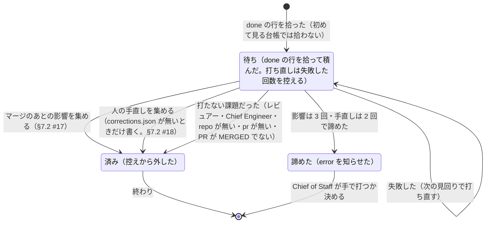

# 片付けのあとの仕事（影響と手直し）

> このファイルは `andon process render` が [`process/states/aftermath.yaml`](../../process/states/aftermath.yaml) から作ったもの。直すときは YAML を直して作り直す（手で直さない）。

出所: dispatcher.md §2.5・§2.6・ADR-0017 決めたこと 4 の (7)。控えの Impact と Corrections が同じ形（課題 → 失敗した回数）で、待ちと打ち直しを持つ

## 図

## 状態

| id | 状態 | 記録 |
|---|---|---|
| `pending` | 待ち（done の行を拾って積んだ。打ち直しは失敗した回数を控える） | `dispatcher:Impact`・`dispatcher:Corrections` |
| `done` | 済み（控えから外した） |  |
| `gave-up` | 諦めた（error を知らせた） |  |

## 移り方

| から | へ | 何が起きたら | 誰が | コマンド | 2 回起きてはいけない |
|---|---|---|---|---|---|
| （始まり・終わり） | `pending` | done の行を拾った（初めて見る台帳では拾わない） | 機械 |  |  |
| `pending` | `done` | マージのあとの影響を集める（§7.2 #17） | 機械 | `andon issue impact` | はい |
| `pending` | `done` | 人の手直しを集める（corrections.json が無いときだけ書く。§7.2 #18） | 機械 |  | はい |
| `pending` | `done` | 打たない課題だった（レビュアー・Chief Engineer・repo が無い・pr が無い・PR が MERGED でない） | 機械 |  |  |
| `pending` | `pending` | 失敗した（次の見回りで打ち直す） | 機械 |  |  |
| `pending` | `gave-up` | 影響は 3 回・手直しは 2 回で諦めた | 機械 |  |  |
| `done` | （始まり・終わり） | 終わり | 機械 |  |  |
| `gave-up` | （始まり・終わり） | Chief of Staff が手で打つか決める | AI |  |  |
