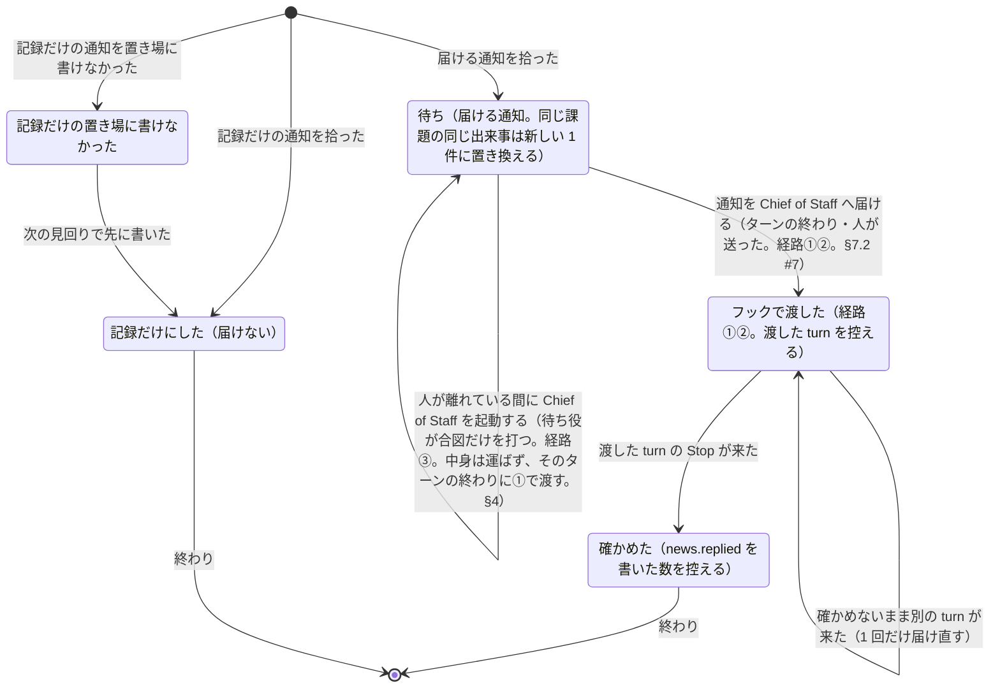

# 通知の配達

> このファイルは `andon process render` が [`process/states/delivery.yaml`](../../process/states/delivery.yaml) から作ったもの。直すときは YAML を直して作り直す（手で直さない）。

出所: dispatcher.md §2.2・§3・§3.2・§4・ADR-0010・ADR-0017 決めたこと 4 の (3)・5。拾う位置（log.jsonl の位置と ready の前回）は状態でないので、ここに置く

## 図

## 状態

| id | 状態 | 記録 |
|---|---|---|
| `pending` | 待ち（届ける通知。同じ課題の同じ出来事は新しい 1 件に置き換える） | `dispatcher:Pending` |
| `hooked` | フックで渡した（経路①②。渡した turn を控える） | `dispatcher:Hook` |
| `acked` | 確かめた（news.replied を書いた数を控える） | `dispatcher:Replied` |
| `unrecorded` | 記録だけの置き場に書けなかった | `dispatcher:Unrecorded` |
| `recorded` | 記録だけにした（届けない） |  |

状態でない項目（拾う位置とデータ）: `dispatcher:LogPos`・`dispatcher:LogHead`・`dispatcher:LogHold`・`dispatcher:Ready`

## 移り方

| から | へ | 何が起きたら | 誰が | コマンド | 2 回起きてはいけない |
|---|---|---|---|---|---|
| （始まり・終わり） | `pending` | 届ける通知を拾った | 機械 |  |  |
| （始まり・終わり） | `recorded` | 記録だけの通知を拾った | 機械 |  |  |
| （始まり・終わり） | `unrecorded` | 記録だけの通知を置き場に書けなかった | 機械 |  |  |
| `unrecorded` | `recorded` | 次の見回りで先に書いた | 機械 |  |  |
| `pending` | `hooked` | 通知を Chief of Staff へ届ける（ターンの終わり・人が送った。経路①②。§7.2 #7） | 機械 | `andon dispatcher drain` | はい |
| `pending` | `pending` | 人が離れている間に Chief of Staff を起動する（待ち役が合図だけを打つ。経路③。中身は運ばず、そのターンの終わりに①で渡す。§4） | 機械 | `andon dispatcher wait` |  |
| `hooked` | `acked` | 渡した turn の Stop が来た | AI |  |  |
| `hooked` | `hooked` | 確かめないまま別の turn が来た（1 回だけ届け直す） | 機械 |  |  |
| `acked` | （始まり・終わり） | 終わり | 機械 |  |  |
| `recorded` | （始まり・終わり） | 終わり | 機械 |  |  |
