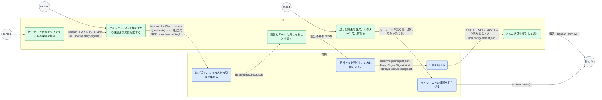

# ダイジェスト（Digest）

> このファイルは `andon process render` が [`process/workstreams/digest.yaml`](../../process/workstreams/digest.yaml) から作ったもの。直すときは YAML を直して作り直す（手で直さない）。

目的: 前に送ったダイジェストのあとに工場で起きたことを、オーナーが短い時間で分かる 1 枚にまとめて届ける

## きっかけ

| きっかけ | 種類 | 中身 | 最初の手順 |
|---|---|---|---|
| routine | 通知 | 通知 `ready` | `start` |
| person | オーナーの依頼 |  | `add` |
| report | 通知 | 通知 `report` | `check` |

## 流れ

## 手順

| id | 手順 | やる者 | 入るもの | 出るもの | 次 |
|---|---|---|---|---|---|
| `add` | オーナーの依頼でダイジェストの課題を足す | AI | `オーナーの言葉`・`kanban（片付いていないダイジェストの課題）` | `kanban（ダイジェストの課題。routine daily-digest）` | `start` |
| `start` | ダイジェストの担当をほかの課題より先に起動する | AI | `notification.ready`・`andon waiting --json（slots）` | `kanban（予約キー review と estimate）`・`hc（担当の端末）`・`kanban（doing）` | `collect` |
| `collect` | 前に送った 1 枚のあとの記録を集める | 機械 | `kanban（期間の記録）`・`dispatcher の記録`・`GitHub（マージされた PR）` | `library/digest/input.json` | `write` |
| `write` | 要旨とテーマと気になることを書く | AI | `library/digest/input.json`・`入力にある課題と PR` | `担当の文の JSON` | `build` |
| `build` | 担当の文を照らし、1 枚に組み立てる | 機械 | `担当の文の JSON`・`library/digest/input.json` | `library/digest/digest.json`・`library/digest/digest.html`・`library/digest/message.txt` | `send` |
| `send` | 1 枚を届ける | 機械 | `library/digest/digest.html`・`library/digest/sent.json`・`project.json（digest）` | `files/（HTML）`・`Slack（送り先があるとき）`・`library/digest/sent.json` | `report` |
| `report` | 送った結果を報告して返す | AI | `library/digest/sent.json` | `報告`・`kanban（review）` | 終わり |
| `check` | 送った結果を見て、そのターンで片付ける | AI | `notification.report`・`kanban（status）`・`報告`・`library/digest/sent.json` | `オーナーへの知らせ（送れなかったとき）` | `finish` |
| `finish` | ダイジェストの課題を片付ける | 機械 | `kanban（review）` | `kanban（done）` | 終わり |

## 機械がやる手順

| id | コマンド | 記録 | 2 回起きてはいけない |
|---|---|---|---|
| `collect` | `andon digest collect` | `library/digest/input.json` |  |
| `build` | `andon digest build` | `library/digest/digest.json` |  |
| `send` | `andon digest send` | `library/digest/sent.json` | はい |
| `finish` | `andon issue finish` |  |  |

## AI がやる手順

| id | どうやるか（SKILL の節・手引き） | 自分で決めてよいこと | オーナーに聞くこと |
|---|---|---|---|
| `add` | `chief-of-staff/playbooks/digest.md` | 足すか（同時に 1 つ） |  |
| `start` | `chief-of-staff/playbooks/digest.md`・`chief-of-staff/playbooks/start.md` | オーナーに聞かずに起動する・枠が空くまで待つ |  |
| `write` | `digest#2`・`digest#3` | テーマの束ね方・図を付けるか・気になることに挙げるか |  |
| `report` | `digest#5`・`worker#7` | 報告の要約 |  |
| `check` | `chief-of-staff/playbooks/digest.md` | done なら何もしない・doing なら待つ・review なら送れていなくても片付ける |  |

見るもの（手順の入るものの和）: `オーナーの言葉`・`kanban（片付いていないダイジェストの課題）`・`notification.ready`・`andon waiting --json（slots）`・`kanban（期間の記録）`・`dispatcher の記録`・`GitHub（マージされた PR）`・`library/digest/input.json`・`入力にある課題と PR`・`担当の文の JSON`・`library/digest/digest.html`・`library/digest/sent.json`・`project.json（digest）`・`notification.report`・`kanban（status）`・`報告`・`kanban（review）`

残すもの（手順の出るものの和）: `kanban（ダイジェストの課題。routine daily-digest）`・`kanban（予約キー review と estimate）`・`hc（担当の端末）`・`kanban（doing）`・`library/digest/input.json`・`担当の文の JSON`・`library/digest/digest.json`・`library/digest/digest.html`・`library/digest/message.txt`・`files/（HTML）`・`Slack（送り先があるとき）`・`library/digest/sent.json`・`報告`・`kanban（review）`・`オーナーへの知らせ（送れなかったとき）`・`kanban（done）`

## 数えるもの

`flow.closed`・`flow.wait.todo`
