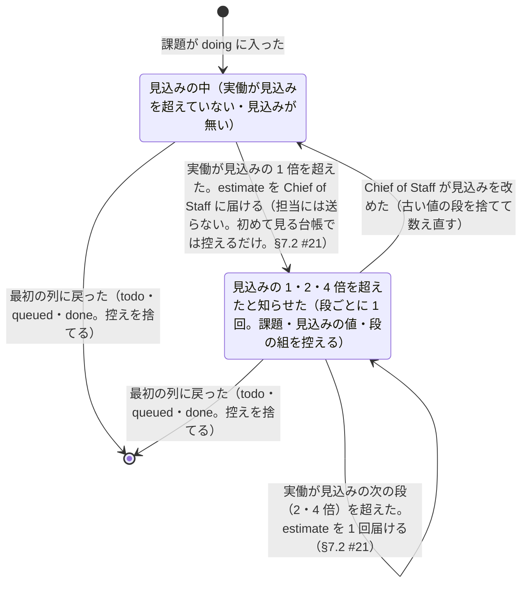

# 見込みとのズレ

> このファイルは `andon process render` が [`process/states/estimate.yaml`](../../process/states/estimate.yaml) から作ったもの。直すときは YAML を直して作り直す（手で直さない）。

出所: dispatcher.md §2.10・ADR-0014 決めたこと 5〜8・11 の 4。doing の担当の課題ごと。実働（待ちを除いた時間）を見込み（予約キー estimate）と比べ、超えた段を控える。担当の端末が Gone だと見た時刻は状態でないので positions に置く（実働から死んでいた区間を引く）

## 図

## 状態

| id | 状態 | 記録 |
|---|---|---|
| `within` | 見込みの中（実働が見込みを超えていない・見込みが無い） |  |
| `over` | 見込みの 1・2・4 倍を超えたと知らせた（段ごとに 1 回。課題・見込みの値・段の組を控える） | `dispatcher:Estimate` |

状態でない項目（拾う位置とデータ）: `dispatcher:Gone`

## 移り方

| から | へ | 何が起きたら | 誰が | コマンド | 2 回起きてはいけない |
|---|---|---|---|---|---|
| （始まり・終わり） | `within` | 課題が doing に入った | AI | `kanban start` |  |
| `within` | `over` | 実働が見込みの 1 倍を超えた。estimate を Chief of Staff に届ける（担当には送らない。初めて見る台帳では控えるだけ。§7.2 #21） | 機械 |  | はい |
| `over` | `over` | 実働が見込みの次の段（2・4 倍）を超えた。estimate を 1 回届ける（§7.2 #21） | 機械 |  | はい |
| `over` | `within` | Chief of Staff が見込みを改めた（古い値の段を捨てて数え直す） | AI | `kanban set` |  |
| `within` | （始まり・終わり） | 最初の列に戻った（todo・queued・done。控えを捨てる） | 機械 |  |  |
| `over` | （始まり・終わり） | 最初の列に戻った（todo・queued・done。控えを捨てる） | 機械 |  |  |
