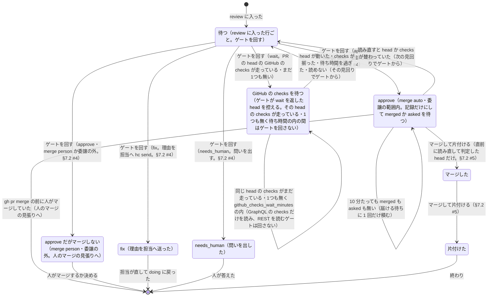

# ゲートとマージ

> このファイルは `andon process render` が [`process/states/gate.yaml`](../../process/states/gate.yaml) から作ったもの。直すときは YAML を直して作り直す（手で直さない）。

出所: dispatcher.md §5（P6a）・§3.2・contract.md §7・ADR-0010 決めたこと 1・ADR-0017 決めたこと 4 の (5)・6。控えの Gates の 1 件（課題と log.jsonl の行ごと）が Decision・Merged で状態を持つ

## 図

## 状態

| id | 状態 | 記録 |
|---|---|---|
| `waiting` | 待つ（review に入った行ごと。ゲートを回す） | `dispatcher:Gates` |
| `checks-pending` | GitHub の checks を待つ（ゲートが wait を返した head を控える。その head の checks が走っている・1つも無く待ち時間の内の間はゲートを回さない） | `dispatcher:Waits` |
| `approved` | approve（merge auto・委譲の範囲内。記録だけにして merged か asked を待つ） | `dispatcher:Approved` |
| `held` | approve だがマージしない（merge person・委譲の外。人のマージの見張りへ） |  |
| `fix` | fix（理由を担当へ送った） |  |
| `needs-human` | needs_human（問いを出した） |  |
| `merged` | マージした |  |
| `finished` | 片付けた |  |

## 移り方

| から | へ | 何が起きたら | 誰が | コマンド | 2 回起きてはいけない |
|---|---|---|---|---|---|
| （始まり・終わり） | `waiting` | review に入った | 機械 |  |  |
| `waiting` | `approved` | ゲートを回す（approve・merge auto・委譲の範囲内。§7.2 #4） | 機械 | `andon gate` | はい |
| `waiting` | `held` | ゲートを回す（approve・merge person か委譲の外。§7.2 #4） | 機械 | `andon gate` | はい |
| `waiting` | `fix` | ゲートを回す（fix。理由を担当へ hc send。§7.2 #4） | 機械 | `andon gate` | はい |
| `waiting` | `needs-human` | ゲートを回す（needs_human。問いを出す。§7.2 #4） | 機械 | `andon gate` | はい |
| `waiting` | `checks-pending` | ゲートを回す（wait。PR の head の GitHub の checks が走っている・まだ1つも無い） | 機械 | `andon gate` |  |
| `checks-pending` | `checks-pending` | 同じ head の checks がまだ走っている・1つも無く github_checks_wait_minutes の内（GraphQL の checks だけを読み、REST を読むゲートは回さない） | 機械 |  |  |
| `checks-pending` | `waiting` | head が動いた・checks が揃った・待ち時間を過ぎた・読めない（その見回りでゲートから） | 機械 |  |  |
| `approved` | `merged` | マージして片付ける（直前に読み直して判定した head だけ。§7.2 #5） | 機械 | `gh pr merge --match-head-commit` | はい |
| `approved` | `waiting` | 読み直すと head か checks が替わっていた（次の見回りでゲートから） | 機械 |  |  |
| `approved` | `approved` | 10 分たっても merged も asked も無い（届ける待ちに 1 回だけ積む） | 機械 |  |  |
| `approved` | （始まり・終わり） | gh pr merge の前に人がマージしていた（人のマージの見張りへ） | 機械 |  |  |
| `merged` | `finished` | マージして片付ける（§7.2 #5） | 機械 | `andon issue finish` | はい |
| `held` | （始まり・終わり） | 人がマージするか決める | 人 |  |  |
| `fix` | （始まり・終わり） | 担当が直して doing に戻った | 台帳の CLI | `kanban start` |  |
| `needs-human` | （始まり・終わり） | 人が答えた | 人 |  |  |
| `finished` | （始まり・終わり） | 終わり | 機械 |  |  |
