# gate とマージ

> このファイルは `andon process render` が [`process/states/gate.yaml`](../../process/states/gate.yaml) から作ったもの。直すときは YAML を直して作り直す（手で直さない）。

出所: dispatcher.md §5（P6a）・§3.2・contract.md §7・ADR-0010 決めたこと 1・ADR-0017 決めたこと 4 の (5)・5・6。andon issue merge の記録（<slug>.merge.json。書き手は merge だけ）の 1 件（課題ごと。review に入った log.jsonl の行を Row に持つ）が Decision・Merged・Wait・Approved で状態を持つ（Retries は base が動いたか必須の check で断られたマージを打ち直した回数。Polled は approve・needs_human・behind を決めたあと PR の head を最後に聞いた時刻）。dispatcher は review の課題ごとに merge を打ち、返った通知を積むだけ。gh の上限の待ちは kanban ごとなので dispatcher の控えに残す

## 図

```mermaid
stateDiagram-v2
  state "待つ（review に入った行ごと。gate を回す。Row が今の行で Decision が空）" as s_waiting
  state "GitHub の checks を待つ（gate が wait を返した head を記録する。その head の checks が走っている・1つも無く待ち時間の内の間は gate を回さない）" as s_checks_pending
  state "gh の上限が戻るのを待つ（gate が gh の rate limit で落ちた。gh api rate_limit の reset と、続けて落ちるたびに倍にする待ち〈1分から〉の遅いほうまで、この kanban の gate を回さない）" as s_rate_limited
  state "approve（merge auto・委譲の範囲内。記録だけにしてマージに進む。マージの直前に読み直して変わっていれば、base が動いてマージが通らなければ、決めずに回し直す。Approved は回し直しても測り直さない）" as s_approved
  state "approve のまま 10 分たっても決まらない（dispatcher が merge の記録の Approved を読んで通知 `gate` を届けた。同じ Approved では二度届けない）" as s_stuck
  state "approve だがマージしない（merge person・委譲の外。オーナーのマージの見張りへ）" as s_held
  state "Chief of Staff が止めている（issue.yaml の予約キー hold。gate を回さず GitHub も読まない。判定のあとに止められたら判定を捨てて gate の問いを閉じる。ADR-0056 決めたこと 9）" as s_on_hold
  state "fix（理由を担当へ送った）" as s_fix
  state "needs_human（問いを出した）" as s_needs_human
  state "behind（積んだ課題の前の PR 待ち。マージも問いもせず、通知 gate を Chief of Staff に届けた。印は黄。ADR-0067 決めたこと 8）" as s_behind
  state "マージした" as s_merged
  state "片付けた" as s_finished
  [*] --> s_waiting: review に入った
  s_waiting --> [*]: PR を出さない課題だった（report.json に pr が無く、課題が報告の課題〈deliverable： report を書いた時点の Chief of Staff が書いた〉か、commit が既定の branch に入っている。gate を回さず fix も送らない。返ったことは collect が通知 report で届ける）
  s_waiting --> s_approved: gate を回す（approve・merge auto・委譲の範囲内。§7.2 #4）
  s_waiting --> s_held: gate を回す（approve・merge person か委譲の外。§7.2 #4）
  s_waiting --> s_fix: gate を回す（fix。理由を担当へ hc send。§7.2 #4）
  s_waiting --> s_needs_human: gate を回す（needs_human。問いを出す。§7.2 #4）
  s_waiting --> s_behind: gate を回す（behind。積んだ課題で、今なら approve か needs_human の判定。gate が判定できなかったときも。通知 gate を届け、問いは出さない。§7.2 #4）
  s_waiting --> s_checks_pending: gate を回す（wait。PR の head の GitHub の checks が走っている・まだ1つも無い）
  s_checks_pending --> s_checks_pending: 同じ head の checks がまだ走っている・1つも無く github_checks_wait_minutes の内（GraphQL の checks だけを読み、REST を読む gate は回さない）
  s_checks_pending --> s_waiting: head が動いた・checks が揃った・待ち時間を過ぎた・読めない（その見回りで gate から）
  s_waiting --> s_rate_limited: gate を回す（gh の rate limit で落ちた。問いにも決めたことにもしない。dispatcher が控えの GHReset・GHWait に書く）
  s_rate_limited --> s_rate_limited: reset の時刻の前（gate も checks も読まない）
  s_rate_limited --> s_waiting: reset の時刻を過ぎた（その見回りで gate から）
  s_approved --> s_merged: マージして片付ける（直前に読み直して判定した head だけ。§7.2 #5）
  s_approved --> s_waiting: 読み直すと head か checks が替わっていた（次の見回りで gate から）
  s_approved --> s_waiting: base が動いたか、必須の check がまだ揃わず（the base branch policy prohibits the merge）gh pr merge が通らなかった（Retries を進め、次の見回りで gate から。3 回まで。ADR-0056 決めたこと 12）
  s_approved --> s_needs_human: gh pr merge が通らず打ち直さない（ほかの失敗・base の動きが 3 回を超えた。問いを出す。§7.2 #5）
  s_approved --> s_stuck: 10 分たっても決まらない（dispatcher が merge の記録を読んで届ける待ちに 1 回だけ積む。§7.2 #25）
  s_stuck --> [*]: merge が回し直して決めた（Approved が消え、dispatcher は Stuck を捨てる）
  s_approved --> [*]: gh pr merge の前か、打ち直しを待つ間にオーナーがマージしていた（オーナーのマージの見張りへ）
  s_merged --> s_finished: マージして片付ける（finish は merge の中で打つ。§7.2 #5）
  s_held --> [*]: オーナーがマージするか決める
  s_held --> s_waiting: PR の head が判定した head から動いた（merge が課題ごとに1分に1回だけ聞く。その見回りで今の head の gate から）
  s_fix --> [*]: 担当が直して doing に戻った
  s_needs_human --> [*]: オーナーが答えた
  s_needs_human --> s_waiting: PR の head が判定した head から動いた（merge が課題ごとに1分に1回だけ聞き、前の head の gate の問いを閉じる。その見回りで今の head の gate から）
  s_behind --> s_waiting: PR の head が判定した head から動いた（merge が課題ごとに1分に1回だけ聞く。その見回りで今の head の gate から）
  s_behind --> s_on_hold: behind のあとに止められた（判定を捨てる）
  s_waiting --> s_on_hold: Chief of Staff が止めている（andon issue hold。gate を回さない。merge は state hold を返す）
  s_approved --> s_on_hold: approve のあとに止められた（判定を捨て、マージしない。直前の読み直しも止めを見る。ADR-0056 決めたこと 9）
  s_held --> s_on_hold: approve のあとに止められた（判定を捨てる）
  s_needs_human --> s_on_hold: needs_human のあとに止められた（判定を捨て、gate の問いを閉じる）
  s_on_hold --> s_waiting: Chief of Staff が andon issue unhold で外した（次の見回りで今の head の gate から。gate が印を書く）
  s_finished --> [*]: 終わり
```

## 状態

| id | 状態 | 記録 |
|---|---|---|
| `waiting` | 待つ（review に入った行ごと。gate を回す。Row が今の行で Decision が空） | `merge:Row` |
| `checks-pending` | GitHub の checks を待つ（gate が wait を返した head を記録する。その head の checks が走っている・1つも無く待ち時間の内の間は gate を回さない） | `merge:Wait` |
| `rate-limited` | gh の上限が戻るのを待つ（gate が gh の rate limit で落ちた。gh api rate_limit の reset と、続けて落ちるたびに倍にする待ち〈1分から〉の遅いほうまで、この kanban の gate を回さない） | `dispatcher:GHReset`・`dispatcher:GHWait` |
| `approved` | approve（merge auto・委譲の範囲内。記録だけにしてマージに進む。マージの直前に読み直して変わっていれば、base が動いてマージが通らなければ、決めずに回し直す。Approved は回し直しても測り直さない） | `merge:Approved` |
| `stuck` | approve のまま 10 分たっても決まらない（dispatcher が merge の記録の Approved を読んで通知 `gate` を届けた。同じ Approved では二度届けない） | `dispatcher:Stuck` |
| `held` | approve だがマージしない（merge person・委譲の外。オーナーのマージの見張りへ） |  |
| `on-hold` | Chief of Staff が止めている（issue.yaml の予約キー hold。gate を回さず GitHub も読まない。判定のあとに止められたら判定を捨てて gate の問いを閉じる。ADR-0056 決めたこと 9） |  |
| `fix` | fix（理由を担当へ送った） |  |
| `needs-human` | needs_human（問いを出した） |  |
| `behind` | behind（積んだ課題の前の PR 待ち。マージも問いもせず、通知 gate を Chief of Staff に届けた。印は黄。ADR-0067 決めたこと 8） |  |
| `merged` | マージした | `merge:Merged` |
| `finished` | 片付けた |  |

状態でない項目（拾う位置とデータ）: `merge:Sha`・`merge:Decision`・`merge:Retries`・`merge:Polled`

## 移り方

| から | へ | 何が起きたら | 誰が | コマンド | 2 回起きてはいけない |
|---|---|---|---|---|---|
| （始まり・終わり） | `waiting` | review に入った | 機械 |  |  |
| `waiting` | （始まり・終わり） | PR を出さない課題だった（report.json に pr が無く、課題が報告の課題〈deliverable: report を書いた時点の Chief of Staff が書いた〉か、commit が既定の branch に入っている。gate を回さず fix も送らない。返ったことは collect が通知 report で届ける） | 機械 | `andon issue merge` |  |
| `waiting` | `approved` | gate を回す（approve・merge auto・委譲の範囲内。§7.2 #4） | 機械 | `andon issue merge` | はい |
| `waiting` | `held` | gate を回す（approve・merge person か委譲の外。§7.2 #4） | 機械 | `andon issue merge` | はい |
| `waiting` | `fix` | gate を回す（fix。理由を担当へ hc send。§7.2 #4） | 機械 | `andon issue merge` | はい |
| `waiting` | `needs-human` | gate を回す（needs_human。問いを出す。§7.2 #4） | 機械 | `andon issue merge` | はい |
| `waiting` | `behind` | gate を回す（behind。積んだ課題で、今なら approve か needs_human の判定。gate が判定できなかったときも。通知 gate を届け、問いは出さない。§7.2 #4） | 機械 | `andon issue merge` | はい |
| `waiting` | `checks-pending` | gate を回す（wait。PR の head の GitHub の checks が走っている・まだ1つも無い） | 機械 | `andon issue merge` |  |
| `checks-pending` | `checks-pending` | 同じ head の checks がまだ走っている・1つも無く github_checks_wait_minutes の内（GraphQL の checks だけを読み、REST を読む gate は回さない） | 機械 |  |  |
| `checks-pending` | `waiting` | head が動いた・checks が揃った・待ち時間を過ぎた・読めない（その見回りで gate から） | 機械 |  |  |
| `waiting` | `rate-limited` | gate を回す（gh の rate limit で落ちた。問いにも決めたことにもしない。dispatcher が控えの GHReset・GHWait に書く） | 機械 | `andon issue merge` |  |
| `rate-limited` | `rate-limited` | reset の時刻の前（gate も checks も読まない） | 機械 |  |  |
| `rate-limited` | `waiting` | reset の時刻を過ぎた（その見回りで gate から） | 機械 |  |  |
| `approved` | `merged` | マージして片付ける（直前に読み直して判定した head だけ。§7.2 #5） | 機械 | `andon issue merge` | はい |
| `approved` | `waiting` | 読み直すと head か checks が替わっていた（次の見回りで gate から） | 機械 |  |  |
| `approved` | `waiting` | base が動いたか、必須の check がまだ揃わず（the base branch policy prohibits the merge）gh pr merge が通らなかった（Retries を進め、次の見回りで gate から。3 回まで。ADR-0056 決めたこと 12） | 機械 | `andon issue merge` |  |
| `approved` | `needs-human` | gh pr merge が通らず打ち直さない（ほかの失敗・base の動きが 3 回を超えた。問いを出す。§7.2 #5） | 機械 | `andon issue merge` | はい |
| `approved` | `stuck` | 10 分たっても決まらない（dispatcher が merge の記録を読んで届ける待ちに 1 回だけ積む。§7.2 #25） | 機械 |  | はい |
| `stuck` | （始まり・終わり） | merge が回し直して決めた（Approved が消え、dispatcher は Stuck を捨てる） | 機械 | `andon issue merge` |  |
| `approved` | （始まり・終わり） | gh pr merge の前か、打ち直しを待つ間にオーナーがマージしていた（オーナーのマージの見張りへ） | 機械 |  |  |
| `merged` | `finished` | マージして片付ける（finish は merge の中で打つ。§7.2 #5） | 機械 | `andon issue merge` | はい |
| `held` | （始まり・終わり） | オーナーがマージするか決める | オーナー |  |  |
| `held` | `waiting` | PR の head が判定した head から動いた（merge が課題ごとに1分に1回だけ聞く。その見回りで今の head の gate から） | 機械 | `andon issue merge` |  |
| `fix` | （始まり・終わり） | 担当が直して doing に戻った | kanban の CLI | `kanban start` |  |
| `needs-human` | （始まり・終わり） | オーナーが答えた | オーナー |  |  |
| `needs-human` | `waiting` | PR の head が判定した head から動いた（merge が課題ごとに1分に1回だけ聞き、前の head の gate の問いを閉じる。その見回りで今の head の gate から） | 機械 | `andon issue merge` |  |
| `behind` | `waiting` | PR の head が判定した head から動いた（merge が課題ごとに1分に1回だけ聞く。その見回りで今の head の gate から） | 機械 | `andon issue merge` |  |
| `behind` | `on-hold` | behind のあとに止められた（判定を捨てる） | 機械 | `andon issue merge` |  |
| `waiting` | `on-hold` | Chief of Staff が止めている（andon issue hold。gate を回さない。merge は state hold を返す） | 機械 | `andon issue merge` |  |
| `approved` | `on-hold` | approve のあとに止められた（判定を捨て、マージしない。直前の読み直しも止めを見る。ADR-0056 決めたこと 9） | 機械 | `andon issue merge` |  |
| `held` | `on-hold` | approve のあとに止められた（判定を捨てる） | 機械 | `andon issue merge` |  |
| `needs-human` | `on-hold` | needs_human のあとに止められた（判定を捨て、gate の問いを閉じる） | 機械 | `andon issue merge` |  |
| `on-hold` | `waiting` | Chief of Staff が andon issue unhold で外した（次の見回りで今の head の gate から。gate が印を書く） | AI | `andon issue unhold` |  |
| `finished` | （始まり・終わり） | 終わり | 機械 |  |  |
