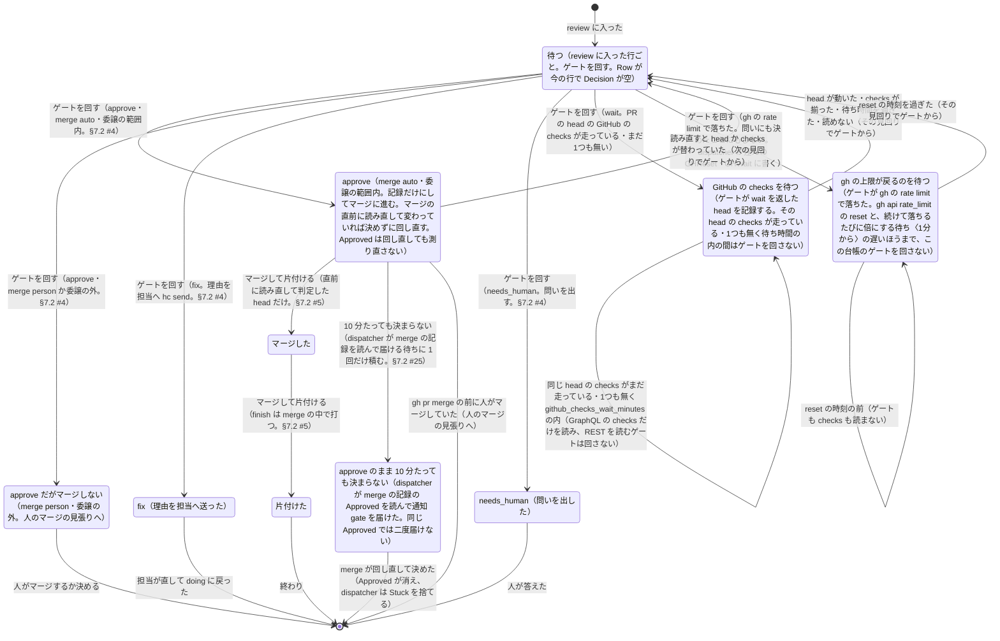

# ゲートとマージ

> このファイルは `andon process render` が [`process/states/gate.yaml`](../../process/states/gate.yaml) から作ったもの。直すときは YAML を直して作り直す（手で直さない）。

出所: dispatcher.md §5（P6a）・§3.2・contract.md §7・ADR-0010 決めたこと 1・ADR-0017 決めたこと 4 の (5)・5・6。andon issue merge の記録（<slug>.merge.json。書き手は merge だけ）の 1 件（課題ごと。review に入った log.jsonl の行を Row に持つ）が Decision・Merged・Wait・Approved で状態を持つ。dispatcher は review の課題ごとに merge を打ち、返った通知を積むだけ。gh の上限の待ちは台帳ごとなので dispatcher の控えに残す

## 図

## 状態

| id | 状態 | 記録 |
|---|---|---|
| `waiting` | 待つ（review に入った行ごと。ゲートを回す。Row が今の行で Decision が空） | `merge:Row` |
| `checks-pending` | GitHub の checks を待つ（ゲートが wait を返した head を記録する。その head の checks が走っている・1つも無く待ち時間の内の間はゲートを回さない） | `merge:Wait` |
| `rate-limited` | gh の上限が戻るのを待つ（ゲートが gh の rate limit で落ちた。gh api rate_limit の reset と、続けて落ちるたびに倍にする待ち〈1分から〉の遅いほうまで、この台帳のゲートを回さない） | `dispatcher:GHReset`・`dispatcher:GHWait` |
| `approved` | approve（merge auto・委譲の範囲内。記録だけにしてマージに進む。マージの直前に読み直して変わっていれば決めずに回し直す。Approved は回し直しても測り直さない） | `merge:Approved` |
| `stuck` | approve のまま 10 分たっても決まらない（dispatcher が merge の記録の Approved を読んで通知 gate を届けた。同じ Approved では二度届けない） | `dispatcher:Stuck` |
| `held` | approve だがマージしない（merge person・委譲の外。人のマージの見張りへ） |  |
| `fix` | fix（理由を担当へ送った） |  |
| `needs-human` | needs_human（問いを出した） |  |
| `merged` | マージした | `merge:Merged` |
| `finished` | 片付けた |  |

状態でない項目（拾う位置とデータ）: `merge:Sha`・`merge:Decision`

## 移り方

| から | へ | 何が起きたら | 誰が | コマンド | 2 回起きてはいけない |
|---|---|---|---|---|---|
| （始まり・終わり） | `waiting` | review に入った | 機械 |  |  |
| `waiting` | `approved` | ゲートを回す（approve・merge auto・委譲の範囲内。§7.2 #4） | 機械 | `andon issue merge` | はい |
| `waiting` | `held` | ゲートを回す（approve・merge person か委譲の外。§7.2 #4） | 機械 | `andon issue merge` | はい |
| `waiting` | `fix` | ゲートを回す（fix。理由を担当へ hc send。§7.2 #4） | 機械 | `andon issue merge` | はい |
| `waiting` | `needs-human` | ゲートを回す（needs_human。問いを出す。§7.2 #4） | 機械 | `andon issue merge` | はい |
| `waiting` | `checks-pending` | ゲートを回す（wait。PR の head の GitHub の checks が走っている・まだ1つも無い） | 機械 | `andon issue merge` |  |
| `checks-pending` | `checks-pending` | 同じ head の checks がまだ走っている・1つも無く github_checks_wait_minutes の内（GraphQL の checks だけを読み、REST を読むゲートは回さない） | 機械 |  |  |
| `checks-pending` | `waiting` | head が動いた・checks が揃った・待ち時間を過ぎた・読めない（その見回りでゲートから） | 機械 |  |  |
| `waiting` | `rate-limited` | ゲートを回す（gh の rate limit で落ちた。問いにも決めたことにもしない。dispatcher が控えの GHReset・GHWait に書く） | 機械 | `andon issue merge` |  |
| `rate-limited` | `rate-limited` | reset の時刻の前（ゲートも checks も読まない） | 機械 |  |  |
| `rate-limited` | `waiting` | reset の時刻を過ぎた（その見回りでゲートから） | 機械 |  |  |
| `approved` | `merged` | マージして片付ける（直前に読み直して判定した head だけ。§7.2 #5） | 機械 | `andon issue merge` | はい |
| `approved` | `waiting` | 読み直すと head か checks が替わっていた（次の見回りでゲートから） | 機械 |  |  |
| `approved` | `stuck` | 10 分たっても決まらない（dispatcher が merge の記録を読んで届ける待ちに 1 回だけ積む。§7.2 #25） | 機械 |  | はい |
| `stuck` | （始まり・終わり） | merge が回し直して決めた（Approved が消え、dispatcher は Stuck を捨てる） | 機械 | `andon issue merge` |  |
| `approved` | （始まり・終わり） | gh pr merge の前に人がマージしていた（人のマージの見張りへ） | 機械 |  |  |
| `merged` | `finished` | マージして片付ける（finish は merge の中で打つ。§7.2 #5） | 機械 | `andon issue merge` | はい |
| `held` | （始まり・終わり） | 人がマージするか決める | 人 |  |  |
| `fix` | （始まり・終わり） | 担当が直して doing に戻った | 台帳の CLI | `kanban start` |  |
| `needs-human` | （始まり・終わり） | 人が答えた | 人 |  |  |
| `finished` | （始まり・終わり） | 終わり | 機械 |  |  |
