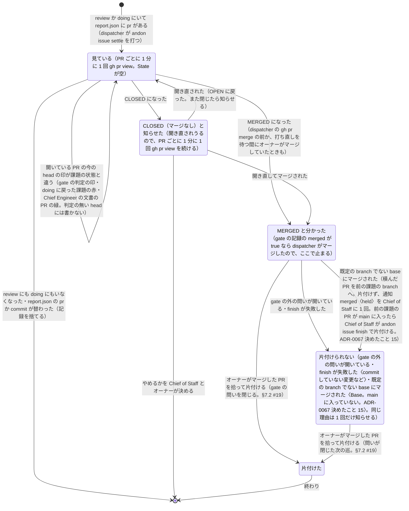

# オーナーのマージの見張り

> このファイルは `andon process render` が [`process/states/human-merge.yaml`](../../process/states/human-merge.yaml) から作ったもの。直すときは YAML を直して作り直す（手で直さない）。

出所: dispatcher.md §2.7・ADR-0017 決めたこと 4 の (6)・5・6。andon issue settle の記録（<slug>.settle.json。書き手は settle だけ）の 1 件（課題ごと）が PR・聞いた時刻・MERGED／CLOSED・知らせた理由を持つ。dispatcher は review・doing の課題ごとに settle を打ち、返った通知を積むだけ（Chief Engineer の課題は doing の間は片付けず、印を揃えるだけ）。settle は PR を聞く同じ読みで、開いている PR の印（andon/gate）を課題の状態に揃える（ADR-0056 決めたこと 5・6。記録は持たない）

## 図

## 状態

| id | 状態 | 記録 |
|---|---|---|
| `watching` | 見ている（PR ごとに 1 分に 1 回 gh pr view。State が空） | `settle:State` |
| `merged` | MERGED と分かった（gate の記録の merged が true なら dispatcher がマージしたので、ここで止まる） |  |
| `closed` | CLOSED（マージなし）と知らせた（開き直されうるので、PR ごとに 1 分に 1 回 gh pr view を続ける） |  |
| `held` | 片付けられない（gate の外の問いが開いている・finish が失敗した〈commit していない変更など〉・既定の branch でない base にマージされた〈Base。main に入っていない。ADR-0067 決めたこと 15〉。同じ理由は 1 回だけ知らせる） | `settle:Held` |
| `finished` | 片付けた |  |

状態でない項目（拾う位置とデータ）: `settle:PR`・`settle:Commit`・`settle:At`・`settle:Head`・`settle:Sha`・`settle:Base`

## 移り方

| から | へ | 何が起きたら | 誰が | コマンド | 2 回起きてはいけない |
|---|---|---|---|---|---|
| （始まり・終わり） | `watching` | review か doing にいて report.json に pr がある（dispatcher が andon issue settle を打つ） | 機械 | `andon issue settle` |  |
| `watching` | `watching` | 開いている PR の今の head の印が課題の状態と違う（gate の判定の印・doing に戻った課題の赤・Chief Engineer の文書の PR の緑。判定の無い head には書かない） | 機械 | `andon issue settle` |  |
| `watching` | `merged` | MERGED になった（dispatcher の gh pr merge の前か、打ち直しを待つ間にオーナーがマージしていたときも） | オーナー |  |  |
| `watching` | `closed` | CLOSED になった | オーナー |  |  |
| `merged` | `finished` | オーナーがマージした PR を拾って片付ける（gate の問いを閉じる。§7.2 #19） | 機械 | `andon issue settle` | はい |
| `merged` | `held` | gate の外の問いが開いている・finish が失敗した | 機械 | `andon issue settle` |  |
| `merged` | `held` | 既定の branch でない base にマージされた（積んだ PR を前の課題の branch へ。片付けず、通知 merged〈held〉を Chief of Staff に 1 回。前の課題の PR が main に入ったら Chief of Staff が andon issue finish で片付ける。ADR-0067 決めたこと 15） | 機械 | `andon issue settle` |  |
| `held` | `finished` | オーナーがマージした PR を拾って片付ける（問いが閉じた次の巡。§7.2 #19） | 機械 | `andon issue settle` | はい |
| `watching` | （始まり・終わり） | review にも doing にもいなくなった・report.json の pr か commit が替わった（記録を捨てる） | 機械 | `andon issue settle` |  |
| `closed` | `watching` | 開き直された（OPEN に戻った。また閉じたら知らせる） | オーナー |  |  |
| `closed` | `merged` | 開き直してマージされた | オーナー |  |  |
| `closed` | （始まり・終わり） | やめるかを Chief of Staff とオーナーが決める | オーナー |  |  |
| `finished` | （始まり・終わり） | 終わり | 機械 |  |  |
