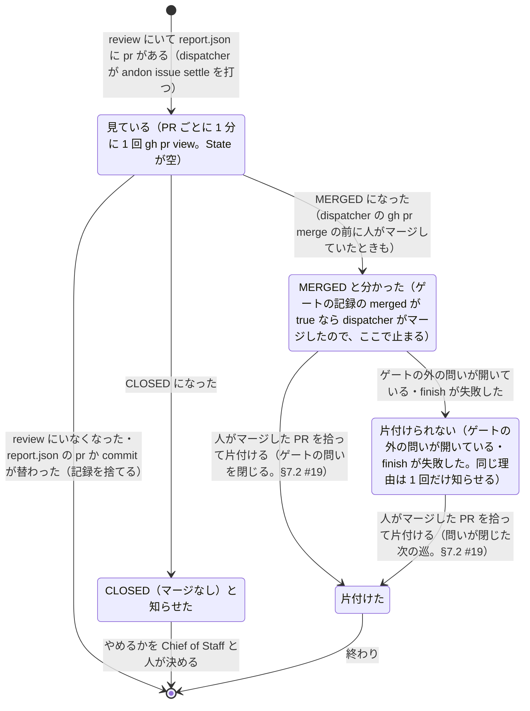

# 人のマージの見張り

> このファイルは `andon process render` が [`process/states/human-merge.yaml`](../../process/states/human-merge.yaml) から作ったもの。直すときは YAML を直して作り直す（手で直さない）。

出所: dispatcher.md §2.7・ADR-0017 決めたこと 4 の (6)・5・6。andon issue settle の記録（<slug>.settle.json。書き手は settle だけ）の 1 件（課題ごと）が PR・聞いた時刻・MERGED／CLOSED・知らせた理由を持つ。dispatcher は review の課題ごとに settle を打ち、返った通知を積むだけ

## 図

## 状態

| id | 状態 | 記録 |
|---|---|---|
| `watching` | 見ている（PR ごとに 1 分に 1 回 gh pr view。State が空） | `settle:State` |
| `merged` | MERGED と分かった（ゲートの記録の merged が true なら dispatcher がマージしたので、ここで止まる） |  |
| `closed` | CLOSED（マージなし）と知らせた |  |
| `held` | 片付けられない（ゲートの外の問いが開いている・finish が失敗した。同じ理由は 1 回だけ知らせる） | `settle:Held` |
| `finished` | 片付けた |  |

状態でない項目（拾う位置とデータ）: `settle:PR`・`settle:Commit`・`settle:At`・`settle:Head`・`settle:Sha`

## 移り方

| から | へ | 何が起きたら | 誰が | コマンド | 2 回起きてはいけない |
|---|---|---|---|---|---|
| （始まり・終わり） | `watching` | review にいて report.json に pr がある（dispatcher が andon issue settle を打つ） | 機械 | `andon issue settle` |  |
| `watching` | `merged` | MERGED になった（dispatcher の gh pr merge の前に人がマージしていたときも） | 人 |  |  |
| `watching` | `closed` | CLOSED になった | 人 |  |  |
| `merged` | `finished` | 人がマージした PR を拾って片付ける（ゲートの問いを閉じる。§7.2 #19） | 機械 | `andon issue settle` | はい |
| `merged` | `held` | ゲートの外の問いが開いている・finish が失敗した | 機械 | `andon issue settle` |  |
| `held` | `finished` | 人がマージした PR を拾って片付ける（問いが閉じた次の巡。§7.2 #19） | 機械 | `andon issue settle` | はい |
| `watching` | （始まり・終わり） | review にいなくなった・report.json の pr か commit が替わった（記録を捨てる） | 機械 | `andon issue settle` |  |
| `closed` | （始まり・終わり） | やめるかを Chief of Staff と人が決める | 人 |  |  |
| `finished` | （始まり・終わり） | 終わり | 機械 |  |  |
