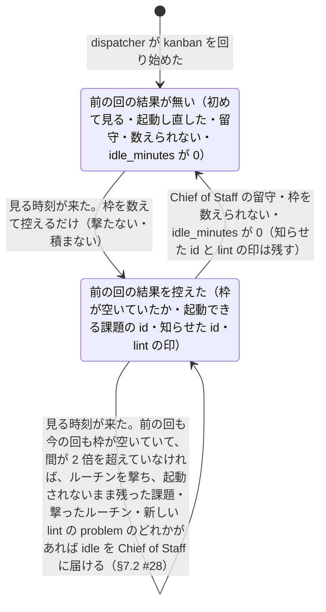

# 枠の空き

> このファイルは `andon process render` が [`process/states/idle.yaml`](../../process/states/idle.yaml) から作ったもの。直すときは YAML を直して作り直す（手で直さない）。

出所: dispatcher.md §2.13・ADR-0047 決めたこと 3〜8・10〜12・17。kanban ごと。idle_minutes（既定 15 分）おきに枠を数え、前の回も今の回も枠が 1 つ以上空いていたら、トリアージと振り返りのルーチンを線の上で空いた枠の数まで撃ち、通知 idle を積む

## 図

## 状態

| id | 状態 | 記録 |
|---|---|---|
| `unknown` | 前の回の結果が無い（初めて見る・起動し直した・留守・数えられない・idle_minutes が 0） |  |
| `looked` | 前の回の結果を控えた（枠が空いていたか・起動できる課題の id・知らせた id・lint の印） | `dispatcher:Idle` |

## 移り方

| から | へ | 何が起きたら | 誰が | コマンド | 2 回起きてはいけない |
|---|---|---|---|---|---|
| （始まり・終わり） | `unknown` | dispatcher が kanban を回り始めた | 機械 | `andon dispatcher` |  |
| `unknown` | `looked` | 見る時刻が来た。枠を数えて控えるだけ（撃たない・積まない） | 機械 |  |  |
| `looked` | `looked` | 見る時刻が来た。前の回も今の回も枠が空いていて、間が 2 倍を超えていなければ、ルーチンを撃ち、起動されないまま残った課題・撃ったルーチン・新しい lint の problem のどれかがあれば idle を Chief of Staff に届ける（§7.2 #28） | 機械 |  |  |
| `looked` | `unknown` | Chief of Staff の留守・枠を数えられない・idle_minutes が 0（知らせた id と lint の印は残す） | 機械 |  |  |
