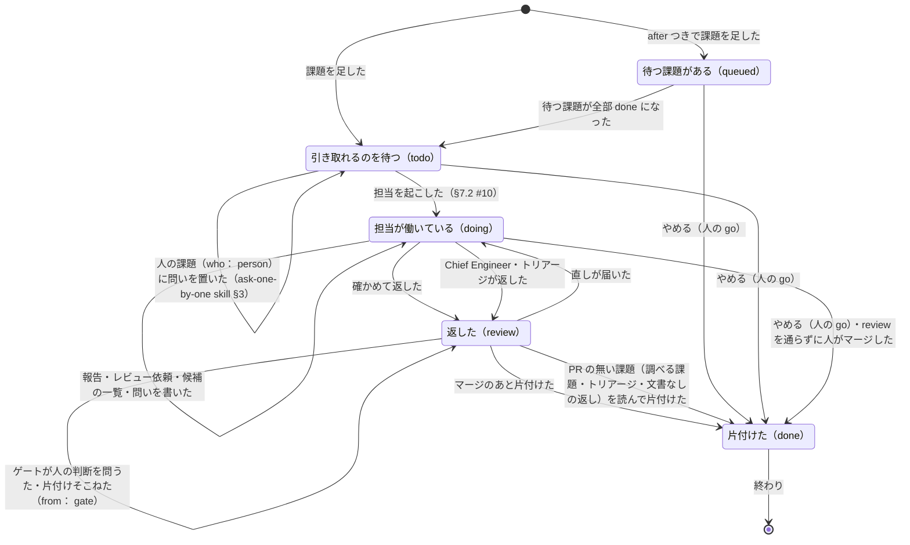

# 課題

> このファイルは `andon process render` が [`process/states/issue.yaml`](../../process/states/issue.yaml) から作ったもの。直すときは YAML を直して作り直す（手で直さない）。

出所: ledger.md（Status rules・Questions）・worker skill §2〜§7・ADR-0017 決めたこと 4 の (1)・15。andon issue … は、ここに無い移り方（今の status から打てないサブコマンド）を断る（by が deck の移り方は kanban を直に打つもので、断らない）。記録は台帳で、dispatcher の控えに項目を持たない

## 図

## 状態

| id | 状態 | 記録 |
|---|---|---|
| `queued` | 待つ課題がある（queued） |  |
| `todo` | 引き取れるのを待つ（todo） |  |
| `doing` | 担当が働いている（doing） |  |
| `review` | 返した（review） |  |
| `done` | 片付けた（done） |  |

## 移り方

| から | へ | 何が起きたら | 誰が | コマンド | 2 回起きてはいけない |
|---|---|---|---|---|---|
| （始まり・終わり） | `todo` | 課題を足した | 台帳の CLI | `kanban add` |  |
| （始まり・終わり） | `queued` | after つきで課題を足した | 台帳の CLI | `kanban add` |  |
| `queued` | `todo` | 待つ課題が全部 done になった | 台帳の CLI | `kanban done` |  |
| `todo` | `doing` | 担当を起こした（§7.2 #10） | AI | `andon issue start` | はい |
| `todo` | `todo` | 人の課題（who: person）に問いを置いた（ask-one-by-one skill §3） | AI | `andon issue ask` |  |
| `doing` | `doing` | 報告・レビュー依頼・候補の一覧・問いを書いた | AI | `andon issue report・review-request・candidates・ask` |  |
| `doing` | `review` | 確かめて返した | AI | `andon issue ready` |  |
| `doing` | `review` | Chief Engineer・トリアージが返した | 台帳の CLI | `kanban review` |  |
| `review` | `review` | ゲートが人の判断を問うた・片付けそこねた（from: gate） | 機械 | `andon issue ask` |  |
| `review` | `doing` | 直しが届いた | 台帳の CLI | `kanban start` |  |
| `review` | `done` | マージのあと片付けた | 機械 | `andon issue finish` |  |
| `review` | `done` | PR の無い課題（調べる課題・トリアージ・文書なしの返し）を読んで片付けた | AI | `andon issue finish` |  |
| `queued` | `done` | やめる（人の go） | AI | `andon issue finish` |  |
| `todo` | `done` | やめる（人の go） | AI | `andon issue finish` |  |
| `doing` | `done` | やめる（人の go）・review を通らずに人がマージした | AI | `andon issue finish` |  |
| `done` | （始まり・終わり） | 終わり | 台帳の CLI |  |  |
