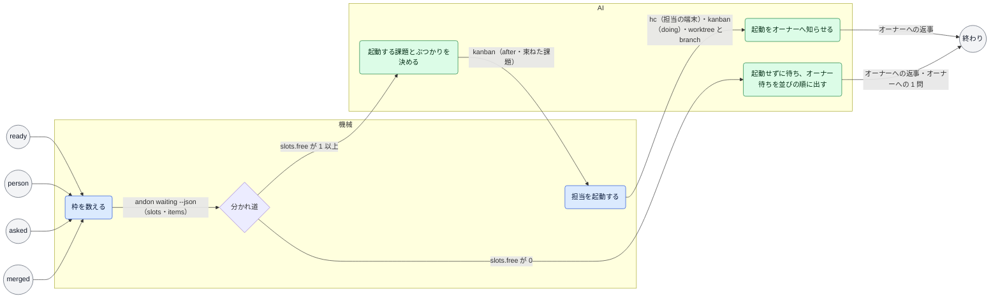

# 起動（Launch）

> このファイルは `andon process render` が [`process/workstreams/launch.yaml`](../../process/workstreams/launch.yaml) から作ったもの。直すときは YAML を直して作り直す（手で直さない）。

目的: 依頼書のできた課題に、並行の枠（オーナー待ちを数えない）とぶつかりを守って担当を起動する

## きっかけ

| きっかけ | 種類 | 中身 | 最初の手順 |
|---|---|---|---|
| ready | 通知 | 通知 `ready` | `count` |
| person | オーナーの依頼 |  | `count` |
| asked | 通知 | 通知 `asked` | `count` |
| merged | 通知 | 通知 `merged` | `count` |

## 流れ

## 手順

| id | 手順 | やる者 | 入るもの | 出るもの | 次 |
|---|---|---|---|---|---|
| `count` | 枠を数える | 機械 | `kanban（doing・review の担当の課題・問い・log.jsonl）`・`library/report.json`・`library/gate/<head>.json`・`project.json（chief_of_staff.parallel）` | `andon waiting --json（slots・items）` | `check`（slots.free が 1 以上）・`hold`（slots.free が 0） |
| `check` | 起動する課題とぶつかりを決める | AI | `andon waiting --json（slots・items）`・`kanban ready`・`依頼書`・`doing・review の課題の依頼書`・`出ている PR の files` | `kanban（after・束ねた課題）` | `start` |
| `start` | 担当を起動する | 機械 | `kanban（todo の課題）`・`brief.md` | `hc（担当の端末）`・`kanban（doing）`・`worktree と branch` | `tell` |
| `tell` | 起動をオーナーへ知らせる | AI | `andon issue start の出た場所の行` | `オーナーへの返事` | 終わり |
| `hold` | 起動せずに待ち、オーナー待ちを並びの順に出す | AI | `andon waiting --json（slots・items）` | `オーナーへの返事`・`オーナーへの 1 問` | 終わり |

## 機械がやる手順

| id | コマンド | 記録 | 2 回起きてはいけない |
|---|---|---|---|
| `count` | `andon waiting --json` |  |  |
| `start` | `andon issue start` |  |  |

## AI がやる手順

| id | どうやるか（SKILL の節・手引き） | 自分で決めてよいこと | オーナーに聞くこと |
|---|---|---|---|
| `check` | `chief-of-staff/playbooks/start.md` | 起動する課題（slots.free の数まで）・after で並べる・束ねる・オーナーの go が要らない起動か（ルーチン・委譲の範囲・プロジェクトの設定） |  |
| `tell` | `chief-of-staff/playbooks/start.md` | 知らせる文 |  |
| `hold` | `chief-of-staff/playbooks/start.md`・`ask-one-by-one#3` | 待つわけ（オーナー待ちが上限の数・動いている課題が上限の数）・問いを出す順（items の並び。holds の多い順）・マージ待ちの後ろに並べた課題を先に起動しない |  |

見るもの（手順の入るものの和）: `kanban（doing・review の担当の課題・問い・log.jsonl）`・`library/report.json`・`library/gate/<head>.json`・`project.json（chief_of_staff.parallel）`・`andon waiting --json（slots・items）`・`kanban ready`・`依頼書`・`doing・review の課題の依頼書`・`出ている PR の files`・`kanban（todo の課題）`・`brief.md`・`andon issue start の出た場所の行`

残すもの（手順の出るものの和）: `andon waiting --json（slots・items）`・`kanban（after・束ねた課題）`・`hc（担当の端末）`・`kanban（doing）`・`worktree と branch`・`オーナーへの返事`・`オーナーへの 1 問`

## 数えるもの

`flow.wait.todo`・`flow.wait.queued`
