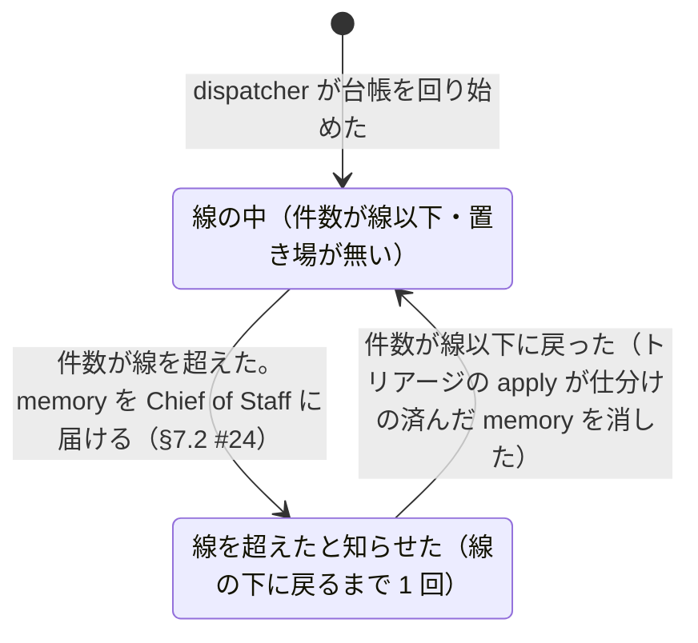

# memory の量の線

> このファイルは `andon process render` が [`process/states/memory.yaml`](../../process/states/memory.yaml) から作ったもの。直すときは YAML を直して作り直す（手で直さない）。

出所: dispatcher.md §2.11・ADR-0020 決めたこと 4。セルに 1 つ（auto memory の置き場 <セルの repo>/memory の件数。目録 MEMORY.md を除く）。線は仮に 30 件

## 図

## 状態

| id | 状態 | 記録 |
|---|---|---|
| `under` | 線の中（件数が線以下・置き場が無い） |  |
| `over` | 線を超えたと知らせた（線の下に戻るまで 1 回） | `dispatcher:MemoryOver` |

## 移り方

| から | へ | 何が起きたら | 誰が | コマンド | 2 回起きてはいけない |
|---|---|---|---|---|---|
| （始まり・終わり） | `under` | dispatcher が台帳を回り始めた | 機械 | `andon dispatcher` |  |
| `under` | `over` | 件数が線を超えた。memory を Chief of Staff に届ける（§7.2 #24） | 機械 |  | はい |
| `over` | `under` | 件数が線以下に戻った（トリアージの apply が仕分けの済んだ memory を消した） | 機械 |  |  |
