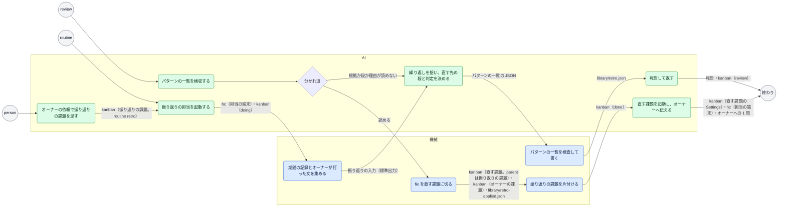

# ふりかえり（Retrospective）

> このファイルは `andon process render` が [`process/workstreams/retrospective.yaml`](../../process/workstreams/retrospective.yaml) から作ったもの。直すときは YAML を直して作り直す（手で直さない）。

目的: 片付いた担当の課題が決めた件数たまるごとと毎朝、直近の記録から別々に 2 回以上起きたつまずきを拾い、直す課題に切る

## きっかけ

| きっかけ | 種類 | 中身 | 最初の手順 |
|---|---|---|---|
| routine | 通知 | 通知 `ready` | `start` |
| person | オーナーの依頼 |  | `add` |
| review | 通知 | 通知 `review` | `check` |

## 流れ

## 手順

| id | 手順 | やる者 | 入るもの | 出るもの | 次 |
|---|---|---|---|---|---|
| `add` | オーナーの依頼で振り返りの課題を足す | AI | `オーナーの言葉`・`kanban（動いている振り返り）` | `kanban（振り返りの課題。routine retro）` | `start` |
| `start` | 振り返りの担当を起動する | AI | `notification.ready`・`kanban（並行の上限）` | `hc（担当の端末）`・`kanban（doing）` | `collect` |
| `collect` | 期間の記録とオーナーが打った文を集める | 機械 | `kanban（片付いた課題の記録）`・`セッションログ`・`GitHub（マージ後のこと）` | `振り返りの入力（標準出力）` | `find` |
| `find` | 繰り返しを拾い、直す先の段と判定を決める | AI | `振り返りの入力`・`根拠の課題の記録` | `パターンの一覧の JSON` | `write` |
| `write` | パターンの一覧を検査して書く | 機械 | `パターンの一覧の JSON`・`振り返りの入力（集め直す）` | `library/retro.json` | `report` |
| `report` | 報告して返す | AI | `library/retro.json`・`andon retro apply --dry-run の出力` | `報告`・`kanban（review）` | 終わり |
| `check` | パターンの一覧を検収する | AI | `notification.review`・`報告`・`library/retro.json`・`根拠の課題の記録`・`andon retro apply --dry-run の出力` |  | `find`（根拠か段か理由が読めない）・`apply`（読める） |
| `apply` | fix を直す課題に切る | 機械 | `library/retro.json`・`振り返りの入力（同じ期間で集め直す）` | `kanban（直す課題。parent は振り返りの課題）`・`kanban（オーナーの課題）`・`library/retro-applied.json` | `finish` |
| `finish` | 振り返りの課題を片付ける | 機械 | `kanban（review）` | `kanban（done）` | `follow` |
| `follow` | 直す課題を起動し、オーナーへ伝える | AI | `library/retro-applied.json`・`kanban（直す課題とオーナーの課題）` | `kanban（直す課題の Settings）`・`hc（担当の端末）`・`オーナーへの 1 問` | 終わり |

## 機械がやる手順

| id | コマンド | 記録 | 2 回起きてはいけない |
|---|---|---|---|
| `collect` | `andon retro collect` |  |  |
| `write` | `andon retro patterns` | `library/retro.json` |  |
| `apply` | `andon retro apply` | `library/retro-applied.json` | はい |
| `finish` | `andon issue finish` |  |  |

## AI がやる手順

| id | どうやるか（SKILL の節・手引き） | 自分で決めてよいこと | オーナーに聞くこと |
|---|---|---|---|
| `add` | `chief-of-staff/playbooks/retro.md` | 足すか（同時に 1 つ） |  |
| `start` | `chief-of-staff/playbooks/retro.md`・`chief-of-staff/playbooks/start.md` | オーナーに聞かずに起動する |  |
| `find` | `retro#2`・`retro#3`・`retro#4`・`retro#5` | パターンにするか・直す先の段・fix か drop か |  |
| `report` | `retro#7`・`worker#7` | 報告の要約 |  |
| `check` | `chief-of-staff/playbooks/retro.md` | 担当に戻す・当てる |  |
| `follow` | `chief-of-staff/playbooks/retro.md`・`chief-of-staff/playbooks/start.md`・`ask-one-by-one` | 直す課題の Settings を書いて起動する | Andon のパッケージの直しを Andon へ伝えるか（Andon の repo を持たないプロジェクト）（line） |

見るもの（手順の入るものの和）: `オーナーの言葉`・`kanban（動いている振り返り）`・`notification.ready`・`kanban（並行の上限）`・`kanban（片付いた課題の記録）`・`セッションログ`・`GitHub（マージ後のこと）`・`振り返りの入力`・`根拠の課題の記録`・`パターンの一覧の JSON`・`振り返りの入力（集め直す）`・`library/retro.json`・`andon retro apply --dry-run の出力`・`notification.review`・`報告`・`振り返りの入力（同じ期間で集め直す）`・`kanban（review）`・`library/retro-applied.json`・`kanban（直す課題とオーナーの課題）`

残すもの（手順の出るものの和）: `kanban（振り返りの課題。routine retro）`・`hc（担当の端末）`・`kanban（doing）`・`振り返りの入力（標準出力）`・`パターンの一覧の JSON`・`library/retro.json`・`報告`・`kanban（review）`・`kanban（直す課題。parent は振り返りの課題）`・`kanban（オーナーの課題）`・`library/retro-applied.json`・`kanban（done）`・`kanban（直す課題の Settings）`・`オーナーへの 1 問`

## 数えるもの

`flow.closed`・`flow.wip_end`
