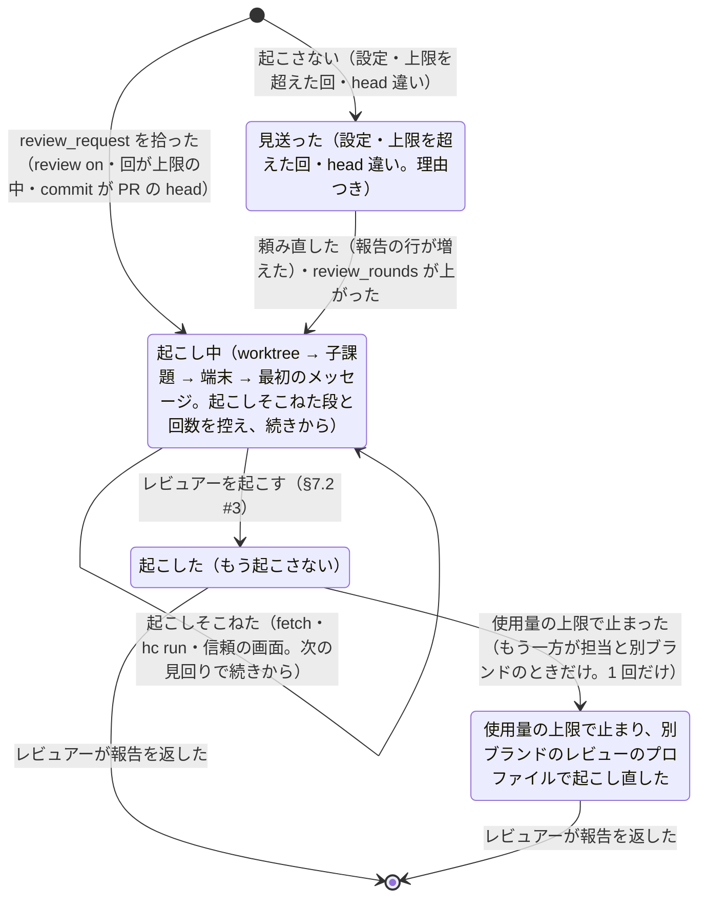

# レビュアーの起動

> このファイルは `andon process render` が [`process/states/reviewer.yaml`](../../process/states/reviewer.yaml) から作ったもの。直すときは YAML を直して作り直す（手で直さない）。

出所: dispatcher.md §5（P6a）・§2.8・decisions/2026-11-09-reviewer-allowance-fallback.md・ADR-0017 決めたこと 4 の (4)。控えの Reviewers の 1 件（課題と commit ごと）が Started・Skipped・Failed・Attempts・OverLimit で状態を持つ

## 図

## 状態

| id | 状態 | 記録 |
|---|---|---|
| `starting` | 起こし中（worktree → 子課題 → 端末 → 最初のメッセージ。起こしそこねた段と回数を控え、続きから） | `dispatcher:Reviewers` |
| `started` | 起こした（もう起こさない） |  |
| `skipped` | 見送った（設定・上限を超えた回・head 違い。理由つき） |  |
| `fallback` | 使用量の上限で止まり、別ブランドのレビューのプロファイルで起こし直した |  |

## 移り方

| から | へ | 何が起きたら | 誰が | コマンド | 2 回起きてはいけない |
|---|---|---|---|---|---|
| （始まり・終わり） | `starting` | review_request を拾った（review on・回が上限の中・commit が PR の head） | 機械 |  |  |
| （始まり・終わり） | `skipped` | 起こさない（設定・上限を超えた回・head 違い） | 機械 |  |  |
| `skipped` | `starting` | 頼み直した（報告の行が増えた）・review_rounds が上がった | 機械 |  |  |
| `starting` | `starting` | 起こしそこねた（fetch・hc run・信頼の画面。次の見回りで続きから） | 機械 |  |  |
| `starting` | `started` | レビュアーを起こす（§7.2 #3） | 機械 | `hc run` | はい |
| `started` | `fallback` | 使用量の上限で止まった（もう一方が担当と別ブランドのときだけ。1 回だけ） | 機械 | `hc run` |  |
| `started` | （始まり・終わり） | レビュアーが報告を返した | 台帳の CLI | `kanban review` |  |
| `fallback` | （始まり・終わり） | レビュアーが報告を返した | 台帳の CLI | `kanban review` |  |
