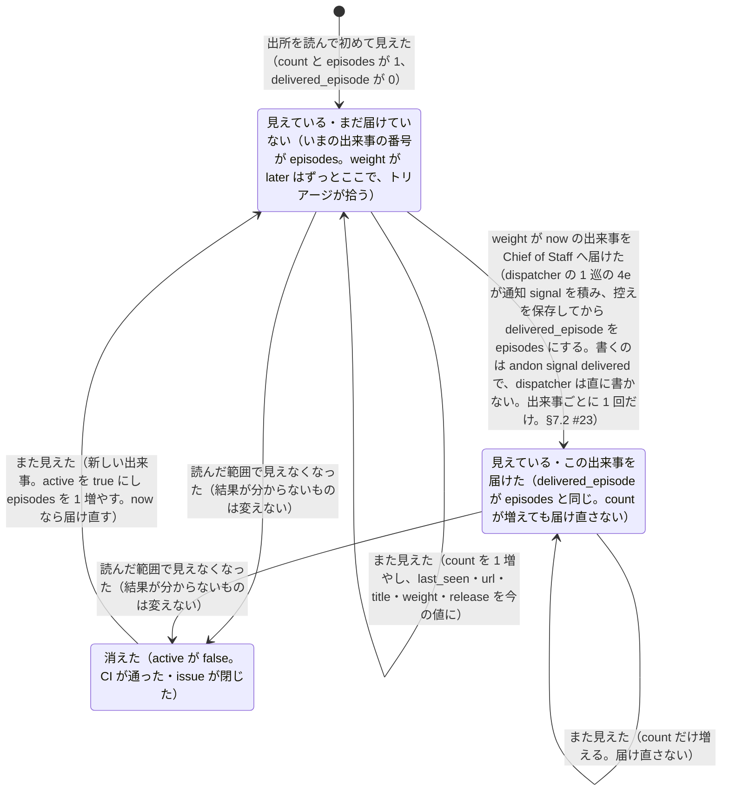

# 外のお知らせ（信号）

> このファイルは `andon process render` が [`process/states/signal.yaml`](../../process/states/signal.yaml) から作ったもの。直すときは YAML を直して作り直す（手で直さない）。

出所: ADR-0011 決めたこと 8・16・contract.md §15・ADR-0017 決めたこと 4 の (8)・5 の (c)。記録は <slug>.signals.json の 1 件（フィンガープリントごと）。状態は active・episodes・delivered_episode の 3 つで、残りは出所のデータと位置

## 図

## 状態

| id | 状態 | 記録 |
|---|---|---|
| `active` | 見えている・まだ届けていない（いまの出来事の番号が episodes。weight が later はずっとここで、トリアージが拾う） | `signals:Active`・`signals:Episodes` |
| `delivered` | 見えている・この出来事を届けた（delivered_episode が episodes と同じ。count が増えても届け直さない） | `signals:DeliveredEpisode` |
| `gone` | 消えた（active が false。CI が通った・issue が閉じた） |  |

状態でない項目（拾う位置とデータ）: `signals:Source`・`signals:Project`・`signals:Key`・`signals:URL`・`signals:Title`・`signals:Weight`・`signals:Fingerprint`・`signals:FirstSeen`・`signals:LastSeen`・`signals:Count`・`signals:Release`

## 移り方

| から | へ | 何が起きたら | 誰が | コマンド | 2 回起きてはいけない |
|---|---|---|---|---|---|
| （始まり・終わり） | `active` | 出所を読んで初めて見えた（count と episodes が 1、delivered_episode が 0） | 機械 | `andon signal collect --due` |  |
| `active` | `active` | また見えた（count を 1 増やし、last_seen・url・title・weight・release を今の値に） | 機械 | `andon signal collect --due` |  |
| `active` | `delivered` | weight が now の出来事を Chief of Staff へ届けた（dispatcher の 1 巡の 4e が通知 signal を積み、控えを保存してから delivered_episode を episodes にする。書くのは andon signal delivered で、dispatcher は直に書かない。出来事ごとに 1 回だけ。§7.2 #23） | 機械 | `andon signal delivered <fingerprint> <episode>` | はい |
| `delivered` | `delivered` | また見えた（count だけ増える。届け直さない） | 機械 | `andon signal collect --due` |  |
| `active` | `gone` | 読んだ範囲で見えなくなった（結果が分からないものは変えない） | 機械 | `andon signal collect --due` |  |
| `delivered` | `gone` | 読んだ範囲で見えなくなった（結果が分からないものは変えない） | 機械 | `andon signal collect --due` |  |
| `gone` | `active` | また見えた（新しい出来事。active を true にし episodes を 1 増やす。now なら届け直す） | 機械 | `andon signal collect --due` |  |
