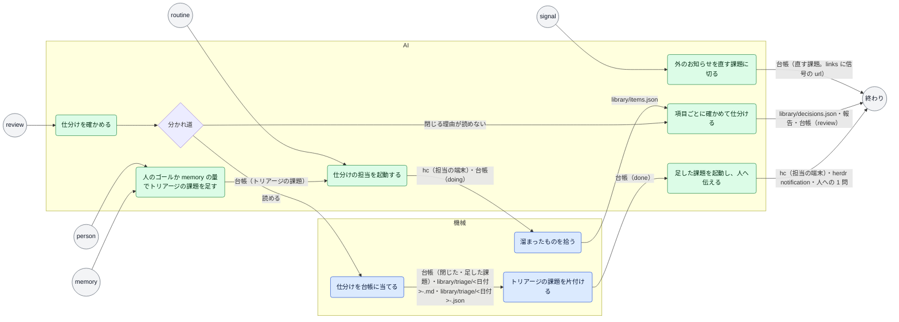

# 仕分け（Triage）

> このファイルは `andon process render` が [`process/workstreams/triage.yaml`](../../process/workstreams/triage.yaml) から作ったもの。直すときは YAML を直して作り直す（手で直さない）。

目的: 台帳に溜まったものと外のお知らせを仕分けて、課題に切る・閉じる・人へ回すを決める

## きっかけ

| きっかけ | 種類 | 中身 | 最初の手順 |
|---|---|---|---|
| routine | 通知 | 通知 `ready` | `start` |
| person | 人の依頼 |  | `add` |
| signal | 通知 | 通知 `signal` | `signal` |
| memory | 通知 | 通知 `memory` | `add` |
| review | 通知 | 通知 `review` | `check` |

## 流れ

## 手順

| id | 手順 | やる者 | 入るもの | 出るもの | 次 |
|---|---|---|---|---|---|
| `signal` | 外のお知らせを直す課題に切る | AI | `notification.signal` | `台帳（直す課題。links に信号の url）` | 終わり |
| `add` | 人のゴールか memory の量でトリアージの課題を足す | AI | `人の言葉（ゴール）`・`notification.memory`・`台帳（動いているトリアージ）` | `台帳（トリアージの課題）` | `start` |
| `start` | 仕分けの担当を起動する | AI | `notification.ready`・`台帳（並行の上限）` | `hc（担当の端末）`・`台帳（doing）` | `collect` |
| `collect` | 溜まったものを拾う | 機械 | `台帳（報告・見送り・問い・todo・片付けの残り）` | `library/items.json` | `sort` |
| `sort` | 項目ごとに確かめて仕分ける | AI | `library/items.json`・`PR と repo と台帳の実物` | `library/decisions.json`・`報告`・`台帳（review）` | 終わり |
| `check` | 仕分けを確かめる | AI | `notification.review`・`報告`・`library/decisions.json`・`andon triage apply --dry-run の出力` |  | `sort`（閉じる理由が読めない）・`apply`（読める） |
| `apply` | 仕分けを台帳に当てる | 機械 | `library/decisions.json` | `台帳（閉じた・足した課題）`・`library/triage/<日付>-<id>.md`・`library/triage/<日付>-<id>.json` | `finish` |
| `finish` | トリアージの課題を片付ける | 機械 | `台帳（review）` | `台帳（done）` | `follow` |
| `follow` | 足した課題を起動し、人へ伝える | AI | `library/triage/<日付>-<id>.md`・`台帳（人の課題）` | `hc（担当の端末）`・`herdr notification`・`人への 1 問` | 終わり |

## 機械がやる手順

| id | コマンド | 記録 | 2 回起きてはいけない |
|---|---|---|---|
| `collect` | `andon triage collect` | `library/items.json` |  |
| `apply` | `andon triage apply` | `library/triage/<日付>-<id>.json` |  |
| `finish` | `andon issue finish` |  |  |

## AI がやる手順

| id | どうやるか（SKILL の節） | 自分で決めてよいこと | 人に聞くこと |
|---|---|---|---|
| `signal` | `chief-of-staff#1` | 直す課題に切る・依頼書の要点 | レベル C の直しを進めてよいか（line） |
| `add` | `chief-of-staff#10` | 足すか（同時に 1 つ） |  |
| `start` | `chief-of-staff#10`・`chief-of-staff#3` | 人に聞かずに起動する |  |
| `sort` | `triage#3`・`triage#4`・`worker#7` | close・fix・bundle・keep |  |
| `check` | `chief-of-staff#10` | 担当に戻す・適用する |  |
| `follow` | `chief-of-staff#10`・`ask-one-by-one` | fix と bundle の課題を起動する・片付け待ちを finish する | 何を作るか（person に仕分けた項目）（business）・使い勝手の好み（person に仕分けた項目）（users）・外との約束と公開（person に仕分けた項目）（promise）・消す・本番・権限（person に仕分けた項目）（irreversible） |

見るもの（手順の入るものの和）: `notification.signal`・`人の言葉（ゴール）`・`notification.memory`・`台帳（動いているトリアージ）`・`notification.ready`・`台帳（並行の上限）`・`台帳（報告・見送り・問い・todo・片付けの残り）`・`library/items.json`・`PR と repo と台帳の実物`・`notification.review`・`報告`・`library/decisions.json`・`andon triage apply --dry-run の出力`・`台帳（review）`・`library/triage/<日付>-<id>.md`・`台帳（人の課題）`

残すもの（手順の出るものの和）: `台帳（直す課題。links に信号の url）`・`台帳（トリアージの課題）`・`hc（担当の端末）`・`台帳（doing）`・`library/items.json`・`library/decisions.json`・`報告`・`台帳（review）`・`台帳（閉じた・足した課題）`・`library/triage/<日付>-<id>.md`・`library/triage/<日付>-<id>.json`・`台帳（done）`・`herdr notification`・`人への 1 問`

## 数えるもの

`flow.closed`・`flow.wip_end`・`flow.wait.todo`
