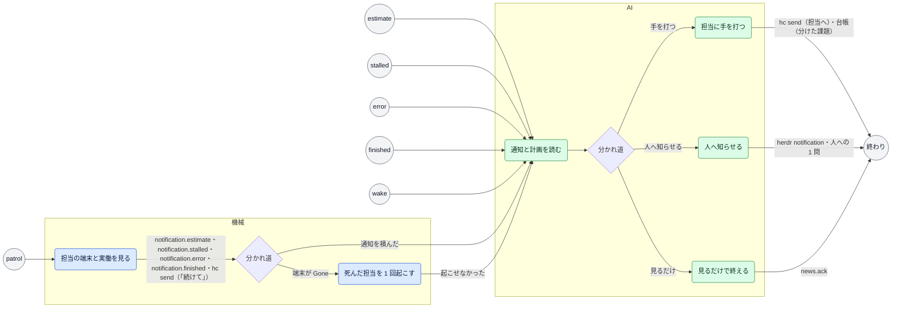

# 見守り（Watch）

> このファイルは `andon process render` が [`process/workstreams/watch.yaml`](../../process/workstreams/watch.yaml) から作ったもの。直すときは YAML を直して作り直す（手で直さない）。

目的: 担当の進みを見て、ズレたときだけ CoS が手を打つ

## きっかけ

| きっかけ | 種類 | 中身 | 最初の手順 |
|---|---|---|---|
| patrol | 間隔 | 1 分ごと | `look` |
| estimate | 通知 | 通知 `estimate` | `read` |
| stalled | 通知 | 通知 `stalled` | `read` |
| error | 通知 | 通知 `error` | `read` |
| finished | 通知 | 通知 `finished` | `read` |
| wake | 出来事 |  | `read` |

## 流れ

## 手順

| id | 手順 | やる者 | 入るもの | 出るもの | 次 |
|---|---|---|---|---|---|
| `look` | 担当の端末と実働を見る | 機械 | `issue.estimate`・`log.status`・`hc.state`・`hc.status_ms` | `notification.estimate`・`notification.stalled`・`notification.error`・`notification.finished`・`hc send（「続けて」）` | `resume`（端末が Gone）・`read`（通知を積んだ） |
| `resume` | 死んだ担当を 1 回起こす | 機械 | `hc.state`・`issue.session` | `hc（起こした端末）`・`notification.resumed`・`notification.finished` | `read`（起こせなかった） |
| `read` | 通知と計画を読む | AI | `notification.estimate`・`notification.stalled`・`notification.error`・`notification.finished`・`report.plan`・`hc.state`・`hc read の画面` |  | `act`（手を打つ）・`tell`（人へ知らせる）・`done`（見るだけ） |
| `act` | 担当に手を打つ | AI | `report.plan`・`hc read の画面` | `hc send（担当へ）`・`台帳（分けた課題）` | 終わり |
| `tell` | 人へ知らせる | AI | `hc read の画面` | `herdr notification`・`人への 1 問` | 終わり |
| `done` | 見るだけで終える | AI | `<news>` | `news.ack` | 終わり |

## 機械がやる手順

| id | コマンド | 記録 | 2 回起きてはいけない |
|---|---|---|---|
| `look` | `andon dispatcher` | `dispatcher/<slug>.json` |  |
| `resume` | `andon issue resume` | `dispatcher/<slug>.json` | はい |

## AI がやる手順

| id | どうやるか（SKILL の節） | 自分で決めてよいこと | 人に聞くこと |
|---|---|---|---|
| `read` | `chief-of-staff#5` | 途中報告を書かせる・分ける・起こし直す・延長する・続きを 1 回促す |  |
| `act` | `chief-of-staff#5` | 送る文・分けた課題の範囲 |  |
| `tell` | `chief-of-staff#5`・`ask-one-by-one` | 知らせる文 | 死んだまま起きない担当を新しいセッションで起こし直すか（andon issue resume --fresh）（business） |
| `done` | `chief-of-staff#5` | 何もしない |  |

見るもの（手順の入るものの和）: `issue.estimate`・`log.status`・`hc.state`・`hc.status_ms`・`issue.session`・`notification.estimate`・`notification.stalled`・`notification.error`・`notification.finished`・`report.plan`・`hc read の画面`・`<news>`

残すもの（手順の出るものの和）: `notification.estimate`・`notification.stalled`・`notification.error`・`notification.finished`・`hc send（「続けて」）`・`hc（起こした端末）`・`notification.resumed`・`hc send（担当へ）`・`台帳（分けた課題）`・`herdr notification`・`人への 1 問`・`news.ack`

## 数えるもの

`flow.wait.todo`・`flow.wait.queued`・`flow.wait.doing`・`flow.wait.review`
