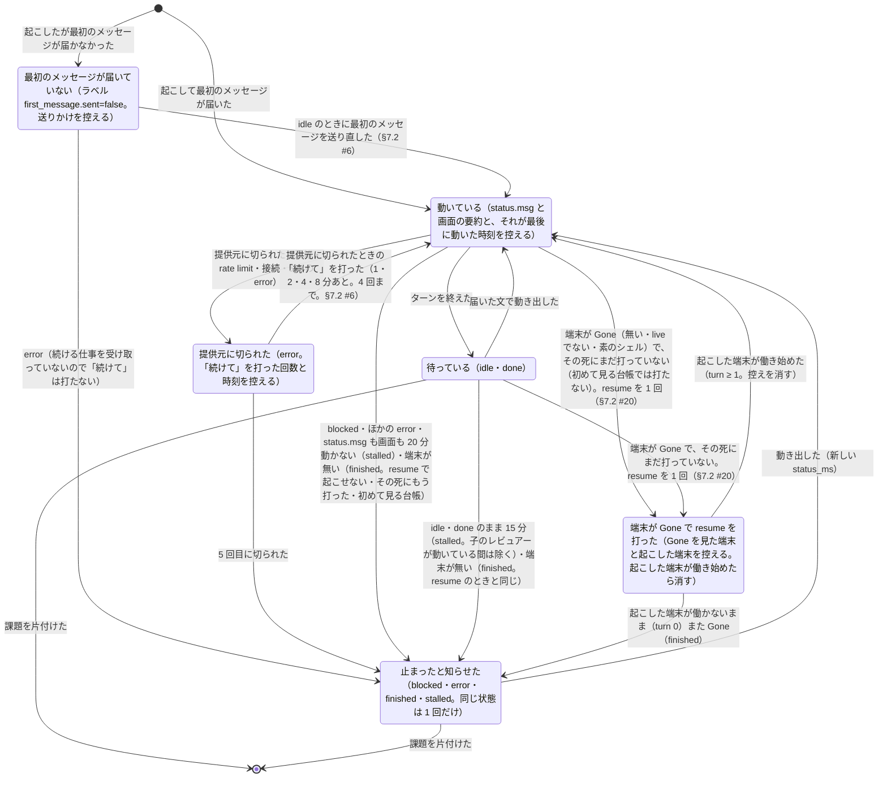

# 担当の端末

> このファイルは `andon process render` が [`process/states/worker.yaml`](../../process/states/worker.yaml) から作ったもの。直すときは YAML を直して作り直す（手で直さない）。

出所: dispatcher.md §2.3・§2.4・§2.9（止まった担当の自動 resume）・§5（最初のメッセージの送り直し）・ADR-0017 決めたこと 4 の (2)・5・ADR-0012 決めたこと 4。hc の状態（idle・working・blocked・error・done・無い）の上に dispatcher が置く判定。担当・レビュアーの端末（Chief of Staff には「続けて」を打たない。dispatcher.md §2.4）

## 図

## 状態

| id | 状態 | 記録 |
|---|---|---|
| `first-pending` | 最初のメッセージが届いていない（ラベル first_message.sent=false。送りかけを控える） | `dispatcher:First` |
| `working` | 動いている（status.msg と画面の要約と、それが最後に動いた時刻を控える） | `dispatcher:Moved` |
| `idle` | 待っている（idle・done） |  |
| `cut` | 提供元に切られた（error。「続けて」を打った回数と時刻を控える） | `dispatcher:Retry` |
| `stopped` | 止まったと知らせた（blocked・error・finished・stalled。同じ状態は 1 回だけ） | `dispatcher:Sent` |
| `resumed` | 端末が Gone で resume を打った（Gone を見た端末と起こした端末を控える。起こした端末が働き始めたら消す） | `dispatcher:Resumed` |

## 移り方

| から | へ | 何が起きたら | 誰が | コマンド | 2 回起きてはいけない |
|---|---|---|---|---|---|
| （始まり・終わり） | `working` | 起こして最初のメッセージが届いた | AI | `andon issue start` |  |
| （始まり・終わり） | `first-pending` | 起こしたが最初のメッセージが届かなかった | AI | `andon issue start` |  |
| `first-pending` | `working` | idle のときに最初のメッセージを送り直した（§7.2 #6） | 機械 |  | はい |
| `first-pending` | `stopped` | error（続ける仕事を受け取っていないので「続けて」は打たない） | 機械 |  |  |
| `working` | `idle` | ターンを終えた | AI |  |  |
| `idle` | `working` | 届いた文で動き出した | AI |  |  |
| `working` | `cut` | 提供元に切られた（混雑・rate limit・接続・5xx の error） | 機械 |  |  |
| `cut` | `working` | 提供元に切られたときの「続けて」を打った（1・2・4・8 分あと。4 回まで。§7.2 #6） | 機械 |  | はい |
| `cut` | `stopped` | 5 回目に切られた | 機械 |  |  |
| `working` | `stopped` | blocked・ほかの error・status.msg も画面も 20 分動かない（stalled）・端末が無い（finished。resume で起こせない・その死にもう打った・初めて見る台帳） | 機械 |  |  |
| `idle` | `stopped` | idle・done のまま 15 分（stalled。子のレビュアーが動いている間は除く）・端末が無い（finished。resume のときと同じ） | 機械 |  |  |
| `stopped` | `working` | 動き出した（新しい status_ms） | AI |  |  |
| `working` | `resumed` | 端末が Gone（無い・live でない・素のシェル）で、その死にまだ打っていない（初めて見る台帳では打たない）。resume を 1 回（§7.2 #20） | 機械 | `andon issue resume` | はい |
| `idle` | `resumed` | 端末が Gone で、その死にまだ打っていない。resume を 1 回（§7.2 #20） | 機械 | `andon issue resume` | はい |
| `resumed` | `working` | 起こした端末が働き始めた（turn ≥ 1。控えを消す） | AI |  |  |
| `resumed` | `stopped` | 起こした端末が働かないまま（turn 0）また Gone（finished） | 機械 |  |  |
| `idle` | （始まり・終わり） | 課題を片付けた | 機械 | `andon issue finish` |  |
| `stopped` | （始まり・終わり） | 課題を片付けた | 機械 | `andon issue finish` |  |
