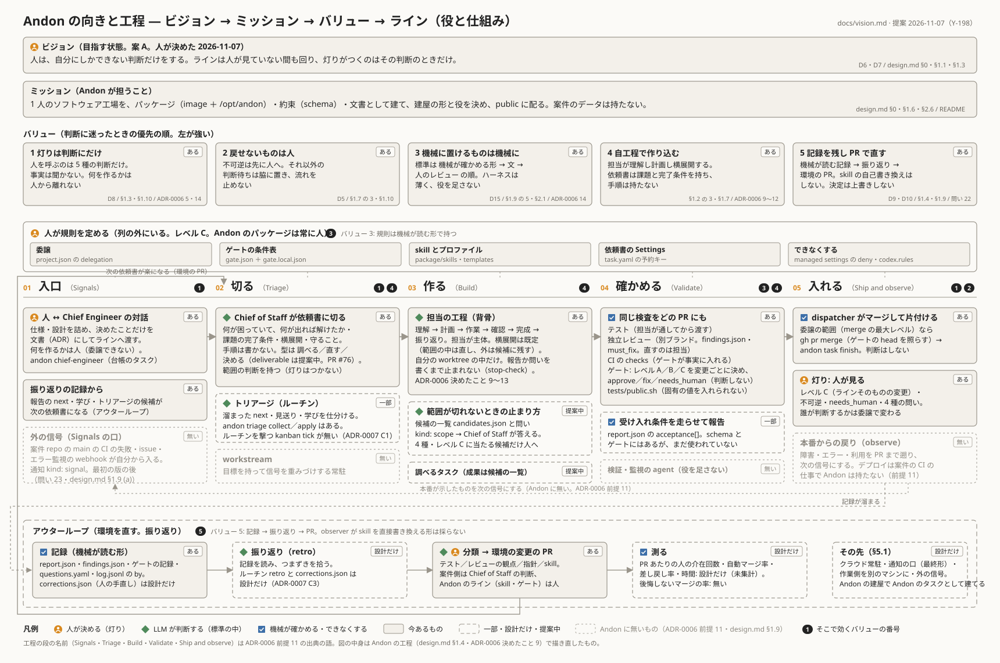
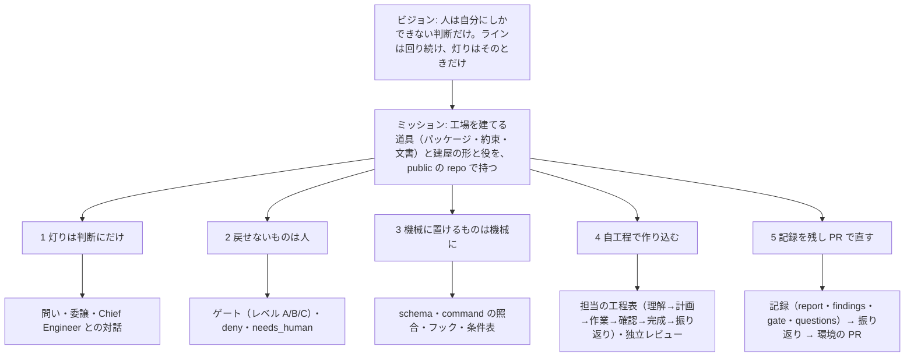

# Andon のビジョン・ミッション・バリュー（向きの1枚）

- 状態: **決定（2026-11-07。人。タスク Y-198 で提案、Y-214 で語を揃えた）**。§6 の 5 問は人が答えた（2026-11-07。1 案 A／2 脚注で添える／3 この順で一旦試す／4 PR あたりの人の介在回数／5 灯りの数え方はトヨタのアンドンの言い方〈呼び出し・定位置停止〉に当てる。§1・§3・§4・§6 に写した）。バリューの順は試しに置いたもの。使ってみて見直す。決定の記録は [decisions.md](decisions.md) §22。
- この文書は**決定を変えない**。既存の決定（[design.md](design.md)・[decisions.md](decisions.md)・[adr/](adr/)）を「何に仕えているか」の順に並べ直し、それぞれに出典を付ける。既存の決定と食い違う所は書き換えず、§6 の「開いている問い」にする。
- 読み手: Andon の repo だけを読む人。語は design.md §0.1（台帳のカードは「タスク」のまま。「課題」への改めは [ADR-0008](adr/0008-issue-naming.md) が提案中）。
- なぜ: ADR が 0001〜0008 と増え、工程の背骨（[ADR-0006](adr/0006-survey-fix-decide.md) 決めたこと 9〜16）も決まった。個々の決定が何に仕えているかを1枚で言えないと、次の判断（[ADR-0007](adr/0007-interim-gap-inventory.md) の塞ぐ順・外の信号の題・public にするときの README）がばらつく。人（2026-11-07）: 「ミッションはもう定まっているが、ビジョンが練り直される段階」。だから重みはビジョン（§1）で、ミッション（§2）は既存の文書から写して確かめる。
- 入力（正）: andon main `d608f5e`（README・design.md・decisions.md・ADR 0001〜0006）、提案中の ADR-0007（PR #72）・ADR-0008（PR #75）、ADR-0006 前提 9〜11 とその出典（§7）。

## 0. 一枚で

図の読み方: 上から **ビジョン → ミッション → バリュー → 工程（ライン）→ 役と仕組み** の順。バリューの帯から点線で、そのバリューが効く工程を指す。工程の列は [ADR-0006](adr/0006-survey-fix-decide.md) 前提 11 の software factory の段（Signals → Triage → Build → Validate → Ship and observe）に Andon の工程を当てたもので、**実線は今あるもの、破線は設計だけか一部、灰色は Andon に無いもの**。図の正は [assets/vision.svg](assets/vision.svg)（手で描いた SVG。フォントは使っていない）。

3行で言うと:

| 層 | 1行 | 遡れる決定 |
|---|---|---|
| **ビジョン**（目指す状態） | 人は、自分にしかできない判断[^judge]だけをする。ラインは人が見ていない間も回り、灯りがつくのはその判断のときだけ（決定 2026-11-07。§1 の案 A） | [decisions.md](decisions.md) §2 D6・D7、design.md §0・§1.1・§1.2 |
| **ミッション**（Andon が担うこと） | 1人のソフトウェア工場を、パッケージ・約束・文書として建てて public に配る。案件のデータは持たない | design.md §0・§1.6・§2.6、README |
| **バリュー**（迷ったときの優先の順） | 1 灯りは判断にだけ ＞ 2 戻せないものは人、戻せるものは止めない ＞ 3 機械に置けるものは機械に ＞ 4 自工程で作り込む ＞ 5 記録を残し、PR で直す | §3 の表 |

## 1. ビジョン（目指す状態）

**今の正**（既存の決定にある「像」の文）:

| 文 | 出典 |
|---|---|
| 目指す像: 判断だけする人、と、建屋が増える・散らばる | [decisions.md](decisions.md) §2 D6（2026-11-04） |
| 選択的 Dark Factory: 止められるものは機械、判断が要るものは LLM、残りだけ人。KPI は人の介在率で、「見なくていい」範囲を広げ続ける | decisions.md §2 D7、design.md §1.2 |
| ラインは回り続け（AND ON）、人を呼ぶときだけ灯りがつく（アンドン） | design.md §0・§1.1 |
| 人は判断だけする。実装・レビュー・ゲート・片付け・通知の仕分けは人の仕事ではない。建屋は手元にもクラウドにもある | design.md §1.5 |
| 製品ではなく、製品を作るものを作る（像は同じ。取り入れる） | design.md §1.9 の 1（Warp） |
| 1人の開発者が、端末で複数の coding agent を回しながら、離席中も働かせ、マージと不可逆な操作の制御は手放さない | README「Who it is for」 |

どれも同じ向きだが、1文になっていない。**練り直しの案**（言葉の案を並べ、推しを1つ。人（2026-11-07）の答え: **案 A**。§6 の問い 1）:

| 案 | 文 | 既存の決定との対応 | 合う所 | 合わない所 |
|---|---|---|---|---|
| **A（決定。人 2026-11-07）** | **人は、自分にしかできない判断[^judge]だけをする。ラインは人が見ていない間も回り、灯りがつくのはその判断のときだけ。** | D6（判断だけする人）＋ §1.1（回り続ける・灯り）＋ §1.3（5種） | 名前（Andon ＝ 灯り ＋ And ON）がそのまま文になる。「自分にしかできない」が ask-one-by-one skill §1 の線（人にしかできないか・灯りがつく判断か）と同じ | 「判断」の語が D7 の「判断が要るものは LLM」と衝突する（§6 問い2）。「増える・散らばる」（D6 の後半）が入らない |
| B | 一人で、いくつもの案件の工場を持ち、人が見なくてよい範囲を広げ続ける。 | D6 の後半（建屋が増える・散らばる）＋ D7 の KPI（人の介在率） | 測れる（§5.1 の指標）。public の読み手に「one-person」がそのまま届く | 「何のために」が無く、手段（範囲を広げる）が目的に見える。灯りの像が消える |
| C | 製品ではなく、製品を作る工場を作る。工場は版管理されたコードで、人は工場の設計者になる。 | §1.9 の 1・6（Warp。取り入れる） | Andon を建てる人の立ち位置（生産技術。§1.7）を言う | Warp の言葉で、Andon の固有の像（灯り・1人）が無い。「作ること」が目的になり、人の介在率の方向が出ない |
| D | 後悔しないマージだけが積み上がる、灯りの少ない工場。 | ADR-0006 前提 11（後悔しないマージの率）＋ §1.9 の 4（paddo.dev の警告: 弱いゲートで速くすると「速くバグを出す工場」） | 品質の向きが出る。指標が1つに決まる | 「後悔しないマージの率」は Andon に無いもの（前提 11。本番からの戻りが無いと測れない）。決まっていない指標をビジョンに置くことになる |

**A を推した理由**: Andon の名前の由来（§1.1）と、灯りがつく条件（§1.3）と、人を呼ぶ線（ask-one-by-one）が、既に同じ1つの像を指している。文はそれを写すだけでよく、新しい決定を要らない。B の「範囲を広げ続ける」は A の**測り方**（§5.1 の指標）、C は A を実現する人の**立ち位置**、D は A の先の**品質の向き**として、それぞれ本文（§1.2・§1.7・§5.1）に既にある。

A を3つの特徴に分けると（それぞれ遡れる）:

| # | 特徴 | 意味 | 遡れる決定 |
|---|---|---|---|
| 1 | **人は判断だけ** | 事実は機械と LLM が集め、人に事実を聞かない。灯りがつく判断は5種（事業・利用者・約束・不可逆・ラインそのものの変更）だけで、「誰が判断するか」は案件ごとの委譲で変わる。トヨタのアンドンの言い方では呼び出し（問い）と定位置停止（不可逆・レベル C）の2つ（§3） | D6・D8、design.md §1.3・§1.10、ADR-0006 前提 4・決めたこと 14 |
| 2 | **人が見ていない間も回る** | 止まる理由が灯りだけ。離席中も、夜も、クラウドでも、同じ建屋の repo と同じパッケージで回る | design.md §1.1・§1.5、D3・D4、dispatcher.md |
| 3 | **見なくてよい範囲を広げ続ける** | KPI は人の介在率。標準（判断の入力・処理・出力）を機械の段へ下ろすほど、人のレビューは薄くなる。一次の指標は PR あたりの人の介在回数。自動マージ率とゲートの差し戻し率は並べて見る（人の答え 2026-11-07。§6 問い 4） | D7、design.md §1.2・§1.9 の 4・§5.1、ADR-0006 決めたこと 14 |

[^judge]: ビジョンの「判断」は、人にしかできない判断（情報が無い中で決めるもの）を指す。ビジョンの文は人が決めた言葉なので「判断」のまま残した。[ADR-0006](adr/0006-survey-fix-decide.md) 決めたこと 14 の語では決断に当たる（決断＝情報が無い中で決める。人か委譲の中の Chief of Staff。判断＝情報があれば理屈で出るもの。LLM と担当の標準）。design.md・README・skill の本文はこの語に揃えた（Y-214。人の答え 2026-11-07）。D6・D7・ADR・decisions.md の過去の行の「判断」は当時の言葉のまま。台帳の題の末尾「（人の判断待ち）」は triage が読む文字列なので変えていない（仕組みの変更になるため。候補）。

## 2. ミッション（Andon が担うこと）

人（2026-11-07）: 「ミッションはもう定まっている」。既存の文書から写して確かめた。食い違いは無い（言い方の違いだけ。§5）。

| Andon が担うこと | 中身 | 出典 |
|---|---|---|
| **工場を建てる道具を、1つの repo で持つ** | パッケージ（base image と `/opt/andon`: command・skill・プロファイル・フック・ゲートの条件表）・約束（`schema/`。機械が読む形）・文書（人用と AI 用） | design.md §0・§1.6・§2.2、README「What it is」 |
| **案件ごとに建屋を立てる形を決める** | 建屋＝信頼境界ごとに1つの長寿命のコンテナと設定だけの repo。`FROM` でパッケージを指し、更新は版上げの PR 1本 | design.md §0・§2.3、ADR-0005 |
| **ラインを回す役と工程を決める** | Chief Engineer（人と仕様・設計）・Chief of Staff（切る・起こす・検収・振り返り）・担当・レビュアー・dispatcher・ゲート。工程の背骨は 理解→計画→作業→確認→完成→振り返り | design.md §1.4・§1.8、ADR-0006 決めたこと 9 |
| **public に配る** | 道具は public、工場の現場（台帳・通知・問い）は private。最初の commit から public に耐える形で建てる | design.md §1.9 の 8・§2.6、decisions.md §1 問い16・§17 |

**持たないもの**（ミッションの外。同じく既存の決定）: 案件のデータ（design.md §0）・ホストされた記憶や指標の基盤（§1.9 の 5。data plane はファイル）・外からの issue や PR を受ける入口（§1.9 の 8。1人の工場）・製造業のアンドン製品との関係（§1.1、README）。

## 3. バリュー（判断に迷ったときの優先の順）

「判断に迷ったとき」＝ 2つの既存の原則が同時に当たり、どちらを先に立てるか決めないと動けないとき。順は上が強い。順は試しに置いたもの（人の答え 2026-11-07: 順番化は難しいが、一旦この順でやってみる）。使ってみて見直す。**どれも既存の決定を言い直したもので、新しい原則は足していない。**

| 順 | バリュー | 迷ったときの読み方（例） | 遡れる決定 | 機械に置いた形（あれば） |
|---|---|---|---|---|
| 1 | **灯りは判断にだけ。** 人を呼ぶのは5種の判断（事業・利用者・約束・不可逆・ラインそのものの変更）だけで、事実は聞かない。その中で「誰が判断するか」は委譲で変わるが、「何を作るか」だけは人から離れない | 推奨案があり後から戻せる問いでも、4種に当たれば人へ（ask-one-by-one skill §1）。範囲の判断は4種のどれでもないので Chief of Staff が持ち、灯りはつかない（ADR-0006 決めたこと 5） | D8、design.md §1.3・§1.10、ADR-0006 決めたこと 4・5・14、ask-one-by-one skill | 問いの `kind`（5種＋`scope`）、委譲 `project.json`、`stop-check`（報告か問いが無ければ止まれない） |
| 2 | **戻せないものは人が見る。戻せるものは流れを止めない。** 不可逆（消す・本番・push 先・権限・秘密）は先に人へ。それ以外の判断待ちは脇に置き、ラインは回り続ける | マージは委譲の範囲なら dispatcher が打つが、`delete-remote` と履歴の書き換えは型でも任せられない（§1.10）。判断が要る問いは決まるまで決めず、ほかの枝を進める（§1.7 の「決定を遅らせる」） | D5、design.md §1.2 の 1・§1.7 の 3・§1.10、decisions.md §1 問い26 | ゲートの `needs_human`、委譲の `irreversible`、managed settings の deny（`gh pr merge`・人のファイル）、`tests/public.sh` |
| 3 | **止める仕組みは機械に置く。文に置くのは機械に置けないものだけ。** 判断の標準は 機械が確かめる形 → 文（skill・雛形） → 人のレビュー の順。ハーネスは薄く、新しい役を足さない | 文に書いた標準が守られないとき、文を増やす前に command や schema に下ろせないかを見る（ADR-0006 決めたこと 14）。検証や監視に新しい役（agent）を足さず、記録と入口の形だけ持つ（§1.9） | D15、design.md §1.9 の 5・§2.1・§4、contract.md §0、ADR-0006 前提 6・決めたこと 14 | `schema/`（正は機械用）、`andon task` の照合（`ready`・`candidates`）、ゲートの条件表、フック |
| 4 | **自工程で品質を作り込む。担当が理解し、計画し、横展開する。** 検査で見つけるのではなく工程で作り込む。依頼書は課題と完了条件を持ち、手順は持たない。担当は作業に分け、終了条件を置き、同じ種類をほかにも探す | 依頼書の「やること」に手順を書いていたら、担当の計画を Chief of Staff が代わりにしている印（ADR-0006 決めたこと 12）。範囲の既定の中は担当が直し、外は候補に残し、範囲を決めないと作業が切れないときだけ止まる（決めたこと 10・11） | design.md §1.2 の 3・§1.7（自工程完結・横展）、ADR-0006 決めたこと 9〜12 | `candidates.json`・問いの `kind: scope`・`deliverable`（提案。PR #76）、独立レビューの `findings.json` と `must_fix` |
| 5 | **記録を残し、環境は PR で直す。決定は上書きしない。** 機械が読む形で記録を残し、振り返りがそれを読んで環境（テスト・観点・指針・skill）を PR にする。skill の自己書き換えはしない。決定は日付つきで下に足す | observer が skill を直接書き換える形は採らない（§1.9 の 5）。案件側の改善は Chief of Staff の判断、Andon 自身のラインは人（D10）。覆した決定は古い行に「→ 覆された」と書いて残す（decisions.md 冒頭） | D9・D10、design.md §1.4・§1.9 の 5・(b)、decisions.md §1 問い22、ADR-0007 決めたこと 4 | `report.json`・`findings.json`・ゲートの記録・`questions.yaml`・`corrections.json`（設計だけ） |

**灯りの言い方**（トヨタのアンドンに当てる。人の答え 2026-11-07「アンドン〈トヨタの〉に合わせていい」。§6 問い 5）:

トヨタのアンドンは、公開の説明の範囲（§7）ではこう分かれる。作業者が紐を引くと灯りがつき、責任者が来る（**呼び出し**）。周期の中で解ければラインは止まらず、解けなければ周期の終わりの決まった位置で止まる（**定位置停止**）。設備は異常を自分で検知して止まり、灯りで人を呼ぶ（**自働化**）。表示盤は稼働の状態（緑＝正常・赤＝異常。計画と実績）も映す（**表示盤**）。引く理由は設備・品質・作業の遅れ・部品切れ・安全で、「何を作るか」はアンドンの外にある。

Andon の今の灯り（design.md §1.3 の5種＝問いになる4種＋レベル C）をそれに当てた言い方は1つ:

> **Andon の灯りは、呼び出しと定位置停止の2つ。** 問い（事業・利用者・約束）は**呼び出し**で、担当が紐を引いて灯りがつき、責任者（委譲の中なら Chief of Staff、外なら人）が来る。ラインは止まらず、その課題だけが答えを待つ。不可逆な操作とラインそのものの変更（レベル C）は**定位置停止**で、決まった位置（不可逆な操作の直前と、ラインを変える PR のゲート）で止まり、人が解いてから動く。テスト・独立レビュー・公開の検査・deny は**自働化**で、灯りをつけずに担当へ戻し、周期の中で直らなかったものだけが呼び出しになる。台帳とボードは**表示盤**。

| トヨタの言い方 | Andon の今の灯り（design.md §1.3） | 機械に置いた形 |
|---|---|---|
| 呼び出し（紐を引く → 灯り → 責任者が来る。ラインは止まらない） | 問い `kind: business` / `users` / `promise`（§1.3 の 1〜3） | `questions.yaml`・ask-one-by-one skill・委譲 `project.json`（誰が来るか） |
| 定位置停止（周期の終わりの決まった位置で止まる） | 問い `kind: irreversible`（§1.3 の 4。操作の直前）・ゲートのレベル C（§1.3 の 5。ラインを変える PR のマージ） | ゲートの条件表・`needs_human`・`delete-remote` を人に残す委譲 |
| 自働化（設備が異常を検知して止まる） | 灯りではない。テスト・独立レビューの `must_fix`・`tests/public.sh`・deny は担当へ戻る | CI の checks・findings.json・managed settings |
| 表示盤（稼働の状態・計画と実績） | 台帳の状態（`deck list`・ボード）。計画と実績（率）は設計だけ | 台帳・§4 の「測る」 |

トヨタに無い灯り（何を作るか・ラインの変更）と Andon に無い灯り（自動停止で人が来る・率の表示）は §5 の 12〜15。この言い方はこの文書だけで、skill と design.md の語（「4種」「5種」）は ADR-0008 のあとの語の統一のタスクで改める。

**順の理由**（上が勝つ場面があること）:

- 1 ＞ 2: 戻せる判断でも、4種（利用者の好みなど）に当たれば人へ（ask-one-by-one skill §1「2つの問いが先」）。「戻せるから進める」は 4種の外でだけ効く。
- 2 ＞ 3: 不可逆な操作は、機械が判定できても人が見る（`delete-remote` は型でも足せない。`hobby` が全部任せるのは人が「戻せないことを承知の上」で決めたから）。
- 3 ＞ 4: 担当の工程（理解・計画・横展開）は文（skill）に置いた標準で、繰り返し同じ判断が出たら機械の段へ下ろす候補（ADR-0006 決めたこと 14 の「500 行」の例）。文を増やして担当に頼む前に、command で確かめられないかを見る。
- 4 ＞ 5: 記録と振り返りは工程で作り込めなかったものを拾う後工程で、記録があるから工程を省いてよいのではない（§1.2 の 3「テストで見つけるのではなく工程で作り込む」）。

**バリューに入れなかったもの**（既存の原則だが、迷いの優先ではなく守ることの側）: 最初の commit から public に耐える（§2.6。ミッションの「public に配る」の条件）・1ファイル1読み手（§2.1。3 の置き方の規則）・流れを止めない／WIP 制限／全体を見る（§1.2 のリーンの原則 1・2・4。2 と 5 の中に入れた）・命名の方針（§1.7）。

## 4. つながり（ビジョン → ミッション → バリュー → 工程・役・仕組み）

工程の列（図の下段）を software factory の段に当てると（[ADR-0006](adr/0006-survey-fix-decide.md) 前提 11 の対応。**今あるもの／一部・設計だけ／無いもの** を分けて書く）:

| 段（出典の語） | Andon の工程 | 役 | 仕組み（機械に置いた形） | 今あるか |
|---|---|---|---|---|
| 人が規則を定める | 委譲・ゲートの条件表・skill とプロファイル・依頼書の Settings・managed settings | 人（レベル C。Andon のパッケージは常に人） | `project.json`（委譲）・`gate.json`／`gate.local.json`・`package/skills`・`templates`・`settings.json` の deny・`task.yaml` の予約キー | **ある** |
| Signals（入口） | 人と Chief Engineer の対話 → 仕様・設計文書（ADR）。振り返りの記録 | 人・Chief Engineer | `andon chief-engineer`（台帳のタスク）・`report.json` の `next` | **ある**（Chief Engineer の実測は未。ADR-0007 D2） |
| | 外の信号（案件 repo の main の CI の失敗・issue・エラー監視の webhook）が自分から入る口 | dispatcher → Chief of Staff | 通知 `kind: signal`（contract.md §6） | **無い**（最初の版の後。decisions.md §1 問い23、design.md §1.9 (a)） |
| Triage（切る） | Chief of Staff が文書と依頼を依頼書に切る（課題の完了条件・横展開・守ること）。タスクの型は 調べる／直す／決める | Chief of Staff | `kanban add`・`andon task start`・`deliverable`（提案） | **ある**（`deliverable`・候補の一覧は PR #76 で提案中） |
| | トリアージ（溜まった `next`・見送り・学びを仕分ける） | トリアージの担当・Chief of Staff | `andon triage collect`／`apply`・ルーチン `triage.yaml`・`kanban tick` | **一部**（command と skill はある。ルーチンを撃つ `kanban tick` は無い＝ADR-0007 C1。引っ越しの前に塞ぐ） |
| | 目標を持って信号を重みづけする常駐（workstream） | — | — | **無い**（ADR-0006 前提 11。範囲の外） |
| Build（作る） | 担当の工程: 理解 → 計画 → 作業 → 確認 → 完成 → 振り返り。横展開は既定。範囲を決めないと作業が切れないときだけ止まる | 担当（Chief of Staff が範囲を答える） | worktree・`andon task report`／`ask`／`ready`・`stop-check`・`candidates.json`・問いの `kind: scope`（提案） | **ある**（候補と `scope` は PR #76 で提案中） |
| Validate（確かめる） | 同じ検査をどの PR にも: テスト・独立レビュー（別ブランド）・CI の checks・ゲート（レベル A／B／C）。受け入れ条件を走らせて報告 | レビュアー・ゲート（判断しない） | `findings.json`・`must_fix`・`andon gate`（checks を事実に入れる）・`acceptance[]` | **ある**。`acceptance[]` は schema にあるが未使用（ADR-0007 A4） |
| Ship（入れる） | ゲートが通し委譲の範囲ならマージして片付ける。レベル C と不可逆は人（灯り） | dispatcher・人 | `gh pr merge --match-head-commit`・`andon task finish`・ゲートの記録 | **ある** |
| and observe（見る） | 本番が示したものを次の信号にする（障害を PR まで遡る） | — | — | **無い**（ADR-0006 前提 11。デプロイは案件の CI の仕事で Andon は持たない） |
| アウターループ | 記録（報告・指摘・ゲートの記録・問い・人の手直し）→ 振り返り → 分類（テスト／観点／指針／skill）→ 環境の変更の PR | 振り返りのルーチン・Chief of Staff（案件側）・人（Andon のライン） | `report.json`・`findings.json`・`gate/<sha>.json`・`questions.yaml`・`corrections.json`・ルーチン `retro` | **一部**（記録はある。`corrections.json` と `retro` は設計だけ＝ADR-0007 C3） |
| 測る | PR あたりの人の介在回数（一次。人の答え 2026-11-07）。自動マージ率・ゲートの差し戻し率は並べて見る。依頼書からマージまでの時間 | 振り返り | `log.jsonl` の `by`・`report.json`・ゲートの記録から数える | **設計だけ**（最初の1回も未集計。ADR-0007 E6） |
| | 後悔しないマージの率 | — | — | **測らない**（人の答え 2026-11-07: 後悔は測りにくい。本番からの戻りも無い） |
| その先 | クラウド常駐・通知の口（最終形）・作業側を別のマシンに | — | `machine`・通知の JSON | **設計だけ**（design.md §5.1「その先」、ADR-0007 E5） |

## 5. 横展開: 同じ向きを別の言葉で書いている所（食い違いと重複）

探した範囲: README（英語の要約と日本語）・design.md §0・§1.1〜§1.5・§1.9・§2.6・§5.1・§6・decisions.md §1・§2・§17・ADR 0001〜0008 の状態行と前提・`package/skills/*/SKILL.md` の前置き（7本）・`docs/assets/logo/README.md`・social preview の1行。手は `grep -n` で「判断だけ」「灯り」「Dark Factory」「介在」「one-person」「software factory」「回り続け」を引き、当たった段を読んだ。

**直すのは人が決めたあと**（別のタスクの候補。この文書では直さない）。

| # | 所 | 言い方 | 種類 | 食い違いか重複か |
|---|---|---|---|---|
| 1 | README 冒頭（英語・日本語）・repo の description（decisions.md §17）・social preview | 「一人で使うソフトウェア工場。エージェントが台帳のタスクを実装・レビュー・マージまで流し、人は自分にしかできない判断のときだけ呼ばれる」 | ビジョン＋ミッションの1文 | **重複**（同じ向き）。ビジョン A と同じ文になっている。人が A と決めれば、README はこのまま vision.md を指すだけでよい |
| 2 | design.md §0「一言で」・README 日本語「選択的 Dark Factory」・decisions.md D7 | 「止められるものは機械、**判断が要るものは LLM**、残りだけ人」 | ビジョン（像） | **食い違い（語）**: D6「**判断だけする人**」と並べると「判断」が LLM と人の両方を指す。ADR-0006 決めたこと 14 は 判断（情報があれば理屈で出る。LLM と担当の標準）と 決断（情報が無い中で決める。人か委譲の中の Chief of Staff）に分けた。D6・D7 は当時の言葉のまま。→ §6 問い2（答え: この文書は脚注で添え、語の統一は別タスク） |
| 3 | design.md §1.3（判断は5種）・README 英語（five kinds）／ask-one-by-one skill §1（「灯りがつく判断の**4種**」）・ADR-0006 前提 4（「4種・レベル C」）・chief-of-staff skill | 5種／4種＋レベル C | バリュー 1 | **重複（言い方が2通り）**: 5種のうち 2〜4 が問い、1 が Chief Engineer、5 がゲートのレベル C。skill は「問いになる4種」と「レベル C」を分けて数える。意味は同じだが、初めて読む人は数が違って見える。→ §6 問い5 |
| 4 | design.md §1.2（KPI は人の介在率）・§1.9 の 4／§5.1（自動マージ率・PR あたりの人の介在回数・時間・差し戻し率）・ADR-0006 前提 11（後悔しないマージの率）・README「Who it is for」 | 指標の名前が 3 系統 | ビジョンの特徴 3 | **重複（正が未定）**: どれが一次の指標か決まっておらず、最初の1回も未集計（ADR-0007 E6）。→ §6 問い4（答え: 一次は PR あたりの人の介在回数。3 系統の名前を揃えるのは別タスク） |
| 5 | design.md 冒頭（人の決定 2026-11-04「Andon は工場そのもの（構造）の名前」）／README 英語「Andon … **is** the package, the contracts and the documents」・glossary（Andon ＝ 工場そのもの。部品の名前には使わない） | Andon ＝ 工場 ／ Andon ＝ パッケージと約束と文書 | ミッション | **重複（ニュアンス）**: design.md §1.6 が「Andon が持つのはパッケージ・約束・文書と建屋の形。hc と App は外部の部品」と解いている。README の英語は「repo の中身」を言い、design.md は「構造」を言う。食い違いではないが、英語の段だけ読むと Andon ＝ repo に見える |
| 6 | design.md §1.1（「夜も回る（クラウド常駐）」）・§1.5（手元とクラウド）／§5.1（クラウド常駐は「その先」）・ADR-0007 E5 | 回り続ける像 ／ 今は手元だけ | ビジョンの特徴 2 | **重複（像と今の差）**: 食い違いではなく、ビジョンと現状の差。図では破線にした |
| 7 | worker skill 前置き（「方針は自工程完結（built-in quality）」）・design.md §1.2 の 3・§1.7 | 品質を作り込む | バリュー 4 | **重複**（同じ向き。語も揃っている） |
| 8 | chief-of-staff skill 前置き（「ラインを回す。自分では実装しない。人と仕様・設計の対話もしない」）・design.md §1.8 | 役の線 | ミッション（役） | **重複**（同じ向き） |
| 9 | ADR-0006 前提 11（@poteto「software factory は要らない。良い工学と token の投じ方」）・design.md §1.1（工場の像を使う理由）・README（software factory） | 工場の語を使うか | ビジョン（語） | **食い違い（出典どうし）**: ADR-0006 は「語の是非は取らない。方針の向きは同じ」と書いて留めた。Andon は工場の像を名前に持つので、ビジョンの文に「工場」を入れるかは A〜D で違う（A は入れていない。B・C・D は入れている） |
| 10 | design.md §1.9 の表 3（Warp は段に人を置く／Andon は変更ごとにゲートがレベルを決める）・§1.10（委譲）・ADR-0006 決めたこと 5（範囲の判断は Chief of Staff） | 人の接点をどこに置くか | バリュー 1・2 | **重複**（同じ向き。「固定の接点より、灯りがつく条件で持つ」） |
| 11 | glossary skill（「ここにある語だけを使う」）・design.md §1.7 命名の方針 4（日本語の文では一般の語）・ADR-0008（タスク → 課題） | 語の規律 | 守ること | **重複**（向きの文ではない。ADR-0008 がマージされると、この文書の「タスク」も「課題」に改める対象になる） |
| 12 | design.md §1.3 の 1（事業判断を灯りに数える）／トヨタのアンドン（§7） | 「何を作るか」の灯り | バリュー 1 | **食い違い（トヨタに無い灯り）**: トヨタのアンドンは工程の異常（設備・品質・遅れ・部品切れ・安全）で引く。「何を作るか」はアンドンの外（生産計画の側）。Andon は §1.3 の 1 を灯りに数え、口は入口の Chief Engineer。§3 では問い `kind: business` を呼び出しに当て、「何を作るか」そのものは入口として灯りと分けた。語を直すのは語の統一のタスク |
| 13 | design.md §1.3 の 5（レベル C）／トヨタ | ラインそのものの変更 | バリュー 1・3 | **食い違い（トヨタに無い灯り）**: トヨタでは標準作業やラインの変更は改善の手順で、アンドンの灯りではない。Andon はラインを変える PR をゲートで止めて人がマージする。§3 では定位置停止（ゲートが決まった位置）に当てた |
| 14 | トヨタの自働化（設備が止まると灯りがつき責任者が来る）／Andon のゲート・テスト（担当へ戻す） | 自動で止まったとき誰が来るか | バリュー 3 | **食い違い（Andon に無い灯り）**: トヨタは設備の自動停止でも灯りがつき人が来る。Andon は `must_fix`・テストの失敗を担当（LLM）へ戻し、灯りはつかない（D7）。周期の中で直らないときに呼び出しへ切り替える線（何回で人へ）は決まっていない → 候補（語ではなく仕組み。範囲の外） |
| 15 | トヨタの表示盤（計画と実績・稼働の状態）・部品切れ・安全の呼び出し／Andon の台帳・再試行・deny | 灯りにしないもの | バリュー 3 | **Andon に無い灯り**: 計画と実績（率）の表示は設計だけ（§4 の「測る」・ADR-0006 前提 11）。部品切れ（provider に切られる）は dispatcher の再試行で、安全（秘密・消す操作）は deny で、どちらも灯りにしない。トヨタではどちらも紐を引く理由 |

## 6. 開いている問い（人に聞く。1問ずつ。推奨案つき）

1. **ビジョンの文は案 A でよいか**（判断の種類: 事業〈Andon の向き〉）。**答え（2026-11-07。人）: 案 A でよい**。§0・§1 に写した。推奨案: **A**「人は、自分にしかできない判断だけをする。ラインは人が見ていない間も回り、灯りがつくのはその判断のときだけ」。B の測り方・C の立ち位置・D の品質の向きは、A の特徴 1〜3 と §5.1 の指標として本文に残す（§1）。代案: B（測れる文を正にする）・A と B を2文で並べる。決まったら README の冒頭はこの文を写し（§5 の 1）、design.md §0 はそのまま。
2. **ビジョンと決定の記録で「判断」と「決断」の語をどう使うか**（判断の種類: ライン〈文書と skill の語〉）。**答え（2026-11-07。人）: 推奨案のとおり**。§1 の脚注に写した。語の統一は ADR-0008 のあと別のタスク（§5 の 2）。推奨案: **ビジョン（この文書）では「人にしかできない判断」と書き、脚注で「ADR-0006 決めたこと 14 の語では決断に当たる」と添える。D6・D7・design.md §0 は当時の言葉のまま残し、語の統一（skill と design.md の本文で 判断／決断 を分けるか）は ADR-0008 のマージのあとに語の改めのタスクとして切る**。代案: 今すぐ D6 を「決断だけする人」と読み替える行を decisions.md に足す（決定を変えないこの文書の範囲を越えるので、人の go が要る）。
3. **バリューの順（1 灯り ＞ 2 不可逆 ＞ 3 機械 ＞ 4 自工程 ＞ 5 記録）でよいか**（判断の種類: ライン）。**答え（2026-11-07。人）: この順で一旦やってみる**（「順番化が難しい」とも。順は試しに置いたもので、使ってみて見直す。§3 と状態行に添えた）。推奨案: **この順**（理由は §3）。代案: 3 を 2 の上に（「機械が確かめられるなら不可逆でも通す」。`hobby` の型はそれに近いが、`delete-remote` を人に残した決定と合わない）／4 を 1 の直下に（担当が主体を強く出す。ただし担当は決断しないので 1・2 の下が自然）。
4. **一次の指標を何にするか**（判断の種類: 事業〈何を良しとするか〉）。**答え（2026-11-07。人）: 推奨案のとおり**。一次は PR あたりの人の介在回数、自動マージ率・差し戻し率は並べて見る。後悔しないマージの率は測らない（「後悔は測りにくい」）。§1 の特徴 3 と §4 の表に写した。推奨案: **PR あたりの人の介在回数**（`log.jsonl` の `by` が人の行の数。D7 の「人の介在率」の Andon 版で、§5.1 の表にある）を一次にし、自動マージ率とゲートの差し戻し率を並べて見る。「後悔しないマージの率」は本番からの戻りが入るまで測らない。最初の1回は P7 の `log.jsonl` から数える（ADR-0007 E6）。代案: 自動マージ率を一次に（Warp の語。速さに寄る。paddo.dev の警告）。
5. **灯りの数え方の言い方を1つにするか**（判断の種類: ライン〈文書の語〉）。**答え（2026-11-07。人）: 「5種」「4種＋レベル C」のどちらかを選ぶのではなく、トヨタのアンドンの言い方に合わせる**。公開の説明（§7）から 呼び出し・定位置停止・自働化・表示盤 を取り、Andon の今の灯りに当てた言い方を §3 に1つ書いた（問いは呼び出し、不可逆とレベル C は定位置停止）。食い違い（トヨタに無い灯り・Andon に無い灯り）は §5 の 12〜15。skill などほかの文書は ADR-0008 のあとの語の統一のタスク。もとの推奨案: **「5種（問いになる4種 ＋ レベル C）」と書く**。design.md §1.3 の表はそのまま、skill の「4種」の所に「（5種のうちレベル C を除く）」の括弧を足すだけ。直すのは別のタスク（§5 の 3）。代案: 全部「5種」に揃える（skill の判定の文〈問いの `kind`〉が 4 で数えているので、かえって読みにくい）。

## 7. 出典（読んだもの）

- Andon の側（main `d608f5e`）: [README.md](../README.md)、[design.md](design.md) 冒頭・§0・§1.1〜§1.10・§2.1・§2.6・§4・§5.1・§6、[decisions.md](decisions.md) §1・§2・§3・§14・§17、[ADR-0001](adr/0001-skills-distribution.md)〜[ADR-0006](adr/0006-survey-fix-decide.md)（とくに 0006 の前提 9〜11・決めたこと 9〜16）、[contract.md](contract.md) §0、[dispatcher.md](dispatcher.md) §1・§7、`package/skills/*/SKILL.md` の前置き、[assets/logo/README.md](assets/logo/README.md)。
- 提案中（マージされていない）: ADR-0007（PR #72。棚卸しの表と塞ぐ順）、ADR-0008（PR #75。タスク → 課題）、PR #76（候補の一覧・`scope`・`deliverable` の schema）。この文書の「今あるか」の列は、これらを「提案中」と印を付けて読んだ。
- ADR-0006 前提 9〜11 の出典（人が示した資料。本文は写していない）: 曽根壮大「仕事を前に進めるためのコツ — 判断と決断と共有 / Aim for the goal」（PHP カンファレンス沖縄 2024。https://speakerdeck.com/soudai/aim-for-the-goal ）。取ったのは 判断と決断の線（§6 問い2）。@poteto の投稿（X、2025 年。「software factory は要らない。良い工学と token の投じ方」と逆三角形の図）。取ったのは 標準の置き場の順（バリュー 3）と、工場の語の扱い（§5 の 9）。同じ投稿への返信の工程の図（Factory の人。Signals → Triage → Build → Validate → Ship and observe。人は規則を定める側。後悔しないマージの率）。取ったのは §4 の表の段の名前と、Andon に無いものの名指し。**その図そのものは他者のもので、この repo には写していない。** §0 の図は Andon の工程で描き直したもの。
- トヨタのアンドン（§3 の「灯りの言い方」。公開の説明だけ。黄色の灯りは一次の出典に無いので使っていない）: トヨタ自動車「トヨタ生産方式」（公式企業サイト。https://global.toyota/jp/company/vision-and-philosophy/production-system/ 。英語版 https://global.toyota/en/company/vision-and-philosophy/production-system/ ）。取ったのは 自働化・紐スイッチで責任者を呼ぶ・設備が止まるとアンドンが点灯・異常のときだけ人が対応。Toyota UK Magazine「Andon – Toyota Production System guide」（2016-05-31。https://mag.toyota.co.uk/andon-toyota-production-system/ ）。取ったのは 紐がチームリーダーを呼ぶ・解けなければラインが止まる・表示盤が工程を示す。Lean Enterprise Institute, Lean Lexicon「Andon」（https://www.lean.org/lexicon-terms/andon/ ）と「Fixed-Position Stop System」（https://www.lean.org/lexicon-terms/fixed-position-stop-system/ ）。取ったのは 表示盤が映すもの（稼働の状態・異常・要る作業・計画と実績）・赤＝異常・緑＝正常・定位置停止（周期の中で解ければ止まらない。解けなければ周期の終わりで止まる）。Wikipedia「Andon (manufacturing)」（https://en.wikipedia.org/wiki/Andon_(manufacturing) ）。取ったのは 1回目の引きは助けの呼び出しでラインは止まらない・手で引く理由（部品切れ・不良・設備・安全）。
- 選択的 Dark Factory の出典（design.md 付録）: freee「freee における規模の実践」。Warp の software factory（design.md §1.9 と付録）。
