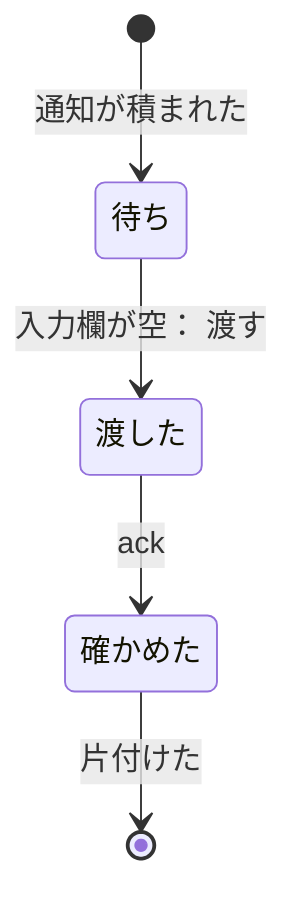

# 見本のもの

> このファイルは `andon process render` が [`process/states/sample-item.yaml`](../../process/states/sample-item.yaml) から作ったもの。直すときは YAML を直して作り直す（手で直さない）。

出所: tests/process.sh の見本（架空）

## 図

## 状態

| id | 状態 | 記録 |
|---|---|---|
| `waiting` | 待ち | `sample:Pending` |
| `handed` | 渡した | `sample:Coord`・`sample:Hook` |
| `done` | 確かめた |  |

状態でない項目（拾う位置とデータ）: `sample:LogPos`

## 移り方

| から | へ | 何が起きたら | 誰が | コマンド | 2 回起きてはいけない |
|---|---|---|---|---|---|
| （始まり・終わり） | `waiting` | 通知が積まれた | 機械 |  |  |
| `waiting` | `handed` | 入力欄が空: 渡す | 機械 | `andon dispatcher` | はい |
| `handed` | `done` | ack | AI |  |  |
| `done` | （始まり・終わり） | 片付けた | 台帳の CLI |  |  |
