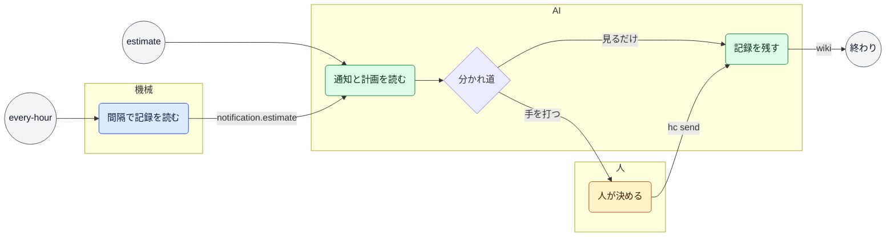

# 見本の見守り（Sample watch）

> このファイルは `andon process render` が [`process/workstreams/sample-watch.yaml`](../../process/workstreams/sample-watch.yaml) から作ったもの。直すときは YAML を直して作り直す（手で直さない）。

目的: 担当の進みを見て、ズレたときだけ手を打つ

## きっかけ

| きっかけ | 種類 | 中身 | 最初の手順 |
|---|---|---|---|
| estimate | 通知 | 通知 `estimate` | `read` |
| every-hour | 間隔 | 60 分ごと | `tick` |

## 流れ

## 手順

| id | 手順 | やる者 | 入るもの | 出るもの | 次 |
|---|---|---|---|---|---|
| `tick` | 間隔で記録を読む | 機械 | `dispatcher.Sent` | `notification.estimate` | `read` |
| `read` | 通知と計画を読む | AI | `notification.estimate`・`report.plan`・`hc.state` |  | `act`（手を打つ）・`done`（見るだけ） |
| `act` | 人が決める | 人 | `人の言葉` | `hc send` | `done` |
| `done` | 記録を残す | AI |  | `wiki` | 終わり |

## 機械がやる手順

| id | コマンド | 記録 | 2 回起きてはいけない |
|---|---|---|---|
| `tick` | `andon issue sample` | `sample.json` | はい |

## AI がやる手順

| id | どうやるか（SKILL の節） | 自分で決めてよいこと | 人に聞くこと |
|---|---|---|---|
| `read` | `chief-of-staff#5` | 途中報告を書かせる・分ける | 期限を延ばすか（business） |
| `done` | `chief-of-staff#5`・`worker#7` |  |  |

見るもの（手順の入るものの和）: `dispatcher.Sent`・`notification.estimate`・`report.plan`・`hc.state`・`人の言葉`

残すもの（手順の出るものの和）: `notification.estimate`・`hc send`・`wiki`

## 数えるもの

`issue.doing_hours`
